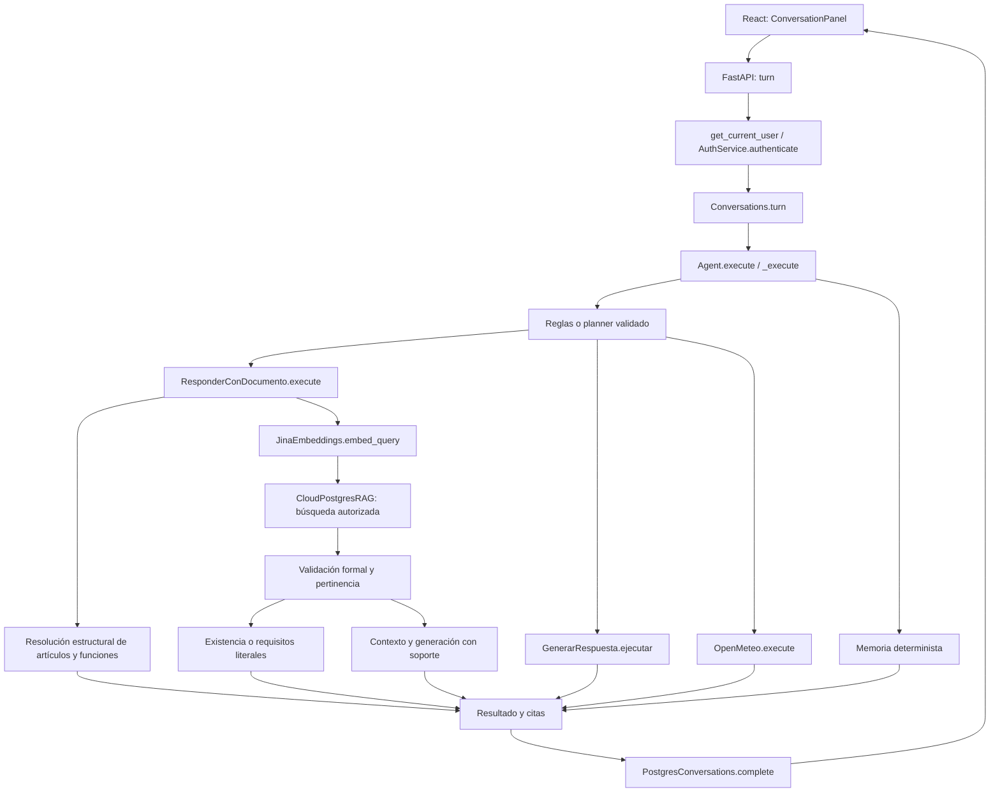

# API Usuarios Clean — usuarios, agente institucional y RAG

Aplicación educativa Full Stack con **Python/FastAPI**, **PostgreSQL/pgvector** y
**React/TypeScript**. Administra perfiles y sesiones, conserva conversaciones
privadas y responde consultas sobre documentos autorizados mediante recuperación
semántica, extracción literal o generación validada.

Guía contrastada con el código del repositorio el **13 de noviembre de 2026**.
Describe los archivos disponibles.

El README proporcionado como antecedente reporta comprobaciones manuales positivas
de Vicerrector y de existencia de Apoyo Pedagógico, artículo 47, PDF 26, F1.
Se conservan como **reporte del operador**, no como E2E ejecutado o verificado
nuevamente aquí. El último informe del repositorio mantiene pendiente la aceptación
funcional. No se declara una suite global sin fallos ni un despliegue público certificado.

## 1. Conceptos para empezar


| Concepto | Qué significa aquí |
|---|---|
| Frontend | React muestra pantallas y envía solicitudes HTTP; no accede a PostgreSQL. |
| Backend | FastAPI valida solicitudes, autentica, autoriza y delega en servicios. |
| Endpoint | Método y ruta de una operación, como `GET /api/v1/auth/me`. |
| Router HTTP | Agrupa endpoints FastAPI. Es distinto de `AgentRouter`, que decide estrategias del agente. |
| Dominio | Entidades y reglas, como `Usuario`, `Email` y `Rol`, independientes de FastAPI. |
| Caso de uso | Coordina una operación, por ejemplo `ListarUsuarios.ejecutar()`. |
| Repositorio | Contrato o implementación para leer y guardar datos. |
| DTO | Objeto que transporta datos entre capas; no necesariamente representa una tabla. |
| Esquema Pydantic | Define y valida datos, especialmente JSON de entrada y salida. |
| Modelo ORM | Clase SQLAlchemy que representa una tabla. |
| LLM | Modelo generativo que propone un plan o redacta; no acredita por sí solo una norma. |
| Embedding | Vector para comparar similitud; no es una respuesta ni evidencia suficiente. |
| RAG | Recuperación de evidencia documental para extraer o generar una respuesta verificable. |
| Scope | Identidad del documento, su versión y el espacio de embeddings. |
| ACL | Reglas de lectura documental aplicadas por backend y consultas SQL. |
| Trace | Identificador que relaciona eventos de una ejecución sin registrar su contenido. |

En Python, `async def` define una función asíncrona y `await` permite esperar una
operación sin bloquear por completo el bucle de eventos. No convierte cualquier
acceso SQL en asíncrono: varios repositorios usan `asyncio.to_thread()` para trabajo
síncrono. En React, `useState` conserva estado visible, `useEffect` sincroniza
lecturas y `useRef` conserva referencias sin provocar por sí sola otro render.

## 2. Arquitectura y organización

```text
api-usuarios-clean/
├── backend/
│   ├── src/app/
│   │   ├── domain/                 # Entidades y reglas de usuarios/autenticación
│   │   ├── application/            # Casos de uso, puertos, agente y reglas RAG
│   │   ├── infrastructure/         # PostgreSQL, seguridad, proveedores y configuración
│   │   ├── presentation/           # Routers HTTP y comandos CLI
│   │   ├── bootstrap.py            # Composición de dependencias
│   │   └── main.py                 # Punto ASGI: app = create_app()
│   ├── migrations/versions/        # Historial Alembic y DDL documental
│   ├── tests/
│   ├── pyproject.toml
│   └── alembic.ini
├── frontend/
│   ├── src/{app,router,api,features,shared,test}/
│   ├── package.json
│   ├── vite.config.ts
│   └── vite.development.config.ts
├── docs/                          # Informes técnicos e históricos
├── infra/                         # Herramientas operativas; no forman parte del chat
└── compose*.yaml                   # Entornos PostgreSQL separados
```



El diagrama muestra alternativas: no todos los turnos llaman a todos los servicios.
El formulario sin historial utiliza otros endpoints y omite la persistencia
conversacional de este recorrido.

## 3. React: componentes y clientes reales

Las rutas de esta sección son relativas a `frontend/src/`.

| Archivo y componente | Responsabilidad |
|---|---|
| `main.tsx`: `createRoot(...).render()` | Monta `App` dentro de `StrictMode`. |
| `app/App.tsx`: `App` | Combina `AppProviders`, `BrowserRouter` y `AppRoutes`. |
| `app/providers.tsx`: `AppProviders` | Instala tema Material UI, `CssBaseline` y `AuthProvider`. |
| `router/routes.tsx`: `AppRoutes` | Declara páginas; carga varias mediante `lazy` y `Suspense`. |
| `router/ProtectedRoute.tsx`, `AdminRoute.tsx`, `PasswordRoute.tsx` | Separan acceso normal, administración y cambio obligatorio de contraseña. La autoridad sigue siendo el backend. |
| `shared/layout/AppShell.tsx`: `AppShell` | Estructura y navegación común de pantallas autenticadas. |
| `features/auth/pages/LoginPage.tsx`, `features/auth/components/LoginForm.tsx` | Pantalla y formulario; `submit()` invoca `useAuth().login()`. |
| `features/auth/pages/ChangePasswordPage.tsx` | Cambio obligatorio o voluntario y tratamiento de errores. |
| `features/auth/model/AuthProvider.tsx`: `AuthProvider` | Token en referencia de memoria; `login`, `refreshProfile`, `get`, `mutate` y gestión de cierre/expiración. |
| `features/auth/model/authState.ts`, `authContext.ts` | Reducer de estados de sesión y contrato de `useAuth`. |
| `features/dashboard/pages/DashboardPage.tsx` | Pantalla inicial autenticada. |
| `features/perfil/pages/MiPerfilPage.tsx` | Perfil propio y actualización mediante `refreshProfile()`. |
| `features/usuarios/pages/UsuariosPage.tsx` | Listado con filtros y paginación. |
| `features/usuarios/pages/UsuarioDetailPage.tsx` | Consulta individual y acciones disponibles. |
| `features/usuarios/pages/UsuarioCreatePage.tsx`, `features/usuarios/pages/UsuarioEditPage.tsx` | Alta y edición administrativa. |
| `features/usuarios/components/UsuariosTable.tsx`, `UsuarioForm.tsx`, `UsuarioActions.tsx` | Tabla, campos y acciones de perfiles. |
| `features/usuarios/components/AsignarCredencialInicial.tsx` | Asignación inicial explícita; su disponibilidad depende de las guardas del servidor. |
| `features/usuarios/hooks/useConsulta.ts`, `useMutation.ts` | Ciclo de lectura/mutación, carga, cancelación y errores. |
| `features/ia/pages/ConsultaIAPage.tsx`: `ConsultaIAPage` | Alterna entre `ConversationPanel` y `DiagnosticPage`, definido en ese archivo. |
| `features/ia/pages/ConversationPanel.tsx`: `ConversationPanel` | Selección/creación de conversación, historial y envío con `run()`. Usa AUTO sin documento explícito. |

Rutas de pantalla: `/login`, `/cambiar-password`, `/dashboard`, `/mi-perfil`, `/ia`,
`/usuarios`, `/usuarios/nuevo`, `/usuarios/:id` y `/usuarios/:id/editar`.
Las páginas de usuarios están bajo `AdminRoute`. No existe una ruta separada
para el diagnóstico IA: se abre con **«Diagnóstico sin historial»** dentro de `/ia`.

### Clientes HTTP

| Archivo | Funciones y métodos |
|---|---|
| `api/httpClient.ts` | `createHttpClient()` devuelve `request()`: construye `fetch`, añade Bearer cuando corresponde y convierte fallos a `ApiError`. |
| `api/contracts.ts`, `api/errors.ts` | Tipos, comprobaciones de respuestas y errores compartidos. |
| `features/auth/api/authApi.ts` | `createAuthApi()`: `login`, `me`, `logout`, `password`. `AuthProvider` expone esta última operación como `changePassword`. |
| `features/usuarios/api/usuariosApi.ts` | `createUsuariosApi()`: `listar`, `obtener`, `crear`, `editar`, `asignarInicial`, `baja`, `reactivar`. |
| `features/ia/api/iaApi.ts` | `createIAApi()`: `auto`, `rag`, `consultar`; `parseAgentResponse()` valida respuestas del agente. |
| `features/ia/api/conversationsApi.ts` | `createConversationsApi()`: `list`, `create`, `history`, `turn`. |
| `features/ia/model/promptPolicy.ts` | `textMetrics()` y `validatePrompt()`: Unicode y límites de entrada. |

`createHttpClient` solo acepta la base `/api/v1`, usa `credentials: 'omit'` y no
depende de cookies implícitas. El token no se persiste en localStorage: recargar
la aplicación requiere login. El historial sí reside en PostgreSQL y puede
recuperarse tras un nuevo login autorizado.

## 4. FastAPI: composición y endpoints

`backend/src/app/bootstrap.py` contiene `create_app()`. Su `lifespan()` construye
repositorios, autenticación, runtime IA y agente, y libera clientes/engine al cerrar.
Las dependencias quedan en `app.state`. `crear_persistencia_postgresql()` ensambla
engine y repositorio; `crear_autenticacion_postgresql()` construye `AuthService`.
FastAPI no crea tablas ni ejecuta Alembic automáticamente al iniciar.

### Routers registrados por `create_app()`

Las rutas de la tabla incluyen el prefijo completo. Los archivos son relativos a
`backend/src/app/presentation/http/`.

| Archivo | Método y ruta | Función real |
|---|---|---|
| `auth/router.py` | `POST /api/v1/auth/login` | `login` → `AuthService.login` |
| `auth/router.py` | `GET /api/v1/auth/me` | `me` → `AuthService.me` |
| `auth/router.py` | `POST /api/v1/auth/logout` | `logout` → `AuthService.logout` |
| `auth/router.py` | `PUT /api/v1/auth/password` | `change_password` → `AuthService.change_password` |
| `usuarios/router.py` | `POST /api/v1/usuarios` | `crear_usuario` |
| `usuarios/router.py` | `GET /api/v1/usuarios` | `listar_usuarios` |
| `usuarios/router.py` | `GET /api/v1/usuarios/{id}` | `obtener_usuario` |
| `usuarios/router.py` | `PUT /api/v1/usuarios/{id}` | `modificar_usuario` |
| `usuarios/router.py` | `DELETE /api/v1/usuarios/{id}` | `dar_de_baja_usuario`: baja lógica |
| `usuarios/router.py` | `PATCH /api/v1/usuarios/{id}/reactivar` | `reactivar_usuario` |
| `usuarios/router.py` | `POST /api/v1/usuarios/{id}/credencial-inicial` | `asignar_credencial_inicial` |
| `ia/router.py` | `POST /api/v1/ia/consultas` | `consultar`: generación directa, sin agente ni historial |
| `ia/respuestas.py` | `POST /api/v1/ia/respuestas` | `responder`: agente con modo y documento opcional |
| `ia/respuestas.py` | `GET /api/v1/ia/documentos` | `documentos`: catálogo autorizado |
| `ia/respuestas.py` | `POST /api/v1/ia/documentos/{document}/publicacion` | `publicar` → `change_publication` |
| `ia/respuestas.py` | `DELETE /api/v1/ia/documentos/{document}/publicacion` | `revocar_publicacion` → `change_publication` |
| `ia/conversaciones.py` | `POST /api/v1/ia/conversaciones` | `create` |
| `ia/conversaciones.py` | `GET /api/v1/ia/conversaciones` | `conversations` |
| `ia/conversaciones.py` | `GET /api/v1/ia/conversaciones/{conversation}/mensajes` | `messages` |
| `ia/conversaciones.py` | `POST /api/v1/ia/conversaciones/{conversation}/mensajes` | `turn` |

`auth/dependencies.py` implementa `get_token()`, `get_current_user()` y
`get_valid_session()`. `get_current_user()` llama a `AuthService.authenticate()`:
comprueba token, sesión, usuario activo y acceso normal. `/me` y cambio de contraseña
admiten también el contexto restringido de cambio obligatorio pendiente.

`http/dependencies.py` proporciona los `get_*` de usuarios y `AuthorizedCase`.
Su `ejecutar()` delega en `AuthService.manage()` para autorizar la operación.
`http/errors.py` registra handlers y formato de error; `ia/middleware.py`
contiene `IABodyLimitMiddleware`, que acota el cuerpo de solicitudes IA.

El listado acepta `estado=activos|inactivos|todos`, `limite` de 1 a 100
(predeterminado 20) y `desplazamiento` no negativo (predeterminado 0). Filtra antes
de paginar, ordena por fecha de creación y UUID y devuelve una lista sin total.
No implementa búsqueda por texto. El DELETE es baja lógica, no borrado físico;
la reactivación es explícita. La edición conserva rol, identidad y fecha.

## 5. Servicios, casos de uso y repositorios

Rutas relativas a `backend/src/app/`:

| Módulo | Símbolos y responsabilidad |
|---|---|
| `application/auth/service.py` | `AuthService`: login, autenticación, perfil, logout, cambio de contraseña y administración autorizada. `Principal` identifica al actor. |
| `application/auth/policies.py` | `authorize_profile()`: ADMIN administra; USUARIO puede obtener su propio perfil. No autoriza cambios HTTP de rol. |
| `application/auth/provisioning.py` | `require_initial_provisioning_enabled()`: barrera por defecto para aprovisionamiento inicial. |
| `application/usuarios/use_cases/` | `CrearUsuario`, `ListarUsuarios`, `ObtenerUsuario`, `ModificarUsuario`, `DarDeBajaUsuario`, `ReactivarUsuario`; exponen `ejecutar()`. |
| `application/usuarios/ports/user_repository.py` | `UserRepository`: `obtener_por_id`, `obtener_por_email`, `listar`, `agregar`, `actualizar`. |
| `infrastructure/persistence/repositories/sqlalchemy_user_repository.py` | `SQLAlchemyUserRepository`: implementación SQLAlchemy y traducción de conflictos/errores de persistencia. |
| `infrastructure/persistence/repositories/in_memory_user_repository.py` | `InMemoryUserRepository`: composición controlada y pruebas sin PostgreSQL. |
| `infrastructure/security/postgres.py` | `PostgresSecurityUnitOfWork`: transacción de seguridad, usuarios asociados, credenciales, sesiones e intentos. |
| `infrastructure/security/crypto.py`, `limiter.py` | `Argon2Hasher`, `JWTService` y `LoginLimiter`: hashing, tokens y control de intentos. |
| `application/ia/use_cases/generar_respuesta.py` | `GenerarRespuesta.ejecutar()`: generación directa con autorización, cuotas, límites y validación. |
| `application/agent/agent.py` | `Agent.execute()` y `_execute()`: orquestan una capacidad final por consulta. |
| `application/agent/router.py` | `AgentRouter.intent()`, `decide()`, `explicit_document()`, `institutional_requirements()` e `institutional_functions()`. |
| `application/agent/planning.py` | Propuestas Pydantic y `planning_context()`: plan acotado, no ejecución de código arbitrario. |
| `application/agent/context.py` | `effective_question`, `direct_context`, `conversation_memory_reference`, `resolve_conversation_memory`, `memory_date_history` y seguimiento de artículos. |
| `application/agent/conversations.py` | `Conversations.create/list/history/turn`: autorización, idempotencia y coordinación del turno persistido. |
| `infrastructure/rag/conversations.py` | `PostgresConversations.owned/create/list/history/reserve/complete/fail`: persistencia privada y transaccional. |
| `application/agent/skills/registry.py` | `SkillRegistry.load()` admite solo `academic-rag` y `weather`; `Skill.execute()` delega al servicio RAG. |
| `infrastructure/rag/skills.py` | `PackagedSkillLoader`: carga instrucciones empaquetadas. No concede permisos. |
| `application/agent/tools.py` | `ToolRegistry`, `WeatherArgs`, `weather_arguments()`: capacidades permitidas y argumentos meteorológicos. |
| `infrastructure/rag/weather.py` | `OpenMeteo.execute()`: geocodificación, desambiguación y pronóstico; no inventa coordenadas ante ambigüedad. |

### Módulos RAG y proveedores

| Módulo | Símbolos y responsabilidad |
|---|---|
| `application/rag/use_cases.py` | `PrepararVersion.execute()` prepara páginas; `ResponderConDocumento.execute()` coordina la respuesta documental. Son operaciones distintas. |
| `application/rag/core.py` | `prepare_pages`, `select_evidence`, `build_context`, `render`, `resolve_citations`, `validate_vector`. |
| `application/rag/articles.py` | `resolve_article()` y estructuras de resolución: encabezados, secciones, continuidad y cierre. |
| `application/rag/functions.py` | `functions_target`, `resolve_functions`, `bind_functions`, `literal_functions`: identificación y transcripción íntegra de funciones. |
| `application/rag/continuity.py` | `requested_article`, `complete_article`, `requirement_section`: reconstrucción y delimitación de apartados. |
| `application/rag/extractive.py` | `enumeration_target`, `literal_requirements`: lista completa de requisitos con integridad demostrada. |
| `application/rag/existence.py` | `existence_target`, `declarations`, `literal_existence`: existencia mediante declaración positiva exacta. |
| `application/rag/relevance.py` | `AcademicRelevance`: pertinencia y soporte; similitud no sustituye estas comprobaciones. |
| `application/rag/structured_output.py` | `Claim`, `StructuredGeneration`, `schema`, `parse`, `supported_text`: contrato y soporte de afirmaciones generadas. |
| `infrastructure/rag/postgres.py` | `PostgresRAG`: ACL compartida, catálogo, búsqueda, lectura estructural y continuidad. |
| `infrastructure/rag/cloud_postgres.py` | `CloudPostgresRAG`: espacio cloud, índice validado y publicación institucional por versión. |
| `infrastructure/rag/jina.py` | `JinaEmbeddings.embed_query()` y `embed_document()`: tareas distintas de embedding, sin generación de respuestas. |
| `infrastructure/llm/openrouter.py` | `OpenRouterProvider`, `OpenRouterGroundedProvider`, `OpenRouterPlanner`, `openrouter_runtime`: transporte remoto. |
| `infrastructure/rag/planner.py` | `JSONPlanner.plan()`: contrato reutilizado por `OpenRouterPlanner`. |
| `infrastructure/rag/models.py` | `LocalModelGate`, `CoordinatedDirectProvider`: coordinación de trabajo; **no son modelos ORM**. |
| `infrastructure/rag/text.py` | `ConservativeCounter`: cuenta bytes UTF-8 como presupuesto conservador, no tokens del tokenizer remoto. |

Existen adaptadores Ollama en `infrastructure/llm/ollama.py` y
`infrastructure/rag/ollama.py`. Su presencia no significa fallback automático:
la composición operativa habilitada con engine real exige **OpenRouter + Jina**.

## 6. Entidades, esquemas y tablas: conceptos distintos

`domain/usuarios/usuario.py` define `Usuario`, con `crear()`, `reconstruir()`,
`modificar_datos()`, `dar_de_baja()` y `reactivar()`. `Email` valida/normaliza el
correo; `Rol` contiene ADMIN y USUARIO. `domain/auth/models.py` define las
estructuras de dominio `Credencial` y `Sesion`.

Los modelos ORM están en `infrastructure/persistence/models/`: `Base`,
`UsuarioModel` → `usuarios`, `CredencialModel` → `usuario_credenciales`,
`SesionModel` → `auth_sesiones` e `IntentoModel` → `auth_intentos`.
`infrastructure/persistence/mappers/usuario.py` convierte entre entidad y modelo
mediante `to_domain()` y `to_model()`.

El esquema RAG y conversacional se define en el **DDL de las migraciones**, no
mediante una clase ORM por tabla:

| Revisión | Tablas o cambios significativos |
|---|---|
| `0001` | `usuarios`. |
| `0002` | Credenciales, sesiones e intentos de autenticación. |
| `0003` | Cambio obligatorio de contraseña y huella de la credencial inicial. |
| `0004_rag` | `rag_documentos`, `rag_documento_permisos`, `rag_versiones`, `rag_paginas`, `rag_fragmentos`, `rag_fragmento_paginas`, `rag_espacios_embeddings`, `rag_embeddings`, `rag_ingestas`. |
| `0005_agent_memory` | `agent_conversaciones`, `agent_solicitudes`, `agent_mensajes`. |
| `0006_cloud_embeddings` | `rag_cloud_espacios`, `rag_cloud_embeddings`, `rag_cloud_ingestas`, `rag_cloud_activos`. |
| `0007_institutional_publication` | `rag_publicaciones_institucionales`: versión, actor, publicación y revocación. |

Para la funcionalidad institucional actual no basta el antiguo esquema `0003`.
El código de publicación requiere `0007_institutional_publication`. Esto describe
compatibilidad del código; no afirma que una base recién instalada ya esté migrada.

### Contratos de datos

| Archivo | Clases principales |
|---|---|
| `presentation/http/usuarios/schemas.py` | `CrearUsuarioSolicitud`, `ModificarUsuarioSolicitud`, `CredencialInicialSolicitud`, `OperacionEstadoSolicitud`, `UsuarioRespuesta`. |
| `presentation/http/auth/router.py` | `LoginSolicitud`, `PasswordSolicitud`, `TokenRespuesta`, `PerfilAuthRespuesta`, `CambioPasswordRespuesta`. |
| `presentation/http/ia/schemas.py` | `ConsultaSolicitud`, `ConsultaRespuesta`. |
| `presentation/http/ia/respuestas.py` | `RespuestaSolicitud`, `Respuesta`, `Referencia`, `PublicacionSolicitud`. |
| `presentation/http/ia/conversaciones.py` | `Turn` añade `solicitud_id`; `NewConversation` admite `conversacion_id`. |
| `application/usuarios/dto.py` | `CrearUsuarioDatos`, `ModificarUsuarioDatos`, `ListarUsuariosDatos`, `UsuarioResultado`, `EstadoUsuarios`. |
| `application/ia/dto.py` | `ConsultaDatos`, `GeneracionEntrada`, `GeneracionSalida`, `validate_prompt`, `validate_output`. |
| `application/rag/dto.py` | `Page`, `Section`, `Scope`, `Chunk`, `Candidate`, `Evidence`, `ArticleLink`, `RequirementList`, `GroundedInput`, `RAGResult`. |
| `application/agent/context.py` | `AgentContext`, `Decision`, `AgentResult`, `ConversationContext`. |

`Chunk.ordinal` es metadata interna, no un campo público nuevo del JSON.
La referencia pública es `{id, pagina}`. `SecretStr` evita ciertas representaciones
accidentales de campos sensibles, pero no reemplaza la protección de logs.

## 7. Seguir una ejecución con nombres reales

### Login y consulta de usuarios

1. `LoginForm.submit()` llama a `AuthProvider.login()`.
2. `createAuthApi().login()` usa `createHttpClient().request()` para enviar JSON
   a `/api/v1/auth/login`. FastAPI valida `LoginSolicitud` y llama a `login()`.
3. `AuthService.login()` verifica credencial/actividad y crea sesión/token mediante
   la unidad de trabajo, `Argon2Hasher` y `JWTService`.
4. React conserva el token en memoria y solicita `me()`. Después acepta el contexto
   normal o de cambio obligatorio; no confía en un rol aportado por la UI.
5. Para listar, `createUsuariosApi().listar()` llega a `listar_usuarios()`;
   `get_listar_usuarios()` crea `AuthorizedCase`, cuyo `ejecutar()` llama a
   `AuthService.manage()` → `authorize_profile()` → `ListarUsuarios.ejecutar()`
   → repositorio `listar()` → `UsuarioResultado` → mapper `usuario_respuesta()`.

En el alta, `crear_usuario()` invoca la acción `crear`:
`AuthService.create_with_initial()` coordina `CrearUsuario.ejecutar()` y la
credencial inicial atómicamente. La barrera de aprovisionamiento sigue aplicando,
aunque el endpoint y formulario existan.

### Chat con historial: camino predeterminado de `/ia`

1. `ConversationPanel.run()` valida entrada y crea conversación mediante
   `createConversationsApi().create()` si hace falta. Conserva un UUID estable
   durante un intento incierto de creación.
2. `api.turn()` envía `prompt`, `modo: 'AUTO'` y `solicitud_id` al POST de mensajes.
   No toma el selector documental de `DiagnosticPage` ni manda un historial
   construido por React.
3. FastAPI ejecuta `get_current_user()` y `ia/conversaciones.py:turn()`, que llama
   a `Conversations.turn()` con el principal real.
4. `Conversations.turn()` valida entrada, rechaza formatos reconocibles de secretos
   y llama a `PostgresConversations.reserve()`. Clave y fingerprint controlan
   idempotencia; un replay revalida historial antes de entregarse.
5. `history()` comprueba propiedad y referencias documentales. El agente recibe
   ocho mensajes habituales o hasta cien para memoria explícita. La pregunta
   actual todavía no está insertada como un turno anterior.
6. `Agent.execute()` aplica `effective_question()` y delega a `_execute()`:
   resuelve memoria explícita, calcula intención/selección y utiliza reglas o
   planner según el modo. Un plan validado no concede permisos documentales.
7. La rama elegida llama a `GenerarRespuesta.ejecutar()`, `OpenMeteo.execute()`
   o carga `academic-rag` con `SkillRegistry.load()` y ejecuta el servicio RAG.
8. `Conversations.turn()` valida salida, revalida referencias y llama a
   `PostgresConversations.complete()`: resultado y par usuario/asistente se
   guardan atómicamente. Un fallo llama a `fail()`, sin mensajes parciales.
9. React solicita `api.history()` y representa texto/citas. Cancelar la espera
   del navegador no garantiza cancelar el cálculo del servidor. No hay reenvío
   automático que deba interpretarse como una nueva consulta exitosa.

`history()` lee hasta cien mensajes en orden cronológico. Una respuesta literal
extensa puede conservarse completa en `agent_solicitudes.resultado` y dejar en
`agent_mensajes.contenido` un rótulo explícito; `message_record()` y `restore_record()`
gestionan esa representación sin presentar una truncación como texto completo.

### RAG: de candidatos a evidencia

`ResponderConDocumento.execute()` comprueba acceso normal y
`CloudPostgresRAG.require_active()`. Después hay caminos diferentes:

- **Funciones estructurales:** el repositorio `resolve_functions()` lee páginas
  autorizadas, verifica hashes y usa `functions.resolve_functions()` y
  `bind_functions()`. `literal_functions()` exige identidad, continuidad, cierre,
  offsets y vínculo de integridad. No necesita embedding ni generador.
- **Artículo explícito:** `requested_article()` y el resolver de artículos
  reconstruyen el contexto normativo. Si no cabe completo, se abstiene;
  no recorta un artículo para aparentar cobertura íntegra.
- **Recuperación vectorial:** `JinaEmbeddings.embed_query()` produce el vector;
  `search(..., limit=12)` consulta pgvector con ACL, versión y espacio. Luego
  `select_evidence()` valida todos los candidatos y aplica umbral **0,60**;
  `AcademicRelevance.select()` filtra pertinencia. Si no quedan fuentes y están
  compuestos recovery/relevancia, `recover()` busca hasta 48 con el mismo vector.

Solo para la forma acotada de `existence_target()`, los candidatos recuperados
y formalmente válidos pueden llegar a `literal_existence()` aunque fallen el
umbral. Se examinan lotes ya obtenidos, hasta 12 + 48 entradas contando repeticiones,
sin ampliar búsqueda ni cambiar ranking. Se exige encabezado de artículo,
identidad del órgano, declaración positiva completa y una única declaración
inequívoca. La similitud no basta. Si falla, retorna SIN_EVIDENCIA. Esa vía nunca
alimenta al generador ni a los validadores de claims generales.

En otras preguntas se aplica continuidad mediante `article_context()` cuando
corresponde y se construye contexto con `build_context()`. Los requisitos
enumerables pueden salir por `literal_requirements()`. La generación restante
usa `OpenRouterGroundedProvider.generate_grounded()` y valida estructura,
`source_ids`, soporte de claims mediante `supported_text()` y soporte final.
`resolve_citations()` comprueba citas; se revalidan acceso y scope antes de responder.

No hay una etapa separada de reranking remoto en este flujo. Score, pertinencia,
integridad y soporte final son controles distintos. Tener candidatos no demuestra
evidencia aceptada; una cita tampoco demuestra cobertura integral de una disposición.

### Modos y memoria

`AUTO` puede usar `OpenRouterPlanner.plan()`, pero evita planificar para memoria
explícita y determinados patrones de título, clima, requisitos y funciones
institucionales. Un único documento autorizado no evita por sí solo el planner.
`RAG` exige `documento_id` en `RespuestaSolicitud`; `LLM_DIRECTO` no lo admite.

En `DiagnosticPage.submit()`, AUTO/RAG usan `/ia/respuestas`; la opción directa
usa `/ia/consultas`. El selector pertenece a ese formulario, no al chat.
Esos endpoints no reservan ni completan turnos de conversación. «Sin historial»
no significa sin autenticación, sin cuotas o sin consumo de proveedores.

La memoria explícita se resuelve con `resolve_conversation_memory()`, sin planner
ni uso de respuestas previas como evidencia normativa nueva. Para «temas tratados»
presenta preguntas previas, no una síntesis normativa generada.
`memory_date_history()` usa fechas con zona y America/Buenos_Aires para filtrar
«hoy»; no equivale a una herramienta general que responda «¿qué día es hoy?».

## 8. Seguridad, publicación y límites

- La sesión tiene expiración y revocación persistidas; el login devuelve 900
  segundos. Cambiar contraseña revoca sesiones y requiere nuevo login.
- Ser ADMIN no concede lectura universal de documentos privados ajenos. La ACL
  contempla propiedad, concesión individual o publicación institucional.
- La lectura colectiva exige AUTHENTICATED y publicación vigente de la versión
  exacta, además de usuario activo, documento no archivado, versión LISTA y,
  para cloud, índice activo/VALIDADA. Publicar no publica futuras versiones.
- `set_institutional_publication()` exige propietario ADMIN activo. La lectura
  institucional no concede ingesta, validación, activación ni conversaciones
  ajenas. Revocar no borra información ya recibida por un navegador.
- `document_export.py` separa la autorización de exportación documental. Publicar
  lectura no habilita automáticamente reindexación ni exportación. Las preguntas
  enviadas a Jina y los prompts enviados a OpenRouter sí implican transferencia
  externa en sus rutas respectivas.
- La entrada IA está acotada a 1000 caracteres Unicode/3000 bytes. El contexto
  generativo utiliza presupuesto local conservador 4096, reserva de salida 256
  y plantilla 512, con hasta tres fuentes; no mide el tokenizer remoto.
- La extracción de funciones admite hasta tres páginas/fuentes y salida de
  8192 caracteres/32768 bytes; existencia usa una fuente y 3000/9000. La capacidad
  literal ampliada no amplía contexto ni salida del modelo generativo.

## 9. Configuración e inicio local

Los comandos siguientes son una guía para un entorno preparado; no se ejecutaron
durante la revisión. No incluyen migraciones, publicación ni aprovisionamiento
de cuentas. No iniciar otra instancia sobre un puerto ocupado.

### Archivos significativos

| Archivo | Responsabilidad |
|---|---|
| `backend/pyproject.toml` | Python `>=3.14,<3.15`, dependencias fijadas, configuración pytest y extra `dev`. |
| `frontend/package.json`, `package-lock.json` | Node `>=24.14.1 <25`, npm `>=11 <12`, dependencias y scripts. |
| `backend/src/app/infrastructure/configuration/database.py` | `DatabaseConfig`, `load_database_config()`: `POSTGRES_*`; test usa `TEST_POSTGRES_*` y destino aislado. |
| `.../configuration/auth.py` | `AuthConfig`, `load_auth_config()`: claves JWT, identificador activo y clave independiente de límites. Sin secretos por defecto. |
| `.../configuration/llm.py`, `llm_local.py` | `LLMConfig`, `apply_provider_settings()`, `LocalLLMContext`, `require_local_runtime()`: proveedor, modelo y habilitación local. |
| `.../configuration/embeddings.py` | `EmbeddingConfig`, `load_embedding_config()`: proveedor, modelo, dimensión y espacio derivado de identidad. |
| `.../configuration/local_provisioning.py` | `verified_local_gate()`: opt-in administrativo con destino/socket verificados. |
| `backend/src/app/infrastructure/persistence/database.py` | `build_engine()` y `build_session_factory()`. |
| `backend/alembic.ini`, `backend/migrations/env.py` | Entorno de migración explícito; desarrollo y test no comparten destino implícito. |
| `compose.yaml`, `compose.override.yaml`, `compose.test.yaml` | PostgreSQL 18, override pgvector y servidor de pruebas separado. |
| `frontend/src/app/config.ts` | `API_BASE_URL` y `validateApiBase()`: solo `/api/v1` en el mismo origen. |
| `frontend/vite.config.ts` | Desarrollo aislado: 5173 → backend 8001; configuración Vitest y build. |
| `frontend/vite.development.config.ts` | Variante explícita: conserva `/api` y dirige al backend 8000. |
| `frontend/tsconfig*.json`, `eslint.config.js` | Comprobación TypeScript y reglas de lint. |

Los módulos abreviados `.../configuration/` están bajo
`backend/src/app/infrastructure/`. `.env` es configuración privada local, no una
plantilla para publicar secretos. Las credenciales Jina y OpenRouter se leen
exclusivamente del entorno del proceso como `JINA_API_KEY` y `OPENROUTER_API_KEY`.
No introducir sus valores en README, frontend, comandos versionados o logs.

Los nombres principales de autenticación son `AUTH_JWT_KEYS_JSON`,
`AUTH_JWT_CURRENT_KID`, `AUTH_LIMITER_KEY`, `AUTH_JWT_ISSUER` y `AUTH_JWT_AUDIENCE`.
La base usa `POSTGRES_HOST`, `POSTGRES_PORT`, `POSTGRES_DB`, `POSTGRES_USER` y
`POSTGRES_PASSWORD`. Se mencionan nombres, nunca sus valores privados.
Los loaders de test usan prefijos `TEST_AUTH_` y `TEST_POSTGRES_` y archivos
separados; no toman las credenciales de desarrollo como fallback.

La selección operativa usa `AGENT_LLM_PROVIDER` y `EMBEDDING_PROVIDER`.
`OPENROUTER_MODEL` determina el modelo remoto: no corresponde afirmar que siempre
se ejecuta Dots o Qwen a partir de un log antiguo o texto de UI. El valor
predeterminado actual de `LLMConfig.remote_model` es
`nvidia/nemotron-3.5-super-vl:free`; no demuestra el del servidor en ejecución.
Jina se define como `jina-embeddings-v3`, dimensión 768. Hay valores legacy
por defecto, pero el arranque operativo con IA rechaza combinaciones distintas
de OpenRouter/Jina. Tener una clave no habilita por sí solo la IA local.

### Backend local en 8000

Con dependencias, configuración privada, base `usuarios_dev` en 127.0.0.1:5434
y esquema compatible preparados por su procedimiento operativo:

```powershell
Set-Location 'D:\Downloads\proyectos\api-usuarios-clean\backend'
$env:PYTHONPATH = (Join-Path (Get-Location) 'src')
& '.\.venv\Scripts\python.exe' -B -m app.presentation.cli.local_server `
  --environment local-development --enable-llm --observe-llm `
  --host 127.0.0.1 --port 8000
```

`local_server.main()` verifica destino, reserva socket y ejecuta Uvicorn con un
worker, `reload=False`, sin access log ni proxy headers. El código editado no se
recarga automáticamente. `--enable-initial-provisioning` es una habilitación
administrativa separada y no forma parte del comando. Sin ella, alta con credencial
y asignación inicial permanecen sujetas a la barrera por defecto.

`app.main:app` existe, pero el arranque ASGI genérico no sustituye los controles
del lanzador local para habilitar IA. `create_test_database_app()` es otra fábrica,
exclusiva del entorno de pruebas; no es el comando del RAG operativo en 8000.

### Frontend correspondiente al backend local

Desde `frontend`, con dependencias previamente instaladas:

```powershell
npm.cmd run dev -- --config vite.development.config.ts
```

Abrir `http://127.0.0.1:5173`; el chat requiere login y está en `/ia`.
Swagger está en `http://127.0.0.1:8000/docs`.
**`npm.cmd run dev` sin `--config` apunta a 8001**, no a 8000. La variante aislada
usa base de pruebas en 5435 y se prepara por separado; esta guía no ordena conectarla.
En una instalación nueva, `npm.cmd ci` instala lo fijado en el lockfile y requiere
acceso al registro de paquetes; tampoco se ejecutó durante esta revisión.

## 10. Estados y diagnóstico seguro

`estado` y `estrategia` son campos diferentes:

| Estado | Interpretación |
|---|---|
| `FUNDAMENTADA` | Evidencia documental aceptada; no promete cubrir todo el reglamento. |
| `SIN_EVIDENCIA` | No se verificó evidencia suficiente para lo solicitado. |
| `ACLARACION` | Hace falta precisar intención, documento, autoridad, ubicación u otro dato. |
| `GENERADA` | Ruta directa o reproducción de memoria rotulada; no implica evidencia documental. |
| `HERRAMIENTA` | Resultado de una herramienta, por ejemplo clima. |

Las estrategias son `LLM_DIRECTO`, `RAG` y `TOOL`; no todos los estados aplican a
todas las estrategias. `finalizacion` distingue `completa`, `limite` o null según
el resultado. Un error de proveedor/contrato es técnico HTTP, no una abstención
documental que deba presentarse como éxito.

`Conversations.turn()` establece `execution_trace` y `request_identifier` y emite
`agent_turn ... stage=start/complete`. `agent_finish` registra duración, no todos
los campos del resultado. Nombres históricos como `source=qwen` o ciertos mensajes
de UI permanecen aunque el transporte sea OpenRouter: no identifican por sí solos
el modelo remoto efectivo.

`application/rag/retrieval_diagnostics.py:observe_candidates()` emite metadata
solo con entorno del servicio `local-development` y opt-in exacto:

```powershell
$env:AGENT_RAG_RETRIEVAL_DIAGNOSTICS = 'true'
# Aplicar antes de una futura carga autorizada en esta misma terminal.
```

Registra exclusivamente trace, etapa, ordinal, página, score y resultados de
umbral, scope, integridad formal, selección y llegada al extractor. No registra
texto documental, prompts, respuestas privadas, datos personales o vectores.
`scope_authorization` indica coincidencia con el scope ya autorizado; no es
una nueva auditoría SQL. `integrity` es formal, no un nuevo hash de página.

En existencia bajo umbral, `threshold_passed=false` puede coexistir con llegada
al extractor. `reached_literal_existence=true` no significa aceptación;
`rag_existence mode=extractive sources=1` y resultado/citas permiten comprobarla.
En esa etapa `pertinent` es null, sin inventar una evaluación de pertinencia.
Los eventos iniciales/recovery conservan su significado de selección normal.

Para quitar el opt-in de la terminal antes de un futuro arranque:

```powershell
Remove-Item Env:AGENT_RAG_RETRIEVAL_DIAGNOSTICS -ErrorAction SilentlyContinue
```

Cambiar variables de una terminal no altera un proceso ya iniciado.
`--observe-llm` y `AGENT_RAG_SAFE_DIAGNOSTICS` son mecanismos distintos de este
diagnóstico. La captura privada de cuerpos también es distinta y no debe
habilitarse como consecuencia de seguir esta guía.

## 11. Pruebas, evidencia y límites actuales

Los números proceden de [Sprint 10G12F](docs/sprint-10g12f-correcciones-finales-rag.md).
No se ejecutaron nuevamente para este README y no se suman entre sí:

| Selección reportada | Aprobadas | Fallidas |
|---|---:|---:|
| Focalizadas de cierre 10G12F | 94 | 0 |
| Regresión ampliada de cierre 10G12F | 510 | 3 |

Fallos heredados registrados:

1. `test_agent.py::test_auto_academic_selects_authorized_document_and_applies_real_skill`:
   dos lecturas de catálogo frente a una esperada.
2. `test_agent.py::test_multiple_documents_require_selection_not_random_choice`:
   doble de catálogo sin `titulo`, con `KeyError`.
3. `test_relevance.py::test_academic_evidence_and_real_page`: respuesta ficticia
   del fixture sin soporte suficiente.

Las pruebas focalizadas usan dobles/mocks. Comando documentado para una ejecución
separada desde `backend`:

```powershell
& '.\.venv\Scripts\python.exe' -B -m pytest `
  tests/rag/test_literal_existence_threshold_12f.py `
  tests/rag/test_safe_retrieval_closure_12f.py `
  tests/rag/test_final_corrections_12f.py `
  tests/rag/test_authority_clarification_12e.py `
  -q -p no:cacheprovider --tb=short
```

No ejecutar indiscriminadamente toda la suite contra una base existente: hay
pruebas marcadas `postgres` y configuración de test independiente. Esta revisión
documental no autoriza operaciones en bases de desarrollo, pruebas o producción.

En frontend, `npm.cmd run typecheck`, `lint`, `test` y `build` corresponden a
TypeScript, ESLint, Vitest y compilación. Se describen por `package.json`;
aquí no se ejecutaron ni se les atribuye un resultado nuevo.

Límites que conviene comprender:

- Las reglas estructurales son acotadas. Rectorado no es sinónimo global de
  Rector: se ofrece aclaración documental cuando corresponde.
- El sello del Vicerrector admite U+FFFD o U+00B7 solo en la posición conocida
  de fecha; no normaliza el original ni acepta prosa arbitraria.
- La existencia literal bajo umbral no arregla un candidato ausente del ranking
  ni permite responder sobre órganos parecidos o declaraciones ambiguas.
- La memoria no es una base documental y tiene ventanas/salida limitadas.
- Fechas de memoria y clima no implementan una herramienta general de fecha actual.
- Los presupuestos generativos pueden impedir responder un artículo extenso completo.
- El README antecedente reporta éxitos manuales posteriores; los informes del
  repositorio y esas observaciones tienen procedencia distinta. Esta revisión no
  convierte esos reportes en aprobación global ni resuelve los tres tests fallidos.

## 12. Recorrido de aprendizaje y documentación relacionada

Empezar con `Usuario` y `Email`, seguir `ListarUsuarios.ejecutar()` y observar
cómo el router lo conecta mediante dependencias. Después recorrer `LoginForm`
→ `AuthProvider` → `auth/router.py` → `AuthService`. Por último seguir
`ConversationPanel.run()` → `Conversations.turn()` → `Agent.execute()` →
`ResponderConDocumento.execute()` y distinguir candidato, evidencia, cita y respuesta.

Documentación complementaria, con su alcance y fecha históricos:

- [Backend](backend/README.md) y [frontend](frontend/README.md): guías de sus etapas;
  contrastar instrucciones operativas con la configuración actual descrita aquí.
- [Diagnóstico de cierre RAG](docs/cierre-tecnico-rag-institucional-diagnostico.md).
- [Aclaración de autoridades 10G12E](docs/sprint-10g12e-aclaracion-autoridades.md).
- [Correcciones y observabilidad 10G12F](docs/sprint-10g12f-correcciones-finales-rag.md).
- [Publicación y antecedentes 10G12D](docs/jina-cloud-10g-12d.md).

Una comprobación E2E posterior debe correlacionar sesión propia, turno, trace,
resultado mostrado y páginas. No sustituir esa evidencia por un score, mocks
o el informe de una ejecución anterior.
