# Sprint 9.3A: diseño del RAG académico con PostgreSQL/pgvector

Fecha: **3 de noviembre de 2026**. Inspección de lectura y diseño; propuesta
pendiente de aprobación. **BLOQUEADOS para implementar/desplegar el RAG completo**:
falta pgvector en la imagen, el entorno de pruebas está sin esquema y deben
aprobarse extractor, modelo de embeddings y contrato nuevo. Se puede aprobar
primero el núcleo con dobles, sin tocar infraestructura. Nada se implementó aquí.

## 1. Diagnóstico y arquitectura real

Backend: `domain/usuarios`, `domain/auth`, `application/usuarios`,
`application/auth`, `application/ia`, `infrastructure/persistence`,
`infrastructure/security`, `infrastructure/llm`, `infrastructure/configuration`
y `presentation/http`/`presentation/cli`. `bootstrap.py` compone dependencias;
lifespan administra engine, autorización y runtime IA compartido.
No existen módulos RAG/agente/memoria implementados en esas capas. La palabra
memory en adaptadores de seguridad/repositorios actuales designa dobles de
persistencia, no memoria conversacional. No se presupone otra estructura.

React: `features/ia` contiene API, validación y ConsultaIAPage; usa AuthProvider,
JWT solo en memoria, transporte compartido y ruta protegida /ia. Vite de desarrollo
redirige /api a 127.0.0.1:8000; su configuración aislada conserva 8001.

La integración actual usa POST `/api/v1/ia/consultas`, solo `{prompt}`, y responde
exactamente `{respuesta, finalizacion}`. ADMIN/USUARIO normales pueden consultar;
pendientes no. Revalida acceso antes y después, limita cuotas y emite errores
saneados/no-store. El runtime usa qwen3:1.7b, think=false, contexto 4096, salida
256 tokens, deadline 60 s, stream=false y keep_alive=0. No se cambia ese contrato.

### Ubicación propuesta — archivos futuros, no creados

| Capa | Componentes y responsabilidades |
| --- | --- |
| domain/documentos | Identidad del documento, versión publicable, alcance de lectura y reglas de estado; sin SDK |
| application/rag/ports.py | PDFTextExtractor, EmbeddingProvider, DocumentRepository, RetrievalRepository, TokenBudget, GroundedLLMProvider y ModelWorkGate |
| application/rag/dto.py | Página extraída, fragmento con procedencia, embedding opaco, evidencia y respuesta fundamentada; texto oculto en repr |
| application/rag/use_cases | PrepararVersion, IndexarVersion y ResponderConDocumento, mediante puertos; ninguna dependencia SQLAlchemy/HTTPX/FastAPI |
| application/ia | Fachada de selección de estrategia y coordinación común de autorización/admisión/deadline |
| infrastructure/documents | Extractor PDF local aprobado y validación de rutas/archivos |
| infrastructure/llm | Adaptador embeddings Ollama y generación fundamentada; reutilizar transporte/parser acotados |
| infrastructure/persistence | Modelos y repositorios pgvector con consultas parametrizadas y ACL |
| presentation/cli | Ingesta explícita con permiso, sin ingesta automática al arrancar HTTP |
| presentation/http/ia | Contrato nuevo de estrategia/citas y resolución autenticada de fuentes |
| bootstrap.py | Componer servicios compartidos solo con capacidades habilitadas; sin cargar modelos o migrar al iniciar |
| frontend/features/ia | API nueva, etiqueta de estrategia y referencias autorizadas, sin tokenización/vectorización en navegador |

No se propone LangChain, ChromaDB, framework de agentes o nuevo gestor de estado.
RAG es una estrategia controlada, no un agente autónomo. Herramientas y memoria
se reservan para incrementos separados con política explícita.

```mermaid
flowchart LR
    P[PDF local aprobado] --> E[Extracción por página]
    E --> C[Fragmentos y procedencia]
    C --> B[Embeddings en lotes pequeños]
    B --> V[PostgreSQL + pgvector]
    R[React autenticado] --> A[FastAPI: auth + cuota + estrategia]
    A --> Q[Embedding de consulta]
    Q --> S[Búsqueda con ACL y versión activa]
    V --> S
    S --> G[Contexto acotado o abstención]
    G --> L[Qwen3 sin herramientas]
    L --> F[Validación de citas y autorización final]
    F --> R
```



## 2. PDF realmente inspeccionado

| Propiedad | Resultado |
| --- | --- |
| Ruta | `backend/data/documents/reglamento_academico.pdf` |
| Tamaño | **1.689.870 bytes**, aproximadamente 1,61 MiB |
| Formato | PDF **1.6**, sin marcador de cifrado observado |
| Páginas | **72**, confirmadas al procesar el documento, no solo por regex |
| Texto extraíble | **Sí en las 72 páginas**, todas con caracteres alfabéticos |
| Texto contado en extracción | **138.667 caracteres** en total, excluido espacio exterior por página |
| Rango por página | **304–2408 caracteres**; páginas 48, 49 y 72 especialmente breves |
| SHA-256 del archivo | `1decdfbfd41cc8eea5a9bb097949d0c8ade3aa3e504be23950b4b842875a2c71` |

No estaban disponibles pypdf/PyMuPDF/pdfminer/pdfium en el entorno virtual ni en
Python global, ni pdfinfo/pdftotext/mutool en PATH. Se encontró **Ghostscript ya
instalado con PDF24**. Se usó txtwrite en modo XML con SAFER/batch y salida a
memoria para contar páginas y caracteres; no se emitió texto del reglamento al
chat, no se guardó una copia extraída ni se hizo OCR. Los procesos auxiliares
terminaron normalmente; no se detuvo ningún servicio existente.

**OCR no es necesario para iniciar la ingesta del texto principal.** Esto no
prueba que sellos, imágenes o todas las tablas sean accesibles como texto, ni
que el orden semántico extraído sea perfecto. Revisar muestras de cada sección,
tablas, encabezados y páginas cortas antes de publicar el corpus. No eliminar
automáticamente páginas cortas: podrían contener disposiciones o firmas relevantes.
La numeración física PDF 1–72 está comprobada; numeración impresa/etiquetas e
índice de artículos requieren validación, sin asumir un desplazamiento constante.

Para implementación se propone **pypdf fijado tras evaluar Python 3.14**, como
extractor ligero inicial. Su instalación no está autorizada aquí. Comparar su
extracción con el diagnóstico Ghostscript y definir tratamiento de tablas; no
introducir automáticamente Ghostscript como dependencia productiva por estar
instalado en esta computadora. Revisar licencia/distribución si se eligiera ese binario.

## 3. PostgreSQL y Alembic: estado observado

Se abrieron **dos conexiones separadas solo lectura**, una por destino autorizado.
Antes de cada una se verificó configuración exacta; para pruebas se exigió además
require_test_database. Psycopg: default_transaction_read_only=on, read_only=True,
connect_timeout=5 s, statement_timeout=10 s, lock_timeout=2 s. Se confirmaron
base/usuario efectivos contra configuración y transaction_read_only=on; rollback
y cierre al finalizar. Sin consultas de registros de aplicación, credenciales o
conteos de personas. Solo catálogo e identificación/version_num autorizados.

| Control | usuarios_dev | usuarios_test |
| --- | --- | --- |
| Host/puerto configurados y usados | **127.0.0.1:5434** | **127.0.0.1:5435** |
| PostgreSQL efectivo | **18.6**, Debian 18.6-1.pgdg13+2 | **18.6**, mismo build |
| Usuario efectivo | Coincide con configuración, identificador no reproducido | Coincide con configuración de pruebas |
| Tablas de usuario visibles | public.alembic_version, usuarios, usuario_credenciales, auth_sesiones, auth_intentos | **Ninguna** |
| Revisión Alembic | **0003**, única fila | **Sin tabla/revisión Alembic** |
| pg_available_extensions para vector | **Sin filas** | **Sin filas** |
| pg_extension para vector | **Sin filas** | **Sin filas** |

Head local **0003**; cadena 0001 → 0002 → 0003. No se ejecutó el entorno Alembic
contra las bases. Desarrollo coincide con el head; pruebas está sin esquema,
no en 0003. Es coherente con su almacenamiento efímero tras reinicios, pero no
se atribuye la causa ni pérdida de datos sin evidencia. **No se inicializó ni
alteró usuarios_test**, conforme a la restricción. Las fixtures PostgreSQL
existentes ejecutarían upgrade y limpieza si se activaran: no se corrieron.

### Imagen, volúmenes y pgvector

Compose e inspect: ambos contenedores propios usan **postgres:18**, image ID
`sha256:979bccfde35445db618c65107d27d08c6c21339d8dc3ad4c830c6633947be0e4`,
running/healthy. Desarrollo monta **api-usuarios-clean_postgres_data** en
**/var/lib/postgresql**, publicado en loopback 5434. Pruebas usa tmpfs declarado
en Compose y puerto separado 5435, sin volumen persistente en Mounts.

**No se puede habilitar vector ahora con un simple CREATE EXTENSION**: el servidor
no anuncia los archivos de extensión. Instalar sus binarios y habilitarla en cada
base son operaciones distintas. El proyecto oficial ofrece paquetes e imágenes
compatibles con PostgreSQL 18. [Instalación oficial de pgvector](https://github.com/pgvector/pgvector).

Es viable preparar **sin reconstruir la base lógica** una imagen derivada o
imagen pgvector compatible con el mismo major PostgreSQL 18 y distribución,
conservando el volumen. Pero exige aprobación de infraestructura, verificación
de PGDATA/montaje, arquitectura, locales, permisos, versión exacta y ensayo de
compatibilidad. No se garantiza conservación por cambiar únicamente el tag.
No se propone apt install manual efímero dentro del contenedor activo.

Plan futuro: imagen reproducible fijada por digest y versión pgvector; ensayo
aislado con datos ficticios; decisión explícita sobre respaldo recuperable y
ventana; sustitución coordinada conservando el volumen; recién entonces DDL
aprobado para extensión y tablas. La dispensa de respaldo de una migración previa
no se extiende automáticamente a esta modificación. No hacer down -v, initdb,
drop/recreate o cambiar de major para conseguir vector.

Alembic actual filtra solo cuatro tablas en include_name e importa solo modelos
de usuarios/auth: el incremento futuro debe **incorporar modelos RAG e incluirlos
en esa allowlist/metadata** para que check/autogenerate no ignoren diferencias.
No confiar en un check exitoso con un filtro que omite el módulo nuevo. Proponer
revisión 0004 para extensión/prerrequisitos y otra posterior para RAG, solo tras
revalidar que el head siga siendo 0003; sin editar migraciones históricas.
No eliminar vector en downgrade si otros módulos pudieran usarlo.

## 4. Modelo de embeddings: disponibilidad y decisión

GET de lectura /api/tags y /api/ps: **ningún modelo cargado**. No hubo embed,
generate/chat o descarga. Solo **nomic-embed-text:latest** es un modelo de embeddings
instalado: **274302450 bytes**, 137M, F16, **768 dimensiones**, contexto **2048**
según metadatos locales. Digest
`0a109f422b47e3a30ba2b10eca18548e944e8a23073ee3f3e947efcf3c45e59f`.
Qwen3 y Qwen2.5 son generadores aquí; su embedding_length interno no los convierte
en proveedores de embeddings autorizados para este diseño.

| Opción | Evaluación propuesta |
| --- | --- |
| Nomic existente | Menor coste adicional de descarga, punto de partida experimental pequeño; **no se acredita calidad en español académico**. Evaluar recuperación antes de comprometer el corpus |
| **EmbeddingGemma 300M**, no instalado | Recomendación multilingüe inicial para evaluar español: pequeño frente a modelos grandes y orientado a ejecución local; requiere autorización de descarga/licencia y benchmark de memoria/calidad |

La documentación de Nomic identifica prefijos search_document/search_query;
no aplicar prefijos de otro modelo. [Ficha oficial Nomic](https://huggingface.co/nomic-ai/nomic-embed-text-v1.5).
EmbeddingGemma declara entrenamiento multilingüe y dimensión base 768, contexto
2048; la distribución Ollama de 300M figura alrededor de 622 MB. No equivale a
consumo RAM ni garantiza superioridad en este reglamento.
[Ficha Google](https://huggingface.co/google/embeddinggemma-300m),
[distribución Ollama](https://ollama.com/library/embeddinggemma:300m).

**Decisión pendiente**: aprobar una de las opciones y su evaluación. Sin permitir
descargas, usar Nomic solo como baseline autorizado, no afirmar ya una solución
multilingüe validada. Congelar tag + digest + dimensión + política de prefijos;
no cambiar modelo o mezclar vectores porque ambos tengan 768 componentes.
El cambio de modelo exige nuevo espacio y reindexación, sin sobrescribir el anterior.

El adaptador futuro usaría POST local **/api/embed**, una entrada o lote muy pequeño,
truncate=false para rechazar excesos, keep_alive=0, URL literal/modelo allowlist,
sin proxies/redirecciones, tamaño/deadline acotados y validación de vectores finitos,
dimensión exacta y norma no nula. Esa API y control de truncamiento están documentados;
no se verificaron empíricamente aquí. [API oficial embed](https://docs.ollama.com/api/embed).

## 5. Esquema propuesto, no implementado

Tablas nuevas en **public** con prefijo rag_, separadas de auth. UUID para identidad,
timestamptz UTC, FK explícitas, restricciones e índices btree. No guardar JWT,
contraseñas o nombres/emails como contexto documental.

| Tabla | Campos/restricciones principales |
| --- | --- |
| rag_documentos | id PK, clave lógica única, titulo_publico validado, propietario_id FK usuarios, visibilidad PRIVATE/AUTHENTICATED, activa_version_id nullable, creado_at, archivado_at |
| rag_documento_permisos | documento_id + usuario_id PK/FK, puede_leer, puede_ingestar, concedido_at; índices por usuario/documento |
| rag_versiones | id PK, documento_id FK, numero, sha256, ruta_relativa_controlada, bytes, paginas, fecha_normativa opcional aprobada, extractor_version, pipeline_fingerprint, estado PREPARANDO/LISTA/FALLIDA/RETIRADA, fechas; UNIQUE(documento_id,sha256,pipeline_fingerprint), UNIQUE(documento_id,numero), UNIQUE(documento_id,id) |
| rag_paginas | version_id + pagina_pdf PK, etiqueta_impresa nullable revisada, texto_extraido, hash_texto; CHECK pagina_pdf>=1; no confundir página física con impresa |
| rag_fragmentos | id PK, version_id FK, ordinal, pagina_inicio/fin, offsets, texto, hash_texto, titulo_seccion/articulo opcionales revisados, tokens_estimados/medidos, pipeline_fingerprint; UNIQUE(version_id,ordinal), CHECK rangos positivos |
| rag_fragmento_paginas | fragmento_id + pagina_pdf PK, version_id y offsets exactos por página; FK compuestas para impedir procedencia cruzada entre versiones |
| rag_espacios_embeddings | id PK, modelo_tag/digest, dimension, metrica=coseno, normalizacion, prefijos/tokenizador/versión; huella única de toda la configuración |
| rag_embeddings | fragmento_id + espacio_id PK, embedding **vector(768)** provisional, hash de entrada/preprocesamiento, creado_at; FK y dimensión compatibles con espacio fijado |
| rag_ingestas | id PK, version_id, espacio_id, estado/progreso, lease_until/intento, error_codigo permitido, fechas; exclusión de trabajos activos duplicados y recuperación sin contenido en errores |

Los nombres son propuestos; por ejemplo el permiso de ingesta será
`puede_ingestar`. No hay SQL ejecutable ni columnas creadas. Para la primera
implementación fijar dimensión 768 en ambos modelos candidatos; si se eligiera
otra dimensión, nueva revisión/tabla compatible, no vector sin contrato y casts
mezclados. Las FK compuestas asegurarán que activa_version_id pertenece a su
documento; creación en dos pasos para resolver la referencia circular. Validar
versión LISTA y cobertura de embeddings antes de activarla, bajo lock transaccional.
La dimensión del espacio inicial tendrá CHECK dimension=768 y UNIQUE(id,dimension);
el repositorio validará identidad completa de espacio antes de insertar/consultar.
No usar un CHECK que consulte otra tabla como si PostgreSQL permitiera esa
invariante directamente. Para otro esquema de dimensiones se requiere diseño
explícito de FK/partición e índice, no comparar espacios distintos silenciosamente.

**Permisos:** documentos privados por defecto. Propietario puede gestionar su
documento; lectura de terceros requiere ACL explícita o visibilidad AUTHENTICATED
aprobada. ADMIN gestiona operaciones según política acordada, no se supone que
todo reglamento o fichero de otro usuario sea público por ser ADMIN. No crear
roles nuevos. Ingesta administrativa tiene habilitación/caso de uso independientes
del aprovisionamiento de cuentas; no abrir esa barrera para indexar.

Aplicar ACL + usuario activo/sesión normal **en la consulta SQL de recuperación**,
antes de top-k/distancia, y revalidar antes de entregar. No recuperar globalmente
y filtrar después en Python. RLS podría añadirse como defensa adicional solo con
diseño de roles/transaction-local probado: el usuario DB actual no debe presentarse
como aislado por RLS sin revisar bypass/ownership. Sin cachés compartidas que
mezclen contenidos o ACL entre usuarios.

### Memoria futura, separada y apagada

| Tabla futura | Diseño mínimo reservado |
| --- | --- |
| ia_conversaciones | id, propietario_id, titulo opcional, consentimiento/retencion, creado_at, eliminado_at; acceso por propietario |
| ia_mensajes | id, conversacion_id, ordinal único, rol permitido, contenido protegido, fechas, estrategia, referencias a versión/fragmentos; sin JWT |
| ia_recuerdos_semanticos | id, propietario_id, mensaje_origen/version, contenido autorizado, espacio_id, embedding, expira_at, eliminado_at, consentimiento |

Estas tablas **no forman parte del primer RAG**. Suponen cambiar la política actual
sin persistencia de contenido y requieren consentimiento, retención, borrado y
pruebas de aislamiento. No reutilizar rag_fragmentos para recuerdos de usuarios,
ni incluir memoria ajena en contexto. Herramientas futuras se registran aparte
en una allowlist de operaciones revisadas; no SQL arbitrario o comandos del LLM.

## 6. Ingesta y publicación idempotente

1. CLI explícita y autenticada/autorizada por operador para un documento aprobado;
   solo raíz backend/data/documents, sin rutas arbitrarias, traversal, enlaces que
   salgan de raíz, URL remota o carga automática al iniciar FastAPI. Validar tamaño,
   firma PDF y hash. No dar al modelo acceso al filesystem.
2. Registro de documento lógico y versión staged. Huella de archivo + extractor,
   normalización y chunking identifica trabajo. Misma huella LISTA devuelve no-op;
   trabajo en progreso no se duplica; fallo permite reanudar sin crear otra versión
   activa ni duplicar fragmentos/embeddings.
3. Extraer por página física; conservar texto bruto de ingesta protegido y mapa
   de offsets de normalización. Limpiar cabeceras/pies repetidos y guiones solo con
   regla versionada y evidencia: no borrar artículos/números de página significativos.
   Fallo o página insuficiente produce advertencia/estado revisable, no OCR implícito.
4. Chunking por artículos/secciones y párrafos, objetivo **250–350 tokens**,
   techo inicial **400**, solape **40–60**, preferentemente sin cruzar páginas;
   si cruza, mapa exacto por página y citas de rango. Son valores propuestos sujetos
   a tokenizador del embedding/contexto, no a contar caracteres como tokens.
   Tabla compleja se trata como unidad con cabeceras o se declara no soportada;
   no fragmentar filas de forma que cambie el significado.
5. Embeddings de fragmentos en lotes 1 inicialmente, fuera de transacción DB larga;
   validar modelo/digest/dimensión, tiempos y cuerpos. Transacciones cortas para
   persistir checkpoints con UNIQUE; no mantener locks de DB mientras corre Ollama.
   Reintentos de ingesta solo explícitos/acotados sobre pasos idempotentes; consultas
   interactivas mantienen ausencia de reenvío automático.
6. La versión permanece invisible a recuperación hasta completar páginas,
   fragmentos, embeddings y revisión de calidad. Publicación atómica cambia puntero
   activo, preservando la versión anterior para auditoría/citas. Otra publicación
   concurrente usa lock/control de versión, sin perder trabajo aprobado.
7. Un PDF actualizado crea otra versión. No deduplicar globalmente documentos de
   distintos propietarios exponiendo existencia/contenido. No borrar la anterior
   en caliente; política posterior de retención y referencias, sin purgar datos
   de auth o conversaciones como efecto secundario.

El PDF actual tiene 72 páginas, pero no se predice un número exacto de chunks sin
tokenización/chunking aprobados. La persistencia del texto/embeddings es un nuevo
tratamiento de contenido y necesita política de acceso/backup; embeddings no son
anonimización irreversible del documento.

## 7. Recuperación, contexto y fundamentación

Primera búsqueda **exacta por distancia coseno**, top-k candidato pequeño, siempre
con documento/ACL, versión activa LISTA y espacio exacto filtrados. Para un solo
reglamento no construir HNSW/IVFFlat por inercia; medir primero. Si crece, revisar
índice aproximado con opclass vector_cosine_ops, filtros, recall, memoria de
construcción y EXPLAIN en pruebas. El proyecto oficial distingue índices aproximados
y búsquedas exactas. [Referencia pgvector](https://github.com/pgvector/pgvector).

No hay umbral universal de relevancia: calibrar distancia/margen/recall con preguntas
españolas y negativas del corpus, separando evaluación de ajuste. El resultado
insuficiente devuelve localmente **estado SIN_EVIDENCIA**, estrategia RAG y una
abstención clara, sin pedir al generador que complete con conocimiento general.
Si falta índice/modelo/configuración, devolver indisponibilidad saneada, **no**
confundir con documento sin respuesta ni hacer fallback silencioso a LLM_DIRECTO.

Elegir inicialmente hasta **3 fragmentos**, deduplicados/diversificados con límites
de tokens, y añadir vecinos solo si cabe y aporta continuidad normativa. Seleccionar
fragmentos completos y sus mapas; no recortar una cita cambiando su página.
Contexto total **4096** debe incluir plantilla, instrucciones, pregunta, fuentes y
**256** de salida, más margen de seguridad. Medir con tokenizador compatible
aprobado y artefacto versionado; no asumir un cociente fijo bytes/tokens. Si la
pregunta sola excede el presupuesto, rechazar sin truncarla. Ajustar contexto
recuperado al presupuesto restante, no aumentar num_ctx automáticamente.

**Bloqueo de contrato interno identificado:** GeneracionEntrada actual contiene
solo prompt y el adaptador vuelve a validar contra el límite de usuario de
1000 puntos/3000 bytes. No sirve pasar una concatenación extensa de PDF como si
fuera la consulta. Proponer puerto separado **GroundedLLMProvider** y DTO interno
de pregunta + evidencias estructuradas, con límites propios de servidor. Reutilizar
transporte y parser de Ollama mediante implementación común, sin aflojar el límite
del endpoint existente ni aceptar contexto/system desde el cliente.

Instrucción de servidor: responder solo sobre evidencia, citar identificadores
asignados por backend, abstenerse si no alcanza. Documento, pregunta y salida son
no confiables; un fragmento no puede cambiar system, activar herramientas, elegir
URL/modelo o acceder a datos. Prompt injection se contiene también con ausencia
de herramientas/permisos, no solo con una frase de prompt.

Citas: backend asigna F1/F2/F3 a fragmentos autorizados. Validar que cada marcador
generado pertenezca a la lista recuperada y resolverlo a documento/versión/página
física/mapa, nunca confiar en páginas o URLs inventadas por el modelo. Citas
inválidas o respuesta factual sin referencias → respuesta rechazada saneada, sin
regeneración automática. La existencia de un marcador no prueba entailment:
evaluar la correspondencia de cada afirmación y conservar opción de respuesta
extractiva/abstención si la fiabilidad es insuficiente. No prometer cero alucinaciones.

## 8. Autenticación, recursos y observabilidad compatibles

No encadenar ResponderConDocumento a GenerarRespuesta como dos casos externos
que consuman cuotas o locks dos veces. Refactor futuro revisado: fachada común
autoriza/valida, adquiere **una admisión por consulta**, selecciona estrategia,
coordina embedding/búsqueda/generación y revalida antes de entregar; direct sigue
su conducta actual bajo regresión. Tiempo de consulta RAG total acotado a **60 s**,
incluidos embedding, recuperación y generación; propagar presupuesto restante,
sin sumar 60 s por cada subpaso. UI puede conservar espera de 70 s.

Crear **ModelWorkGate compartido por proceso**, separado de cuotas de usuario,
para impedir que ingesta/embedding/generación se ejecuten simultáneamente. No
confiar en un pool HTTP o en dos semáforos independientes. Consultas ocupadas
reciben 429 saneado/Retry-After; ingesta por CLI solo en mantenimiento de IA, sin
detener autenticación/usuarios. Un worker; otros clientes Ollama siguen fuera del
control del backend y requieren coordinación operativa.

En 8 GB: extracción y embeddings offline secuenciales, generador no cargado durante
indexación; por consulta, embedding de pregunta primero, cierre/liberación del
modelo de embeddings y luego Qwen3, sin concurrencia de modelos deliberada.
keep_alive=0 solicita descarga, pero no garantiza liberación instantánea/cancelación
real. Verificar /api/ps/recursos en piloto autorizado y no avanzar al generador si
persisten presión o modelos que impidan cumplir el presupuesto. No matar procesos
Ollama ni hacer una segunda generación vacía para descargarlos. Si el arranque
frío secuencial no cabe en 60 s, informar timeout y revisar diseño; no ampliar
plazos/salida sin decisión. No se ejecutó tal secuencia aquí.

Preservar ocho campos del observador actual **sin añadir prompt, fuentes o
embeddings**. Su evento sigue describiendo solo generación Ollama; no presentarlo
como latencia total RAG ni prueba de grounding. Métricas RAG/embeddings futuras,
separadas y opt-in, podrían contar chunks/tiempos/códigos sin IDs de usuarios,
texto, vectores o SQL. No alterar la allowlist actual de forma silenciosa.

## 9. Contrato HTTP y React propuestos

El cliente actual rechaza claves extra. **No añadir estrategia/citas al 200 actual
sin evolucionar el contrato y sus tests**. Propuesta de endpoint nuevo:
POST **/api/v1/ia/respuestas**, Bearer normal, no-store, cuerpo estricto con prompt,
modo solicitado LLM_DIRECTO o RAG y documento_id opcional solo para RAG. El backend
resuelve permisos y estrategia efectiva; rechaza IDs no autorizados con semántica
que no filtre existencia. Sin modelo/URL/tools/system/historial del usuario.

Respuesta orientativa, no implementada:

```json
{
  "respuesta": "<texto seguro>",
  "finalizacion": "completa",
  "estrategia": "RAG",
  "estado": "RESPONDIDA",
  "fuentes": [
    {"referencia":"F1","documento_id":"<uuid>","version_id":"<uuid>",
     "fragmento_id":"<uuid>","titulo":"<titulo aprobado>",
     "pagina_pdf_inicio":1,"pagina_pdf_fin":1,"pagina_impresa":null}
  ]
}
```

RAG sin evidencia: estado SIN_EVIDENCIA, abstención textual, fuentes vacías y
estrategia RAG; no llamar Qwen3. LLM_DIRECTO: fuentes vacías, aviso visible de que
no se consultó documento. Nunca etiquetar como RAG un fallback general.
TOOL queda en el enum de presentación **reservado**, no aceptado como modo ni
capacidad ejecutable hasta un sprint de herramientas con registro/validación y
permisos. Selección inicial explícita/determinista; no dejar al LLM decidir qué
comando operar. Memoria no se envía en esta versión.

React mostrará badge **LLM_DIRECTO / RAG / TOOL**, basado en el valor validado del
servidor, no en heurística sobre texto. Panel de fuentes con versión y página PDF
y etiqueta impresa cuando esté revisada, texto escapado y sin HTML ejecutable.
Resolver enlaces mediante ruta backend autenticada que revalide ACL, no revelar
rutas locales ni servir PDFs de documentos privados como static público. Si la
respuesta se corta por límite, conservar el aviso y no inventar citas ausentes.
Limpiar al salir/logout y preservar cancelación, bloqueo de doble envío y mensajes
saneados. No registrar consultas, evidencias, respuestas o tokens en consola/storage.

Errores nuevos propuestos (manteniendo 401/403/413/422/429/502/503/504 existentes):
RAG_NO_DISPONIBLE para corpus/config ausente, RAG_PRESUPUESTO_EXCEDIDO para contexto
inviable y RAG_CITAS_INVALIDAS para validación fallida. Documentar códigos/estados
y allowlists de validación en backend/React; no copiar errores DB/modelo al cliente.

## 10. Pruebas propuestas y criterios de aceptación

| Nivel | Casos/criterios |
| --- | --- |
| Extractor con PDF ficticio | Página física exacta, Unicode, texto vacío/imagen, tabla y orden de lectura; no OCR automático ni contenido en errores |
| Chunking | Límites de tokens reales, solape, artículos entre páginas, offsets reversibles; ningún fragmento cita otra página |
| Embeddings con MockTransport | Prefijos/payload correctos, truncate=false, modelo/digest/dimensión, NaN/Inf/cero rechazados, timeout/cierre/tamaño; cero red real |
| Idempotencia | Misma huella no duplica; cambio PDF/pipeline/modelo crea versión/espacio; fallo/reanudación y publicación concurrente atómica |
| Repositorio pgvector aislado | Distancia y ranking de vectores sintéticos conocidos; filtros antes del top-k, versión LISTA, no mezcla de espacios; sin usar desarrollo |
| Acceso | ADMIN/USUARIO normales, pendientes/revocados/inactivos; documento ajeno no aparece aunque su vector sea el más cercano; revocación durante respuesta descarta resultado |
| Generación fundamentada con falso | Citas de fuentes recuperadas, marcadores inventados rechazados, documento sin evidencia → abstención y proveedor no llamado, límite sin fuente inventada |
| Recursos | Gate único entre ingesta/embed/generate, una cuota por consulta, deadline total/cancelación, sin UoW larga, sin cargas paralelas; cero reintentos interactivos |
| HTTP/React | Contrato antiguo intacto, nuevo enum/badge/fuentes/abstención, errores, XSS, fuente privada, logout limpia, UI no afirma TOOL/RAG por texto |
| Privacidad | Centinelas en textos/vectores/JWT no aparecen en logs, repr/errores o métricas; memoria conversacional apagada |

Dataset de evaluación del PDF, creado/revisado por responsable después de aprobar
la extracción: preguntas sobre artículos presentes con respuestas de referencia,
página física y evidencia mínima; paráfrasis en español, preguntas que combinan
disposiciones, excepciones y referencias cruzadas; negativas genuinamente ausentes
y preguntas que demanden conocimiento externo. No inventar ahora qué dispone el
reglamento solo por conocer su nombre.

Medir recall@k/MRR y precisión de páginas por separado de generación; evaluar
afirmaciones respaldadas, citas correctas y abstención con revisión humana. Criterios
de seguridad: cero fugas de ACL, cero referencias fuera del contexto permitido,
cero generación en negativas sin evidencia; si fallan, no publicar. Fijar objetivos
de calidad cuantitativos después de construir un conjunto de ajuste y otro de
evaluación independiente; no elegir umbral por una sola respuesta favorable.
Un LLM juez no es prueba suficiente y no se ejecutará automáticamente en 8 GB.

Unidad y contratos sin DB/Ollama con dobles. Futuras integraciones solo en
usuarios_test:5435, con guardas existentes y autorización para inicializarla:
**hoy no tiene tablas**. La ingesta real del PDF y evaluación con modelos son
operaciones posteriores opt-in, no fixtures contra usuarios_dev.

## 11. Incrementos y decisiones pendientes

1. **Aprobar diseño**: modelo de embeddings definitivo, licencia/permisos del PDF,
   política ACL/publicación, fuente de etiquetas impresas y nuevo endpoint.
2. **Núcleo aislado**: puertos/DTO, chunking/procedencia, orquestación de estrategias,
   abstención, gate y pruebas con proveedores falsos. No implica habilitar RAG.
3. **Infraestructura revisada**: aprobar imagen PostgreSQL 18 con pgvector y su
   estrategia de respaldo/ensayo; instalación reproducible y mantenimiento
   coordinado, sin borrar volumen. No detener ahora los servicios existentes.
4. **Dependencias/migraciones en pruebas autorizadas**: extractor y pgvector Python
   fijados/compatibles con Python 3.14, actualizar metadata/allowlists Alembic,
   preparar extensión y esquema; inicializar únicamente pruebas con guardas.
5. **Ingesta autorizada**: un documento, extracción revisada, embeddings secuenciales,
   checkpoints y publicación; presupuesto/medición sin Qwen3 simultáneo.
6. **Recuperación y API/React**: pruebas con vectores sintéticos, contrato nuevo,
   selección explícita, fuentes y respuesta sin evidencia; regresión de login/IA directa.
7. **Piloto RAG separado**: recursos, auth manual y sus escrituras normales aprobadas,
   número de consultas explícito, medición durante ejecución y evaluación de páginas/
   grounding. No activar herramientas/memoria como parte del piloto documental.

## 12. Alcance cumplido y estado final

Solo se creó este informe. Se inspeccionó el PDF con herramienta ya instalada,
se leyeron código/Compose/migraciones y metadatos Docker/Ollama, y se consultaron
catálogos/versiones en dos transacciones DB forzadas a lectura. No se instalaron
paquetes, descargaron/cargaron modelos, generaron embeddings o respuestas,
ejecutaron suites/migraciones, habilitaron extensiones o modificaron datos.
No se alteró usuarios_test; su estado vacío se conserva. No se detuvieron Docker,
Ollama, FastAPI, React, contenedores o volúmenes; no se modificó código productivo.

**BLOQUEADOS para implementación integral/operativa** por pgvector ausente,
pruebas sin esquema y decisiones de dependencias/modelo/contrato pendientes.
**Diseño listo para revisión y eventual implementación incremental del núcleo
aislado**, sin tomar eso como autorización de infraestructura o ingesta.
Se detiene y espera autorización expresa para cualquier cambio.
