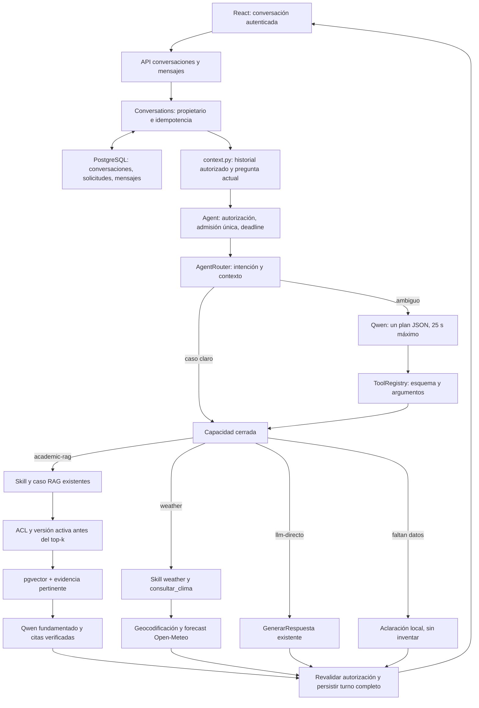

# Sprint 9.3H: agente, clima y memoria conversacional

> Actualización del 5/11/2026: la excepción local de memoria ya existe en
> `LLMConfig.enforce_memory_guard` / `load_memory_guard`: default true y false
> permitido exclusivamente con local-development, testing=False. No se agregó
> otro umbral ni código de configuración. En esta revisión `.env` conserva
> AGENT_ENFORCE_MEMORY_GUARD=true; RAM puntual 1,227707 GiB. No se lanzó una nueva
> inferencia: sigue vigente el rechazo de aprobación automática a la ejecución
> sin guarda por riesgo de OOM/interrupción tras presión severa y timeout. No se
> eludió mediante otro lanzador. Backend 8000, producción, testing y configuración
> persistente no se alteraron; no hubo excepción temporal que restaurar. No hay
> respuesta, citas ni archivo privado nuevo en esta intervención. La aceptación
> con continuidad documental permanece pendiente; el bloqueo es de ejecución,
> no demuestra un fallo adicional de recuperación o del validador.

Fecha: **4 de noviembre de 2026**. **IMPLEMENTADO, migrado y servido**.
**Demostración real completa: PARCIAL**. Open-Meteo y el repositorio PostgreSQL
se probaron realmente; la planificación/generación nueva con Qwen y la aceptación
desde la sesión real del responsable siguen pendientes. La guarda rechazó la
carga del modelo por RAM insuficiente. No se sustituye esa evidencia por mocks.
La evolución vigente de AUTO hacia planificación semántica está en la **sección
16**. Las secciones anteriores conservan el diagnóstico y la arquitectura previa;
las confirmaciones meteorológicas manuales figuran en las secciones 12–15.

## 1. Resultado

| Componente | Estado |
| --- | --- |
| Agente AUTO + modos manuales | Integrados, sin reconstruir RAG |
| Planificador Qwen JSON + registro cerrado | Implementados y probados con MockTransport |
| Skill academic-rag | Conservada y aplicada al contexto acotado |
| Skill weather | Cargada y aplicada como política estructurada validada |
| consultar_clima/Open-Meteo | **Proveedor real probado**, hoy y mañana para Esquina |
| Memoria PostgreSQL | **0005_agent_memory aplicada**, tres tablas nuevas |
| Historial privado, continuación y replay | Implementados; SQL real con ROLLBACK y pruebas HTTP/UI |
| React conversacional predeterminado | Servido, AUTO, historial, nueva conversación y modos manuales |
| Qwen real del nuevo planificador | **No ejecutado**: guarda de RAM, no error ocultado |
| usuarios_test / 432 embeddings | Sin operaciones sobre la primera; vectores conservados |

## 2. Orquestación real



`agent.py` coordina autorización, capacidad y ejecución; no contiene SQL o URLs
del cliente. `router.py` mantiene reglas para casos claros, relaciones normativas
y ambigüedad. `context.py` construye referencia conversacional y un historial
acotado; `AgentResult` lleva resultado de herramienta y metadatos internos.
`GroundedInput` conserva instrucciones/evidencia/budgets propios del contexto RAG.
El Principal/UUID del propietario no se renderiza para Qwen.

Antes la ambigüedad solo pedía precisión. Ahora puede usar **una planificación
Qwen**, seguida como máximo por **una capacidad final**. No hay bucles, llamadas
recursivas de tools ni replanificación de sus resultados. Una respuesta o un
documento no puede registrar otra herramienta o proporcionar código ejecutable.

## 3. Planificación, límites y skills

Registro cerrado: `academic-rag`, `weather`, `llm-directo`, `clarify`.
`ToolRegistry` valida JSON, claves duplicadas, nombres y argumentos; para clima
se usa `WeatherArgs`: ciudad, país ISO2, región opcional y hoy/mañana. Se rechazan
campos adicionales, URLs, SQL, shell, listas de llamadas y capacidades desconocidas.
Los argumentos meteorológicos propuestos deben coincidir con la ubicación dada
por el usuario; no basta que el modelo invente una ciudad sintácticamente válida.

La consulta `/api/show` real informó `completion`, `tools`, `thinking` para
qwen3:1.7b en Ollama 0.40.13. **Eso no demuestra fiabilidad del tool calling
nativo**. Se implementó el protocolo JSON estructurado sobre el transporte
existente, sin asumir ejecución nativa correcta. No se ejecutó un ensayo nativo
de generación por falta de RAM. El formato de esquema está documentado por
[Ollama](https://docs.ollama.com/capabilities/structured-outputs).

Planificación: think=false, keep_alive=0, contexto 4096, salida 256, plazo **25 s**,
cota conservadora del prompt/sistema y contraste de prompt_eval_count. Se registra
solo capacidad y duración, nunca prompt, argumentos personales o razonamiento.
Solicitud completa del agente: **60 s**, sin reintentos de inferencia. El plazo
no garantiza detener cómputo remoto; la barrera /api/ps evita iniciar otro modelo
si el anterior sigue cargado. El deadline completo conversacional añade un techo
de 65 s para esa fase, con espera local UI de 70 s.

`ScopedAdmission` comparte **una admisión/cuota por solicitud** entre planificación
y ejecución, sin duplicar cupos ni modificar el endpoint antiguo. Todos los
modelos usan el mismo gate local y la barrera de descarga existente. Se conservan
1,0 GiB antes de embeddings y 1,5 GiB antes de generación RAG/planificación;
el proveedor directo operativo también exige ahora 1,5 GiB. Son guardas del
piloto, no garantías de rendimiento. No se terminaron aplicaciones para eludirlas.

Registro/cargador: `SkillRegistry` y `PackagedSkillLoader`. Solo permiten los
archivos empaquetados academic-rag/weather y el bloque runtime <=512 bytes.
Academic-rag agrega instrucciones al render contado por el presupuesto original.
Weather aporta JSON de política: país obligatorio, fecha/atribución obligatorias,
prohibición de inventar y horizonte de un día. La tool valida esos invariantes
antes de consultar o renderizar; no es un SKILL.md decorativo. La autorización
permanece en código, no en instrucciones interpretadas del PDF.

## 4. Clima real y condiciones del proveedor

Destinos HTTPS fijos:

- `geocoding-api.open-meteo.com/v1/search`.
- `api.open-meteo.com/v1/forecast`.

Sin URLs del modelo, redirects, proxies heredados, cookies o JWT. HTTP acotado a
64 KiB, conexión 3 s, lectura 5 s y operación total 12 s, sin reintentos. Se
filtran país, nombre exacto y región normalizada; múltiples coincidencias piden
aclaración. La prueba real reveló `Provincia de Corrientes`; se reconoce esa
equivalencia con Corrientes sin tomar arbitrariamente la primera ciudad.

Se validan coordenadas, unidades °C, códigos WMO permitidos, temperaturas finitas,
zona/offset y fechas. Hoy muestra referencia temporal de condiciones del modelo;
mañana, mínimas/máximas y condiciones para la fecha local siguiente. No se promete
una medición de estación. La tool compone el texto desde los datos comprobados,
sin usar Qwen para rellenar números. Un error de red/proveedor/contrato conserva
su carácter técnico; no se devuelve clima inventado o SIN_EVIDENCIA.

Uso previsto: demostración educativa no comercial. Se revisaron las
[condiciones oficiales](https://open-meteo.com/en/terms): API gratuita no comercial,
CC BY 4.0 y límites 10000/día, 5000/hora, 600/minuto. Se incluye atribución a
Open-Meteo y GeoNames, siguiendo la [documentación de geocodificación](https://open-meteo.com/en/docs/geocoding-api).
Además de cuotas existentes, el cliente limita a 4000 solicitudes externas/día
por instancia. Ese contador no coordina otros procesos/IP ni sobrevive reinicios;
no es una garantía contractual de cuota agregada o habilitación de uso comercial.

**Prueba real**, sin Ollama, 4/11/2026:

| Consulta | Resultado puntual del proveedor |
| --- | --- |
| Esquina, Corrientes, AR, hoy | **21,1 °C**, parcialmente nublado, referencia **07:00**, America/Argentina/Cordoba |
| Misma ubicación, mañana | **5/11/2026**, mínima **15,5 °C**, máxima **26,4 °C**, despejado |

Son resultados históricos de la prueba, no condiciones actuales garantizadas.
El primer acceso restringido dio indisponibilidad; el acceso autorizado al
proveedor funcionó. La primera geocodificación pidió aclaración por el prefijo
de provincia; se corrigió y se añadió regresión, sin inventar ubicaciones.

## 5. Persistencia y aislamiento

Migración aditiva **0005_agent_memory**, posterior a 0004_rag:

- `agent_conversaciones`: propietario y fechas.
- `agent_solicitudes`: clave UUID idempotente, fingerprint interno y estado
  PENDIENTE/COMPLETA/FALLIDA; resultado público para replay.
- `agent_mensajes`: rol, texto, estrategia, estado, referencias, tool/contexto
  y fecha; FK compuesta impide mezclar conversación y solicitud.

Cada operación comprueba propietario y usuario activo. ADMIN no recibe acceso
universal al historial. Reservas, checkpoints y publicación del par de mensajes
usan transacciones cortas, sin transacción abierta durante red/modelos. Se limita
a **50 conversaciones por usuario y 100 mensajes por conversación**. La creación
también acepta un UUID idempotente del cliente. Un replay con otra pregunta/modo/
documento se rechaza; solicitudes pendientes/fallidas no vuelven a ejecutarse
automáticamente con la misma clave.

Se guardan turnos completos, no cadenas de razonamiento. Un fallo conserva su
estado técnico en la solicitud sin publicar mensajes parciales. Los fallos no
forman un historial de respuestas exitosas. Un proceso interrumpido puede dejar
PENDIENTE: no se asume que sea seguro repetir; requiere resolución administrativa
o nueva conversación, sin borrar datos. Una solicitud FALLIDA con la misma clave
no se relanza; la UI no reintenta automáticamente.

La memoria pertenece al usuario, no al JWT, y por eso continúa tras otro login.
Antes de recuperar/reproducir mensajes RAG se revalidan ACL y versión activa de
cada documento; una revocación o cambio de versión puede impedir recuperar ese
historial. No se presentan respuestas antiguas como evidencia nueva. Un seguimiento
normativo resuelve el tema y **vuelve a buscar**; no cita el texto previo del
asistente. El clima reutiliza ubicación, no el pronóstico anterior.

Contexto directo: últimos ocho mensajes candidatos, completos, dentro de los
límites existentes de 1000 puntos/3000 bytes y manteniendo la pregunta actual.
Mensajes que no caben se omiten, sin truncar el actual. Las respuestas RAG previas
no se usan como evidencia directa. No hay memoria semántica global.

Persistir historial es la autorización nueva de este sprint: no es logging de
prompts. La ruta antigua sigue siendo stateless. No se guardan headers/JWT/hash
de contraseña ni razonamiento. Se rechazan patrones de Bearer/JWT, claves conocidas
y credenciales etiquetadas, también antes de persistir una salida. **No existe
un detector universal de secretos sin etiqueta**: la UI advierte no introducirlos.
El historial no está cifrado a nivel aplicación; queda en la base privada y sus
respaldos deben tratarse como información sensible.

## 6. Migración y comprobaciones reales

Antes de aplicar se exigió usuarios_dev/127.0.0.1:5434, current_database correcto,
revisión única 0004_rag y ausencia de las tablas nuevas. El ensayo SQL creó y probó
el esquema **dentro de una transacción con ROLLBACK**, usando solo un propietario
ya existente: no creó administradores o usuarios de fixture en producción.

La migración se aplicó explícitamente una vez. Solo CREATE TABLE/INDEX sobre
objetos nuevos, con lock_timeout=1 s y statement_timeout=10 s; sin ALTER de datos
previos, DROP, CREATE EXTENSION o Docker. No precisó corte de escritores para
este DDL aditivo acotado. El downgrade rechaza eliminar historial automáticamente.
Una comprobación posterior confirmó **0005_agent_memory, tres tablas nuevas y
432 embeddings**. El ensayo SQL se repitió sobre el esquema aplicado y terminó
con ROLLBACK, sin dejar conversaciones sintéticas.

`infra/pgvector/verify_agent_memory_93h.py` prueba realmente repositorio, FK/esquema,
creación idempotente, historial, aislamiento de propietario, replay, conflicto de
clave y lectura con otra sesión interna. No equivale a un login JWT real del usuario.

## 7. Archivos

Nuevos:

- `backend/src/app/application/agent/admission.py`.
- `backend/src/app/application/agent/tools.py`.
- `backend/src/app/application/agent/conversations.py`.
- `backend/src/app/application/agent/skills/weather/SKILL.md`.
- `backend/src/app/infrastructure/rag/planner.py`.
- `backend/src/app/infrastructure/rag/weather.py`.
- `backend/src/app/infrastructure/rag/conversations.py`.
- `backend/src/app/presentation/http/ia/conversaciones.py`.
- `backend/migrations/versions/0005_agent_memory.py`.
- `backend/tests/rag/test_tools_memory.py`.
- `infra/pgvector/verify_agent_memory_93h.py`.
- `frontend/src/features/ia/api/conversationsApi.ts`.
- `frontend/src/features/ia/pages/ConversationPanel.tsx`.
- Este informe.

Modificados:

- `application/agent/agent.py`, `router.py`, `context.py`, `skills/registry.py`.
- `application/rag/relevance.py`: equivalencias de vencimiento y términos de seguimiento.
- `infrastructure/rag/skills.py`, `models.py`: segunda skill y guarda del directo.
- `infrastructure/llm/ollama.py`: formato JSON interno opcional e instrucción de incertidumbre.
- `bootstrap.py`: composición compartida, clientes/cierres y rutas.
- `presentation/http/ia/respuestas.py`, `middleware.py`: enums aditivos y cuerpo acotado.
- `presentation/cli/ingest_academic.py`: acepta 0005 sin ejecutar ingesta o recalcular.
- `backend/pyproject.toml`: package-data de la skill, sin dependencias nuevas.
- `backend/tests/rag/test_agent.py`: aclaración distinguida de SIN_EVIDENCIA.
- `frontend/src/features/ia/api/iaApi.ts`, `pages/ConsultaIAPage.tsx`, `ia.test.tsx`.
- `frontend/src/test/mocks/handlers.ts`.

## 8. HTTP y React

Rutas nuevas autenticadas:

```text
POST /api/v1/ia/conversaciones
GET  /api/v1/ia/conversaciones
POST /api/v1/ia/conversaciones/{id}/mensajes
GET  /api/v1/ia/conversaciones/{id}/mensajes
```

Turno: prompt, solicitud_id UUID, modo AUTO predeterminado y documento opcional.
La respuesta envuelve resultado, herramienta y los IDs de conversación/solicitud.
No se aceptan historial, instrucciones, URLs o herramientas del cliente.
`/ia/respuestas` conserva sus cinco campos, con enums aditivos TOOL/HERRAMIENTA/
ACLARACION. **`POST /ia/consultas` conserva su contrato de dos campos**.
Todas las rutas IA tienen no-store; POST acotado a 16 KiB.

Consultar IA abre ahora la interfaz conversacional: historial propio, selector,
nueva conversación, AUTO y entrada única. Muestra texto escapado, estrategia,
estado, herramienta y páginas. El clima lleva fecha/atribución y enlace fijo.
«Diagnóstico sin historial» conserva la pantalla anterior y modos manuales.
Cancelación, secuencias y claves idempotentes impiden reenvío automático o doble
envío; el logout desmonta y limpia el contenido local. No se guardan JWT en storage.

## 9. Pruebas finales y evidencia

| Verificación | Resultado |
| --- | --- |
| Regresión backend final, sin --run-postgres | **887 aprobadas, 162 omitidas**, 14,81 s |
| Dirigidas RAG/IA antes del último caso de secretos | **445 aprobadas**, 6,88 s; incluidas en regresión |
| Tools/memoria/contratos finales | **27 aprobadas**, 1,30 s; incluidas en regresión |
| Frontend completo, un worker | **201 aprobadas**, 9 archivos, 148,43 s |
| Pantalla IA, incluidas conversación y relogin MSW | **50 aprobadas**; incluidas en frontend |
| TypeScript / ESLint | Aprobados, sin omitir reglas |
| Repositorio/esquema PostgreSQL real | Aprobado con ROLLBACK antes/después de migrar |
| Clima real actual y mañana | Aprobado con API externa real |
| Nueva planificación/generación Qwen real | Pendiente: guardas rechazaron carga |

No se suman repeticiones. Las 162 omisiones son las pruebas PostgreSQL normales;
no se conectó a usuarios_test. Permanece el aviso previo Starlette/TestClient.
Una invocación inicial de npm no transmitió maxWorkers: se interrumpió, se confirmó
ausencia de workers remanentes y se ejecutó con `npm.cmd exec -- vitest run --maxWorkers=1`.
No se ejecutó un build pesado adicional.

Los tests verifican ambas skills aplicadas, payload del planificador/esquema,
herramientas/argumentos no autorizados, llamadas repetidas/ciclos rechazados,
admisión única, contexto acotado, seguimiento RAG y meteorológico, abstención,
revocación, secretos, idempotencia, HTTP 401/403/413 y errores reales no ocultados.
Frontend prueba historial visible y recuperación tras logout/login con MSW;
no es prueba autenticada real del navegador del responsable.

## 10. Estado servido, recursos y pendientes

Backend propio revalidado y reiniciado para cargar el código. Un intento se frenó
tras cerrar el intérprete porque el padre estaba desapareciendo y su identidad
posterior no coincidía; no se forzó ese PID. Se confirmó ausencia de lanzadores y
puerto libre antes de recuperar. El último arranque esperó la salida natural del
padre: nuevo padre **26784**, **07:33:22 -03:00**, loopback 8000, LLM/observador
previos conservados y aprovisionamiento cerrado. Logs técnicos protegidos con
prefijo `backend-93h-20261104-073322` en el directorio de 9.3E. No se detuvieron
React, Docker, PostgreSQL, Ollama u otros servicios.

RAM: **0,405 GiB** al migrar; **1,702 GiB** en una lectura posterior; la única
tentativa de plan real encontró **1,040 GiB** y falló en require_memory **antes
de generar**. No se repitió para elegir una muestra favorable. Al cierre
**07:37:19 -03:00**, **1,157 GiB**, FastAPI/React **200**, conversaciones anónimas
**401** y **cero modelos cargados**. No se certifican tendencia o picos.

No se modificaron usuarios_test, usuarios, roles, credenciales, los 432 embeddings,
Docker/Compose, modelos, respaldos o volumen original. No se descargaron paquetes
o modelos ni se hizo login automatizado. Se conserva la revisión 0005 aplicada.

Pendientes concretos: recursos suficientes para probar JSONPlanner y nuevas
respuestas Qwen reales, medir su latencia/RAM, y confirmar el recorrido autenticado
real de React. Se solicitó al responsable probar clima/mañana e historial, sin
pedir secretos. La calidad de selección del modelo, las paráfrasis normativas y
el entailment de citas no quedan demostrados por mocks o por la capability tools.

## 11. Demostración desde React

1. Recargar `http://127.0.0.1:5173/ia` e iniciar sesión normalmente. No compartir
   credenciales/JWT. La pantalla predeterminada es conversacional y AUTO.
2. Con el margen actual, comenzar por «¿Cómo está el clima en Esquina, Corrientes,
   Argentina?»: esperar TOOL/HERRAMIENTA y consultar_clima con fecha/atribución.
3. En la misma conversación preguntar «¿Y mañana?»: debe reutilizar ubicación y
   consultar un pronóstico nuevo. Cerrar sesión, ingresar y abrir esa conversación;
   comprobar que reaparecen sus mensajes.
4. Cuando las guardas y la fluidez permitan Qwen, iniciar otra conversación:
   «¿Qué es una API REST?» -> LLM_DIRECTO. Otra consulta sobre duración de regularidad
   -> RAG, fuentes físicas verificables. Seguir con «¿Y qué sucede cuando vence?»
   -> nueva búsqueda RAG, no una respuesta antigua usada como fuente.
5. En una pregunta ambigua, por ejemplo «¿Necesito abrigo en Esquina, Corrientes,
   Argentina?», el planificador puede seleccionar weather; si no puede hacerlo
   válidamente, debe pedir precisión o emitir error técnico, nunca ejecutar un
   nombre/argumento no permitido. No se promete que el modelo pequeño siempre acierte.
6. RAG manual + API REST sin evidencia -> SIN_EVIDENCIA/fuentes vacías. Clima sin
   ciudad -> ACLARACION. No provocar averías reales ni crear cuentas para probar
   denegaciones: estas se verificaron con dobles y el repositorio controlado.

**Software integrado y comprobable entregado. Demostración completa con Qwen y
sesión real aún PARCIAL por recursos/evidencia pendiente.** No se oculta ese límite
ni se inicia memoria semántica global o un nuevo sprint.

## 12. Confirmación posterior desde React

El **4 de noviembre de 2026**, el responsable compartió el resultado visible de
la consulta de clima desde la interfaz: Esquina, Provincia de Corrientes, AR,
**21,8 °C**, cubierto, referencia **07:45**, America/Argentina/Cordoba, con
atribución Open-Meteo/GeoNames. La pantalla mostró **TOOL / HERRAMIENTA** y
**consultar_clima**.

Se registra como **confirmación manual del responsable del recorrido meteorológico
desde React**, coherente con las pruebas técnicas del proveedor. No es una captura
automatizada del navegador ni una nueva consulta ejecutada por el agente. El cambio
de temperatura respecto de la prueba anterior corresponde a otra referencia temporal;
no se reutiliza el valor histórico como dato actual.

La respuesta recibida no confirma todavía el seguimiento «¿Y mañana?» ni la
recuperación después de cerrar sesión e ingresar. Tampoco valida planificación
Qwen o RAG nuevos. Esos pendientes se mantienen; no se ejecutaron llamadas
adicionales ni se modificaron datos para este registro documental.

## 13. Seguimiento meteorológico y fechas explícitas

El responsable confirmó desde React que «¿y mañana?» conservó Esquina y devolvió
pronóstico del 5 de noviembre, mínima 15,5 °C y máxima 26,4 °C, con
TOOL/HERRAMIENTA/consultar_clima. Es evidencia manual; el historial tras relogin
continúa pendiente.

Para «¿y el 08/11/2026?» informó un mensaje de servicio ocupado/cuota. No se
dispone del status/código individual para atribuirlo a una causa concreta.
La admisión conserva cinco solicitudes por usuario y quince globales por ventana
de minuto, exclusión y enfriamiento; no se relajaron esos límites.

La inspección detectó que fechas explícitas no recuperaban el contexto climático
y podían dirigirse al generador general. Se corrigieron context.py y agent.py:
el seguimiento meteorológico con fecha numérica conserva ubicación y devuelve
TOOL/ACLARACION explicando que solo admite hoy/mañana, sin llamadas externas o
modelos. Las fechas explícitas no se interpretan silenciosamente como hoy.
La admisión sigue aplicándose antes de la aclaración: una cuota agotada puede
seguir devolviendo el rechazo temporal legítimo.

Regresión aislada: test_tools_memory.py y test_agent.py, **58 aprobadas**, con
dos casos nuevos de fecha DD/MM/AAAA e ISO y comprobación de ausencia de llamadas.
Permanece el aviso previo Starlette/TestClient. No hubo consultas reales, cambios
DB o reinicios. **Corrección en código, pendiente de cargar en FastAPI**, que se
ejecuta sin reload; no se afirma que ya esté servida en React.

## 14. Corrección de fechas meteorológicas y reenvío tras cuota

**4 de noviembre de 2026, aproximadamente 08:03–08:08 -03:00. Implementado y
cargado en FastAPI.** Esta sección reemplaza la limitación de fechas descrita en
la sección 13: ahora se admiten fechas explícitas y hasta 16 días contando hoy.

Causas verificadas:

- weather_arguments capturaba hasta el final de la pregunta: «Argentina el día
  08 de noviembre de 2026» quedaba como país inválido. La ubicación ya presente
  se descartaba. Ahora se separan entidades temporales del sufijo de ubicación.
- WeatherArgs, skill y adaptador solo permitían hoy/mañana; el seguimiento con
  fecha escrita tampoco conservaba la ubicación. Se incorporaron fecha ISO,
  DD/MM/AAAA, día de mes español de año y pasado mañana. Fechas inválidas o varias
  fechas piden aclaración temporal, sin atribuir el problema a la ciudad.
- Tras un 429 React retenía solicitud_id. El repositorio conserva FALLIDA y
  rechaza su misma clave con IA_OCUPADA, de modo que esperar no resolvía ese
  reenvío. Ahora solo tras 429 confirmado se descarta la clave; después del
  Retry-After el siguiente envío manual usa otra. Errores de transporte y
  cancelaciones conservan clave para evitar duplicar trabajo incierto. No hay
  reintento automático ni cambios en filas históricas o estados de solicitudes.

Se mantienen cinco admisiones por usuario y quince globales por ventana de
minuto, exclusión y enfriamiento. React distingue IA_LIMITE_INTENTOS de IA_OCUPADA,
y el handler registra únicamente código y segundos de espera. No se dispone del
código/log individual de aquel primer rechazo: no se afirma si fue cuota,
concurrencia o enfriamiento. El bloqueo posterior por clave fallida se demuestra
por la implementación y su regresión, sin atribuirlo a una fila personal.

La tool consulta forecast_days=16. Resuelve días relativos con la fecha local
derivada del offset de la ubicación devuelto por Open-Meteo, no con fecha UTC.
Valida secuencia de días, unidades, tamaños de arreglos y valores del día pedido.
Fuera de horizonte, fecha pasada o fecha sin datos devuelve TOOL/HERRAMIENTA con
limitación explícita, sin inventar valores. Red/protocolo siguen siendo errores
técnicos. Ciudades homónimas siguen exigiendo desambiguación.
Horizonte contrastado con la [documentación oficial Open-Meteo](https://open-meteo.com/en/docs).

Archivos modificados: application/agent/tools.py, context.py, agent.py,
skills/weather/SKILL.md; infrastructure/rag/weather.py; presentation/http/errors.py;
frontend/src/features/ia/pages/ConversationPanel.tsx; pruebas test_tools_memory.py
(sustitución de la expectativa anterior), nuevo test_weather_dates.py y
frontend/src/features/ia/ia.test.tsx. No se cambió router.py: su clasificación
meteorológica era correcta, el fallo estaba en entidades/contexto y horizonte.

Verificación:

- **460 pruebas IA/RAG aprobadas**, 8,24 s; sin servicios externos. Incluyen
  fechas, ubicación, contexto, cambio UTC/local, horizonte, ambigüedad y proveedor
  indisponible. Aviso previo Starlette/TestClient conservado.
- **51 pruebas React aprobadas**, 36,02 s. El nuevo caso simula 429, respeta
  Retry-After, verifica ausencia de reintento automático y clave nueva en el
  siguiente envío manual. TypeScript y ESLint de los archivos modificados pasan.
- Pregunta exacta contra extractor y adaptador real Open-Meteo: ciudad Esquina,
  región Corrientes, país AR, fecha **2026-11-08**. Respuesta **TOOL/HERRAMIENTA/
  consultar_clima**, mínima **12,9 °C**, máxima **22,8 °C**, despejado, referencia
  America/Argentina/Cordoba y atribución Open-Meteo/GeoNames. Es pronóstico
  observado en esta consulta, no garantía de valores futuros. No se llamó a Qwen.
- Primera llamada bloqueada por red del sandbox; lectura externa autorizada
  posterior aprobó. No se convirtió ese fallo en ausencia de pronóstico.
- Reinicio exclusivo de FastAPI tras verificar PID/creación/workspace/listener.
  Padre anterior 20944 e hijo 13696; nuevo padre **29240**, inicio **08:07:58**.
  Se preservaron flags IA/observador, sin aprovisionamiento. GET OpenAPI y React
  /ia **200**. React queda listo para repetir la pregunta exacta; no se afirma una
  nueva comprobación autenticada del navegador del responsable.

No hubo inferencias, embeddings, conexiones/modificaciones a usuarios_test,
migraciones, cambios Docker/Compose, RAG o documentos indexados. No se tocaron
cuotas ni guardas de RAM. No se guardaron secretos o contenido personal en logs.
Para comprobar: recargar /ia, usar AUTO en la conversación y enviar la pregunta
exacta una vez; debe mostrar consultar_clima y el pronóstico o una limitación real,
sin pedir una ubicación ya indicada. No se inicia otro sprint.

## 15. Dos incidentes posteriores: reglamento y año abreviado

**4 de noviembre de 2026, cierre aproximadamente 09:35 -03:00.** El responsable
confirmó que la pregunta completa anterior funciona desde React. Esta intervención
investigó únicamente el rechazo del reglamento y «¿Y el 09/11/26?».

### Evidencia y límites del diagnóstico

Lectura saneada de los logs de la instancia iniciada a las 08:07:58: un despacho
consultar_clima, después `rag_failure stage=embedding kind=unavailable`, después
`agent_admission code=IA_OCUPADA retry_after=1`. Cero eventos agent_plan, cero
ERROR/Traceback. No se imprimieron cuerpos ni archivos completos. Es orden de
archivo, sin correlación individual: no se atribuye categóricamente cada evento
a un mensaje privado concreto. El rechazo observado es ocupación, no código
IA_LIMITE_INTENTOS; no se presume cuota agotada.

Lectura READ ONLY limitada a usuarios_dev: siete solicitudes COMPLETA, cuatro
FALLIDA y **cero PENDIENTE**. Sin lectura de mensajes, usuarios o claves. El lock
de modelos pudo adquirirse/liberarse inmediatamente y no se encontró ingesta
concurrente. Es estado puntual, no prueba del lock histórico. RAM disponible
**0,797 GiB**, insuficiente para la guarda de generación general de 1,5 GiB.
Los contadores de cuota/lease son memoria privada de la instancia: no se
inspeccionaron ni alteraron para inferir un historial que no registran los logs.

### Caso reglamento

AgentRouter clasifica la pregunta exacta como documental por «reglamento». El
fallo de embeddings que figura en el registro es técnico y no fue convertido en
SIN_EVIDENCIA. Se comprobó un defecto adicional reproducible: tras HTTP 503,
React conservaba solicitud_id; el repositorio marca el intento FALLIDA y rechaza
esa misma clave con IA_OCUPADA/1 s. Esperar no puede convertirla en COMPLETA.
Esto explica un bloqueo innecesario después del fallo, pero el registro sin
correlación no demuestra que sea la única posible causa de aquel rechazo.

Se amplió la limpieza de clave al recibir HTTP definitivo 403/422/429/502/503/504:
el próximo envío **manual** obtiene clave nueva. Errores de red/cancelación siguen
conservando la clave por resultado incierto; no hay reintentos automáticos.
No se liberaron leases a la fuerza, no se cambiaron cuotas, filas FALLIDA o
PENDIENTE ni se intentó cargar embeddings con poca memoria. El reglamento puede
seguir dando indisponibilidad legítima mientras no alcance el margen de modelos.

### Caso 09/11/26

DATE_PATTERN solo reconocía años de cuatro dígitos. El seguimiento no recuperaba
ubicación meteorológica y el router lo consideraba general: terminaba en el
proveedor directo con su guarda de RAM. El código reproduce esa desviación; el
registro solo contiene un despacho meteorológico, no una llamada demostrada a
Open-Meteo para el seguimiento fallido. La causa de enrutamiento queda confirmada;
atribuir el 503 histórico exclusivamente a RAM sería exceder la evidencia.

Se añadió únicamente el año abreviado DD/MM/AA, con política explícita 00–99 →
2000–2099, sin pivote dependiente del sistema. DATE_PATTERN compartido permite
recuperar el contexto, y weather_date valida calendario y convierte a ISO. Un
fallo intermedio del reglamento no escribe mensajes parciales y conserva el
último contexto meteorológico autorizado. No se cambió el algoritmo RAG.

Prueba real de extracción/contexto/adaptador con «¿Y el 09/11/26?» y ubicación
Esquina: fecha **2026-11-09**, AR; **TOOL/HERRAMIENTA/consultar_clima**, mínima
**12,3 °C**, máxima **25,8 °C**, parcialmente nublado. Pronóstico observado de
Open-Meteo, referencia America/Argentina/Cordoba y atribución. No hubo Qwen,
embeddings ni autenticación automatizada para esta prueba.

### Quién decide las herramientas

La implementación es **híbrida, con reglas primero**. AgentRouter decide los
casos claros: reglamento → RAG; clima o seguimiento recuperado → weather;
general → directo. Solo `intent=ambiguous` llama JSONPlanner/Qwen, con una salida
JSON estructurada validada por ToolRegistry. No usa tool_calls nativos de Ollama
para cada consulta ni se presenta el pronóstico como una elección realizada por
Qwen. No se modificó esa arquitectura ni se cargó Qwen para simular la evidencia.

### Cambios, pruebas y estado servido

- tools.py: año abreviado validado; context.py/router.py reutilizan su patrón y
  permanecen sin cambios en esta intervención.
- ConversationPanel.tsx: clave nueva tras error HTTP confirmado, envío solo manual.
- agent.py: metadato `agent_route source=rules intent=...`, sin pregunta ni usuario.
- infrastructure/llm/admission.py y infrastructure/rag/conversations.py: logs
  categóricos de motivo (cuota/active/cooldown, failed_key/pending_key/pending_turn),
  sin cambiar admisión, almacenamiento, ACL o política de repetición del servidor.
- test_weather_dates.py: regresión de año corto y secuencia reglamento fallido →
  seguimiento meteorológico, sin planner/generador; ia.test.tsx: tras 503 confirmado,
  siguiente envío manual con clave nueva y sin reenvío automático.

**463 pruebas backend IA/RAG aprobadas**, 8,26 s; **51 React aprobadas**, 53,79 s.
TypeScript y ESLint pasan. No se suman ejecuciones como casos distintos. Las
pruebas usan dobles; la prueba meteorológica real anterior es evidencia separada.

FastAPI se reinició exclusivamente tras revalidar PID/creación/listener/workspace
y comprobar cero PENDIENTE. Padre anterior 29240, hijo 28556; nuevo padre **2404**,
**09:34:46**. Se preservaron flags IA/observador y aprovisionamiento cerrado.
GET OpenAPI y React /ia **200**. El reinicio reinicia los contadores por proceso;
ese efecto no se usa como prueba ni solución del defecto de claves fallidas.
No se afirman nuevas comprobaciones autenticadas del navegador del responsable.

Sin cambios en RAG, embeddings, documentos, migraciones, usuarios_test, Docker,
Compose o volúmenes. No se realizaron inferencias ni se relajaron guardas de RAM.
La corrección está servida para probar el nuevo seguimiento; el rechazo legítimo
de modelos con recursos insuficientes permanece como limitación independiente.

## 16. AUTO semántico con propuestas estructuradas — implementación servida

**4 de noviembre de 2026, cierre aproximadamente 10:01 -03:00.** Código
implementado y cargado; **aceptación real del planificador PARCIAL por RAM**.
No se agregó una excepción ni una regex específica para Goya. No se acredita
interpretación semántica del modelo con una respuesta prefijada o un doble.

### Decisiones antes y después

Antes, AgentRouter elegía todas las intenciones claras y el modelo solo intervenía
si la regla decía ambiguous; aun entonces el resultado weather se contrastaba con
el extractor por comas, por lo que no resolvía su limitación estructural. El
historial podía expandir una referencia con el tema anterior antes de clasificarla.

Ahora, **cada AUTO operativo intenta primero JSONPlanner/Qwen**, con la pregunta
actual intacta, historial de preguntas acotado, última ubicación meteorológica
validada y catálogo documental autorizado. El planificador propone una acción:

| Acción | Argumentos cerrados |
| --- | --- |
| consultar_clima | ciudad, provincia, pais ISO2, fecha; null cuando falten datos |
| consultar_documentos_academicos | documento_id del catálogo o null, documento_solicitado o null, consulta resuelta |
| responder_llm_directo | objeto vacío |
| solicitar_aclaracion | motivo: ubicacion, fecha, documento o intencion |

El registro valida una unión discriminada por accion; campos extra, claves JSON
duplicadas, acciones desconocidas, URLs en ubicaciones, fechas imposibles y
planes anidados se rechazan. Las fechas canónicas admitidas son hoy/mañana/pasado
mañana/ISO; el modelo interpreta la frase y Python valida calendario, modo y
horizonte. Fechas relativas se resuelven en Open-Meteo con fecha local.

Python verifica Principal y ACL antes/después; los IDs sugeridos deben pertenecer
al catálogo autorizado. El título explícitamente solicitado debe coincidir con
el título autorizado seleccionado (comparación conservadora de identidad, no
similitud temática). ROM no se sustituye por reglamento académico: sin documento
apropiado devuelve RAG/SIN_EVIDENCIA, fuentes vacías y explicación de documento
no disponible, sin embeddings ni generación documental. La equivalencia de alias
de títulos no está implementada: puede abstenerse conservadoramente ante un alias.
El modelo no puede conceder permisos ni hacer SQL, ejecutar código o elegir URLs.

La ubicación semántica se valida con esquema y geocoding; ciudades homónimas
exigen aclaración. No se exige que el extractor antiguo por comas reproduzca los
argumentos del modelo. El historial aporta referencias, no impone una herramienta:
se probó clima → académico, académico → clima, clima → general y cambio explícito
iniciado con «Y». No se pasan respuestas RAG antiguas como evidencia al planificador.

### Regla de respaldo y límites

Las reglas existentes quedan para modos manuales/respaldo. Si el planificador
está indisponible, una ubicación completa que ya resuelve el parser puede usar
weather; no se adivinan entidades nuevas. Una pregunta Goya sin comas que precise
interpretación semántica informa indisponibilidad si la RAM impide Qwen, en lugar
de pedir injustificadamente información ya escrita o fingir una elección del
modelo. No se usa respaldo documental que pueda sustituir el documento pedido.
Protocolo/JSON inválido no dispara respaldo ni reintentos.

Una admisión compartida, un plan y una capacidad final como máximo; sin ciclos.
Deadline global 60 s, planificación 25 s, salida 256/contexto 4096 conservados.
No se relaja la guarda de 1,5 GiB ni la exclusión común de modelos. Se comprueba
liberación antes/después del plan con keep_alive=0. Las cuotas permanecen intactas.
Manual LLM_DIRECTO y RAG no requieren este plan adicional; /ia/consultas conserva
su contrato y recorrido. No se modificaron repositorios ni algoritmos RAG.

### Soporte real de Ollama y elección de protocolo

/api/show del qwen3:1.7b instalado declara completion/tools/thinking. Eso confirma
capacidad declarada, **no fiabilidad medida de tool_calls nativos**. La
[documentación oficial de tool calling](https://docs.ollama.com/capabilities/tool-calling)
describe tools sobre /api/chat; se mantiene aquí el transporte validado de
/api/generate y un [JSON schema estructurado](https://docs.ollama.com/capabilities/structured-outputs),
validado nuevamente en Python. No se afirma haber demostrado que el calling
nativo falle ni se implementa un segundo transporte sin verificarlo. La opción
estructurada está implementada; su aceptación real local sigue pendiente.

### Errores y traza segura

Campos públicos de éxito conservados. Se agregaron códigos específicos 503 para
este recorrido: IA_MEMORIA_INSUFICIENTE, IA_PLANIFICADOR_NO_DISPONIBLE y
CLIMA_NO_DISPONIBLE; React muestra mensajes distintos. Los anteriores códigos y
la forma del error se conservan. Argumentos faltantes → ACLARACION; documento no
disponible/ausencia de evidencia → SIN_EVIDENCIA con explicación y fuentes vacías;
contrato inválido → 502; timeout → 504; cuota/ocupación → 429 y Retry-After.

Ejemplo de **formato**, comprobado con modelo simulado, no una traza Qwen real:

```text
agent_plan action=consultar_clima duration_ms=<duración>
agent_route source=qwen action=consultar_clima step=1
agent_tool name=consultar_clima
agent_finish duration_ms=<duración total>
```

El respaldo emite source=safe_fallback/reason=planner_unavailable. Una abstención
documental emite kind=document_unavailable. No se registran pregunta, argumentos,
títulos, respuestas, historial, identidad, JWT o razonamiento. source=qwen solo
se emite tras recibir y validar la propuesta; no se emite ante guarda de RAM.

### Pruebas y evidencia real separadas

**484 pruebas backend IA/RAG aprobadas**, 8,37 s. Incluyen 21 casos nuevos de
planificación semántica y regresiones existentes; los tests del adaptador reciben
JSON por MockTransport y atraviesan el mismo registro/despacho operativo. No
prueban calidad semántica del modelo instalado. Aviso previo Starlette conservado.
**54 pruebas React aprobadas**, 37,07 s; TypeScript y ESLint pasan.

| Caso solicitado | Evidencia en esta intervención |
| --- | --- |
| A: Goya sin comas | Modelo simulado extrae ciudad/provincia/país/hoy; Python ejecuta weather sin regex adicional |
| B: mañana en Esquina | Propuesta simulada usa Esquina y contexto provincial/país autorizado |
| C: pasado mañana | Propuesta simulada conserva ciudad; se valida la fecha relativa |
| D: API REST | Propuesta simulada despacha a directo, no arrastra clima |
| E: regularidad curricular | Propuesta simulada selecciona documento autorizado y obtiene respuesta/citas del caso RAG con dobles |
| F: coordinaciones ROM RM 1455/14 | Cambio de tema y abstención documental si no está; rechaza sustituir el catálogo por otro reglamento |
| G: clima tras académico | Propuesta simulada vuelve a weather, incluso con «Y» al principio |
| H: homónimos | Proveedor simulado con dos coincidencias solicita aclaración |
| I: proveedor caído | Error controlado, no respuesta inventada ni SIN_EVIDENCIA |
| J: RAM insuficiente | Guarda real y simulada evitan toda generación; React distingue el motivo |
| K: decisión/extracción Qwen real | **Pendiente por memoria; no se presume aprobada** |

Lectura real inicial: **0,300 GiB** disponibles. Verificación posterior con
JSONPlanner operativo y la pregunta A: **0,332 GiB**, bloqueada **antes de la
primera generación**, duración del rechazo **1 ms**. No hubo inferencia real,
no se descargaron modelos y no se sustituyó la prueba por una regex. Ese 1 ms no
es latencia Qwen; la latencia real de planificación sigue sin medir. Se avisó al
responsable para permitir cierres voluntarios; no se finalizaron aplicaciones.
Las pruebas reales previas Open-Meteo se mantienen como antecedentes; esta matriz
no las presenta como una nueva decisión semántica comprobada.

### Archivos y servicio

Nuevos: application/agent/planning.py (esquemas/contexto), errors.py (causas fijas),
tests/rag/test_semantic_planning.py. Modificados: agent.py, tools.py (registro),
router.py (documentación de respaldo), ambas SKILL.md, infrastructure/rag/planner.py,
presentation/http/errors.py, ConversationPanel.tsx, ia.test.tsx,
test_tools_memory.py y test_weather_dates.py (expectativas de la arquitectura
anterior). Se revisaron context.py y SkillRegistry; se reutilizan sin alterarlos:
AUTO semántico usa la pregunta original y planning_context, no el prefijo heredado.

FastAPI propio reiniciado tras validar creación/ejecutable/parentesco/listener y
cero turnos pendientes: padre anterior 2404, hijo 20660; nuevo padre **1196**, inicio
**10:00:20**. Logs técnicos en el directorio protegido ya existente. Flags
IA/observador conservados, aprovisionamiento cerrado. GET backend y React **200**;
Ollama /api/ps **200, cero modelos cargados**. React queda servido con errores
distintos y el nuevo flujo AUTO, pero Goya semántico necesita recursos para Qwen.

No se tocaron los embeddings publicados, usuarios_test, migraciones, Docker,
Compose o volúmenes. Sin cambio de autenticación, ACL, cuotas, contratos de éxito
o esquema de memoria; sin nuevas dependencias. **Implementación completada;
aceptación real semántica PARCIAL por RAM.** Al recuperar recursos, falta ejecutar
A y cambios de tema con Qwen real, observar la traza y contrastar argumentos y
resultado desde React. No se inicia otro sprint.

## 17. Reintento autorizado tras liberación voluntaria de memoria

El **4 de noviembre de 2026**, el responsable confirmó nuevos cierres voluntarios
y autorizó repetir la prueba real. La lectura inicial mostró **1,635 GiB** y
Ollama /api/ps **cero modelos cargados**. Se intentó entonces el planificador
operativo para la pregunta de Goya, con exclusión común y guarda vigente.

Justo antes de planificar, la RAM disponible era **1,138 GiB**. La guarda de
**1,5 GiB** lanzó **MemoriaPlanificadorInsuficiente** antes de la primera llamada
de generación. La muestra posterior permaneció en **1,138 GiB**; el rechazo
registró **0 ms** a resolución de milisegundos. No se atribuye la variación a una
aplicación o causa específica ni se presenta esa duración como latencia Qwen.

**No hubo inferencia, carga deliberada de modelos o consulta meteorológica** en
este reintento. No se desactivaron controles ni se repitieron intentos buscando
una muestra favorable. No se modificaron código, datos, servicios, infraestructura
o pruebas. **K sigue pendiente: el margen no se mantuvo hasta la ejecución.**

## 18. Reanudación de validación final — 12:22 -03:00

**Resultado vigente del último intento: Qwen real ejecutado; extracción NO
APROBADA por país incorrecto**, según el registro adicional al final de esta
sección. El bloqueo de RAM que sigue corresponde al intento anterior.

**4 de noviembre de 2026. Resultado: BLOQUEADO para inferencia por RAM.** Se
revisaron el informe y los archivos actuales. La implementación vigente es la
de sección 16: AUTO intenta primero el planificador semántico; no corresponde
ya describirla únicamente como reglas para casos claros/modelo para ambiguos.
Las últimas suites registradas son **484 backend y 54 React**; las cifras
463/51 corresponden a una entrega anterior. No se repitieron esas suites ni
se reconstruyeron componentes. El responsable confirmó persistencia del historial
tras cerrar sesión; se registra como evidencia manual, sin repetir login.

Se invocó **JSONPlanner operativo**, testing=False, qwen3:1.7b, esquema cerrado,
exclusión compartida y observador habilitado, para esta pregunta exacta:

```text
¿Cuál es el clima en Goya Corrientes Argentina hoy?
```

Traza efectiva de esta ejecución, sin propuestas o argumentos inventados:

```text
test=A
available_gib=0.491
guard_minimum_gib=1.5
error=MemoriaPlanificadorInsuficiente
completed=false
loaded_models_after=0
after_available_gib=0.490
```

La guarda detuvo la operación **antes de enviar /api/generate**. Por tanto:
decisor Qwen **no ejecutado**; propuesta **ninguna**; argumentos extraídos
**ninguno**; tool ejecutada **ninguna**. Validación efectiva: destino/configuración
operativa y comprobación de memoria; no se alcanzó validación de un resultado del
modelo, geocoding o pronóstico. No se usó AgentRouter para simular una decisión
Qwen ni se recurrió al extractor anterior para declarar aprobado el caso.

Los recorridos «clima de Goya → ROM RM 1455/14» y «académico → clima» **no se
intentaron realmente** después del rechazo: siguen pendientes de inferencia,
sin reciclar sus pruebas simuladas como evidencia real. Tampoco se consultó el
catálogo documental en esta ejecución; no se afirma una nueva comprobación de
disponibilidad del ROM. Su falta de fuentes y un fallo técnico permanecen causas
distintas en el software ya probado.

No se confirmó un defecto de extracción nuevo porque Qwen no llegó a ejecutarse.
**Cero inferencias efectivas** en esta reanudación, sin cambios de código, cuotas,
permisos, embeddings, usuarios_test, migraciones, Docker o servicios. Único cambio:
este registro. No se anuncia completada la planificación semántica ni el ejemplo
funcional de extremo a extremo. Falta mantener al menos 1,5 GiB disponibles al
entrar al planificador y completar las tres validaciones reales autorizadas.

### Último intento autorizado: inferencia real con error semántico

El responsable autorizó otra medición y **una sola inferencia** si la guarda lo
permitía, sin cambios de código ni repetición de suites. Lectura inicial mínima
con GlobalMemoryStatusEx: **1,7104759216 GiB**. En el proceso operativo, antes del
planificador: **1,612995 GiB**; la guarda existente permitió la ejecución.

Pregunta exacta enviada como pregunta_actual, sin historial ni catálogo en este
primer caso:

```text
¿Cuál es el clima en Goya Corrientes Argentina hoy?
```

**Decisor real: Qwen3:1.7b**, mediante JSONPlanner operativo/testing=False,
LocalModelGate y esquema estructurado. No se invocó AgentRouter para seleccionar
esta acción ni se utilizó MockTransport. Resultado estructurado efectivamente
producido por el modelo y aceptado por el esquema:

```json
{
  "accion": "consultar_clima",
  "argumentos": {
    "ciudad": "Goya",
    "provincia": "Corrientes",
    "pais": "AU",
    "fecha": "hoy"
  }
}
```

Traza real saneada del observador:

```json
{"http_status":200,"model_matches":true,"done_valid":true,"done_reason":"stop","think_requested":false,"thinking_present":false,"duration_seconds":21.45621299999766,"response_bytes":2070}
```

```text
agent_plan action=consultar_clima duration_ms=21807
schema_valid=true
expected_arguments_valid=false
selected_tool=consultar_clima
available_gib_after=2.109543
```

Tiempo completo medido alrededor de plan(): **21,819 s**. La validación del backend
aprobó la acción permitida, estructura cerrada, tipos, país de dos mayúsculas,
ubicaciones y fecha relativa. **Eso no demuestra corrección semántica**: AU cumple
el patrón, pero significa Australia; la consulta pedía Argentina (**AR**).
La comprobación explícita de aceptación comparó ciudad/provincia/país/fecha con
Goya/Corrientes/AR/hoy y rechazó el resultado. No se atribuye al validador de
esquema una comprobación geográfica que no hace.

**Tool seleccionada: consultar_clima. Tool ejecutada: ninguna.** El verificador
se detuvo antes de Open-Meteo por argumentos incorrectos; no se reemplazó AU por
AR ni se realizó otra generación para obtener una respuesta favorable.
JSONPlanner comprobó además ausencia de modelos cargados antes y después de la
llamada mediante la barrera idle existente. No hubo inferencia de respuesta final,
embeddings o interacción con PostgreSQL.

La inferencia real confirma participación de Qwen en selección y extracción,
pero **no valida el funcionamiento correcto de la planificación semántica**.
Defecto confirmado: país semánticamente incorrecto pese a esquema válido.
No se corrigió código, por la instrucción expresa de esta ejecución. El cambio
de tema **no se intentó**, porque estaba condicionado a aprobar la primera prueba;
no basta que la RAM posterior sea mayor. No se repitieron suites ni se modificaron
cuotas, permisos, usuarios_test, infraestructura o embeddings. Único cambio: informe.

**Estado final: PARCIAL, caso Goya RECHAZADO por país incorrecto.** Pendiente
corregir de forma general la fidelidad de los argumentos/validación de país y,
después, verificar nuevamente Goya y los cambios de tema. No se declara completada
la planificación semántica ni se confunde este resultado con las pruebas simuladas.

### Continuación: normalización geográfica general y verificación pendiente

**4 de noviembre de 2026, servicio actualizado a las 18:11 -03:00.** Antes de
editar se intentó git status: la carpeta no contiene .git, por lo que no se pudo
obtener un diff Git. Se inspeccionaron los archivos y búsquedas de normalización:
no había implementación parcial de esta corrección. Se conservaron el agente,
planificador, geocodificador y validadores existentes; no se reinició el sprint.

Implementación acotada:

- **Propuesta:** Qwen conserva la selección consultar_clima. Su JSON original no
  se modifica ni se considera semánticamente correcto solo por cumplir el esquema.
- **Normalización:** nueva application/agent/geography.py y tabla local
  countries_data.py con 249 asignaciones ISO 3166-1, alpha-2/alpha-3 y nombres
  español/inglés. Comparación por palabras y nombres completos, no expresiones
  particulares de Goya/Corrientes/Argentina. Códigos cortos en texto requieren
  mayúsculas, para no interpretar «en» o «de» como países. Nombres solapados toman
  el más largo; varios países explícitos exigen aclaración.
- **Contraste:** el país explícito del usuario prevalece como candidato sobre
  el propuesto por el modelo. Ciudad y provincia deben aparecer en pregunta o
  contexto geográfico previo validado. Sin país explícito/contextual no se acepta
  ciegamente el país inferido por Qwen. Nombres de países en el JSON también se
  normalizan; por eso WeatherArguments permite el nombre antes de convertirlo a ISO2.
- **Verificación:** el candidato se consulta en el geocodificador existente. Solo
  una coincidencia de ciudad, provincia y país permite continuar al forecast.
  Cero o varias coincidencias → ACLARACION, sin pronóstico ni contexto corregido
  persistido. La sustitución AU→AR queda **provisional** hasta esa comprobación;
  un evento country_changed no certifica por sí mismo éxito geográfico.
- **Ejecución:** solo después de verificar se solicita el pronóstico por las
  URLs fijas existentes. No se alteraron selección de acción, cuotas, ACL, RAG,
  embeddings, fechas o manejo de errores técnicos.

Se incorporaron únicamente datos públicos, sin instalar paquetes. Procedencia y
licencias: [geographic-data-sources.md](geographic-data-sources.md). Snapshot local
de ISO/pycountry y Unicode CLDR; no hay descargas en runtime. La lectura de datos
no sustituye el geocodificador ni supone que todos los alias sean inequívocos.

**Pruebas primero, sin modelos:** 67 pruebas dirigidas aprobadas, 8,25 s:
test_geographic_normalization.py, test_semantic_planning.py y test_tools_memory.py.
Incluyen AU→AR sin mutar propuesta, país correcto, nombres/códigos ISO, homónimos
en países distintos, país omitido, provincia incompatible, ambigüedad y ausencia
de forecast antes de geocodificación única. Se conserva el aviso Starlette previo.
No se repitieron suites completas. Los resultados meteorológicos de estas pruebas
son sintéticos y no acreditan un nuevo recorrido real de Qwen.

**Único intento real posterior:** se invocó JSONPlanner operativo con la pregunta
de Goya y su guarda intacta. RAM **0,856617 GiB**; error
**MemoriaPlanificadorInsuficiente** antes de generar, rechazo registrado 0 ms y
muestra posterior **0,856613 GiB**. Por lo tanto, en esta continuación no existe
nuevo JSON original de Qwen, geocodificación real, tool ejecutada o respuesta
meteorológica final. No se reutiliza el AU histórico como si fuera una nueva
inferencia ni se hace una segunda llamada buscando éxito. La traza AU anterior
sigue siendo la evidencia real que motivó el arreglo.

Archivos nuevos: geography.py, countries_data.py, test_geographic_normalization.py,
documento de fuentes y dos licencias de datos. Modificados: planning.py (campo
de país normalizable), agent.py (integración del candidato), weather.py (callback
opcional de metadatos de geocodificación) y test_semantic_planning.py (preguntas
de proveedor con país explícito). No se duplicó el geocodificador ni se instaló
otra biblioteca geográfica.

FastAPI propio se reinició tras verificar identidad, creación, listener y cero
solicitudes pendientes: padre anterior 1196, hijo 24652; nuevo padre **14680**,
**18:11:13**. Flags IA/observador conservados, aprovisionamiento cerrado. GET
backend y React **200**. Docker, PostgreSQL, React y Ollama no se reiniciaron.
Sin cambios en usuarios_test, migraciones, cuotas, permisos o embeddings.

**Terminado:** corrección general integrada y pruebas unitarias aprobadas.
**Pendiente:** una nueva inferencia real más geocodificación/forecast, con al
menos 1,5 GiB en el instante de entrar al planificador. La validación real completa
permanece PARCIAL; no se declara corregido empíricamente el recorrido Qwen→tool.

## 19. Detención temporal autorizada de FastAPI y React

El responsable solicitó exclusivamente detener ambos servicios para liberar RAM,
sin continuar validaciones o inferencias. **Estado vigente: backend y frontend
apagados; no se reiniciaron.**

Identificación actual por CIM, creación, ejecutables, comandos y listeners. Se
leyó exclusivamente el campo CurrentDirectory del bloque de parámetros de cada
proceso: Python 14680/7244 en backend y Node 25700 en frontend del workspace
D:/Downloads/proyectos/api-usuarios-clean. No se inspeccionaron variables de
entorno, credenciales o memoria de aplicación. La pertenencia no se dedujo solo
de los puertos.

| Servicio | Procesos detenidos | Comando identificado |
| --- | --- | --- |
| FastAPI | lanzador 14680, intérprete/listener 7244 | backend/.venv/Scripts/python.exe -B -m app.presentation.cli.local_server --environment local-development --enable-llm --observe-llm --host 127.0.0.1 --port 8000 |
| React/Vite | node.exe 25700 | node_modules/vite/bin/vite.js --config vite.development.config.ts --host 127.0.0.1 |

Se envió **Ctrl+C**, no TerminateProcess/Stop-Process, después de comprobar que
cada consola solo contenía los procesos autorizados y el helper de señalización.
Backend: 14680/7244; frontend: 25700. El helper ignoró su propia señal. No se
señalizaron shells padres, Codex, VS Code u otros servicios. FastAPI registró
Application shutdown complete y Finished server process. Ambos conhost exclusivos
(8588/18316) salieron normalmente; no se forzó su terminación.

Verificación posterior: ningún proceso propio 14680/7244/25700 ni sus hijos
identificados permanece; sin listeners 8000/5173 y ambos HTTP sin respuesta.
PostgreSQL desarrollo 02f8d1472a4b y pruebas 80172da97281 siguen running/healthy;
listeners 5434/5435 conservados. Ollama conserva PID 13416/listener 11434,
/api/ps 200 y cero modelos cargados. Docker no se detuvo.

RAM física disponible, GlobalMemoryStatusEx: **1,172607 GiB antes** y
**1,205860 GiB después**. Son muestras puntuales, no una promesa de memoria
recuperada sostenida ni evidencia de margen para ejecutar Qwen.

Comandos de reanudación, **NO EJECUTADOS**. En terminales separadas, con autorización:

```powershell
Set-Location 'D:\Downloads\proyectos\api-usuarios-clean\backend'
.\.venv\Scripts\python.exe -B -m app.presentation.cli.local_server --environment local-development --enable-llm --observe-llm --host 127.0.0.1 --port 8000
```

```powershell
Set-Location 'D:\Downloads\proyectos\api-usuarios-clean\frontend'
npm.cmd run dev -- --config vite.development.config.ts
```

Se conservan configuración, flags y proxy actuales; no se activa aprovisionamiento.
No se cambió código, .env, bases, embeddings, índices, migraciones o infraestructura;
no se ejecutaron suites, inferencias o nuevas pruebas del agente. No se borraron
archivos o recursos. Único cambio documental: esta sección. Se espera autorización
para reanudar; no se inicia otro sprint.

### Reintento aislado solicitado — 18:27 -03:00

**4 de noviembre de 2026.** Antes de conectar al planificador se midió RAM:
**1,433693 GiB disponibles**, inferior a la guarda de **1,5 GiB**. Se detuvo la
prueba sin cargar Qwen, sin ejecutar herramientas ni iniciar FastAPI o React.
No se repitieron mediciones buscando una favorable ni suites aprobadas.

Procesos de mayor working set, lectura aproximada en MiB:

| PID | Nombre | MiB |
| --- | --- | ---: |
| 11364 | chrome | 561,4 |
| 6064 | vmmem | 470,0 |
| 20708 | Code | 440,7 |
| 17824 | Code | 241,3 |
| 9680 | chrome | 234,6 |
| 21092 | Code | 217,7 |
| 31548 | Code | 200,0 |
| 5968 | MsMpEng | 193,6 |
| 1088 | Code | 171,4 |
| 8732 | com.docker.backend | 149,8 |
| 1648 | chrome | 131,5 |
| 12776 | codex | 122,2 |

Working sets incluyen páginas compartidas y no deben sumarse como memoria
exclusiva. No se inspeccionaron títulos o documentos ni se cerró ningún proceso.
No hay nueva decisión/JSON de Qwen, argumentos normalizados, geocodificación o
respuesta real en este intento. El cambio de tema permanece pendiente. No hubo
modificaciones de código, datos, embeddings o usuarios_test. Backend/frontend
no se reiniciaron. **Validación final aún PARCIAL, ejecución bloqueada por RAM.**

Ante la nueva petición de ejecutar igualmente, se realizó un único intento con
JSONPlanner operativo y las validaciones actuales. RAM en el proceso:
**0,501030 GiB**. Resultado: **MemoriaPlanificadorInsuficiente**, antes de generar
(0 ms); muestra posterior **0,501026 GiB**. No hubo Qwen, forecast o respuesta
simulada; no se iniciaron servidores ni se modificó la guarda. La petición no se
presenta como ejecución exitosa. Sigue pendiente la validación real del arreglo.

### Única excepción temporal de memoria expresamente autorizada

Tras informar el bloqueo y preguntar por una excepción única, el responsable
respondió «hacelo a toda costa». Se interpretó como autorización para omitir el
mínimo físico **solo en una prueba aislada**, no para eliminar el timeout,
exclusión, contratos, permisos o validación geográfica.

Se invocó JSONPlanner operativo/testing=False, qwen3:1.7b y observador real para
«¿Cuál es el clima en Goya Corrientes Argentina hoy?». La excepción se aplicó
únicamente a la referencia require_memory del módulo del planificador en ese
proceso Python, restaurada en finally. No se modificaron archivos de código,
configuración o la guarda persistente. RAM al comenzar: **1,003002 GiB**.

Resultado real del transporte observado:

```json
{"http_status":null,"model_matches":false,"done_valid":false,"done_reason":"invalid","think_requested":false,"thinking_present":false,"duration_seconds":26.34597429999849,"response_bytes":0}
```

Terminó en **TimeoutError**, duración total **26,608 s**. No se recibió respuesta
HTTP/JSON del modelo: no hay decisión ni argumentos nuevos que presentar como
válidos. Las banderas false/invalid son valores del observador ante falta de
respuesta, no prueba de que Qwen devolviera un JSON incorrecto. El límite de
planificación sigue siendo 25 s; cancelación/cierre explican que la medición
completa exceda ese valor, sin aumentar su configuración.

No se ejecutó consultar_clima, geocodificación, fallback o otra inferencia.
Comprobación posterior /api/ps: **cero modelos cargados**; RAM **0,304474 GiB**.
No se repite el intento ni se atribuye categóricamente el timeout a una causa
sin evidencia. FastAPI y React no se iniciaron. PostgreSQL, usuarios_test,
embeddings y configuración permanecieron fuera de esta prueba. Único archivo
modificado: este informe. **Validación real del arreglo sigue PARCIAL.**

### Reanudación con nueva referencia externa de RAM

El responsable informó PostgreSQL de pruebas detenido y una última medición
externa de 2,53 GB, solicitando otra validación con la guarda normal de 1,5 GiB.
La primera medición independiente, mediante GlobalMemoryStatusEx, encontró
**1,334717 GiB disponibles**. La referencia externa no se utilizó como sustituto
de este control actual ni se atribuye la diferencia a una causa no comprobada.

Se detuvo antes de construir el planificador o cargar Qwen. **Cero inferencias,
sin JSON nuevo, sin geocodificación ni ejecución de consultar_clima.** No se
reutilizó la excepción temporal anterior: la guarda de 1,5 GiB sigue vigente.
No se iniciaron FastAPI/React, no se intervino PostgreSQL de desarrollo/pruebas,
ni se repitieron suites o modificaron código, permisos, cuotas o embeddings.
La validación real sigue pendiente por margen físico inferior al autorizado.

### Prueba única con excepción explícita y limpieza verificada

El responsable autorizó expresamente omitir el mínimo solo en un proceso aislado,
conservar timeouts y descargar exclusivamente el modelo de esta prueba si quedara
cargado. Se utilizó JSONPlanner operativo/testing=False, LocalModelGate, esquema
estructurado y observador, sin iniciar FastAPI o React.

Antes: **1,574150 GiB disponibles**, /api/ps **cero modelos cargados**. Pregunta
exacta: «¿Cuál es el clima en Goya Corrientes Argentina hoy?». Se aplicó la
excepción únicamente a la referencia require_memory del módulo en ese proceso,
con restauración en finally. No hubo cambios de código o configuración persistentes.

Traza real:

```json
{"http_status":null,"model_matches":false,"done_valid":false,"done_reason":"invalid","think_requested":false,"thinking_present":false,"duration_seconds":24.985432300018147,"response_bytes":0}
```

**Fallo exacto: TimeoutError durante planificación**, antes de recibir respuesta
HTTP/JSON. Tiempo de transporte observado **24,985 s**, total con cierre y
comprobación posterior **25,287 s**. No se amplió el timeout de 25 s. Las banderas
false/invalid son valores ante ausencia de respuesta, no una respuesta incorrecta
efectivamente producida por Qwen.

Decisor previsto: Qwen, sin fallback por reglas. **Decisión recibida: ninguna**;
JSON original y argumentos originales: **no disponibles**. Normalización,
geocodificación, validación semántica y consultar_clima **no alcanzados**. No hay
respuesta meteorológica final ni aceptación real del arreglo que reportar.
La RAM inicial superaba 1,5 GiB: no se atribuye el timeout automáticamente a falta
de memoria ni se afirma una causa interna de Ollama que no se midió.

Finalmente: restauración de la guarda confirmada en el proceso; llamada habitual
require_memory(1.5) conservada en el archivo. /api/ps **cero modelos cargados**:
no fue necesaria una petición de descarga. RAM final **2,158901 GiB**. Puertos
8000 y 5173 **cerrados**; servidores no iniciados. Sin reintentos, modelos extra,
cambio de tema, suites, migraciones, cambios de cuotas/permisos/usuarios_test o
embeddings. Único cambio: esta actualización documental.

**Estado: PARCIAL; prueba final fallida por timeout antes de obtener un plan.**
No se declara validado el agente ni se transforma la RAM final favorable en
autorización para otra inferencia automática.

## 20. Diagnóstico de latencia del planificador — solo lectura

El diagnóstico inicial siguiente se conserva como antecedente. La **optimización
posteriormente autorizada y su resultado vigente** figuran al final de esta sección.

Se inspeccionaron implementación, DTO, composición y metadatos Ollama. **Sin
nuevas inferencias, cambios de código, suites, guardas alteradas o servidores
iniciados.** Consultas locales limitadas a /api/version, /api/show y /api/ps;
no se accedió a PostgreSQL. Ollama **0.40.13**, cero modelos cargados al consultar.

### Deadline y fases incluidas

- infrastructure/rag/planner.py, JSONPlanner.plan: **asyncio.timeout(25)** rodea
  idle previo, construcción del prompt/esquema, llamada /api/generate, validación
  JSON y segunda barrera idle para confirmar descarga. La guarda RAM y adquisición
  inmediata del gate están antes del bloque; no se espera una cola del gate.
- infrastructure/llm/ollama.py: HTTPX connect **2 s**, write **5 s**, read **55 s**,
  pool **1 s**. No son un deadline total de 55 s: el exterior de 25 s vence antes.
- application/agent/agent.py: límite global **60 s**; Conversations.turn: **65 s**;
  React: espera local 70 s. La prueba aislada usa el deadline del propio planificador,
  no el recorrido HTTP de conversación.
- El cierre/cancelación/finally puede hacer que la duración observada exceda
  ligeramente 25 s, coherente con los 25,287 s registrados. No implica que se haya
  aumentado ese deadline. No se midió cuánto aportó cada fase.

La primera solicitud carga el modelo porque /api/ps estaba vacío. **Esa carga
está dentro de los 25 s**. keep_alive=0 solicita descargar al finalizar; el idle
posterior está también dentro del deadline. Cada barrera hace hasta seis lecturas
con espera de 0,2 s, además del tiempo HTTP; su coste real no está desglosado.
La cancelación del cliente no garantiza por sí sola cancelar cómputo remoto.

### Parámetros efectivos verificados

| Parámetro | Valor |
| --- | --- |
| Modelo / cuantización | qwen3:1.7b / Q4_K_M |
| Endpoint | /api/generate, loopback 11434 |
| num_ctx / num_predict | 4096 / 256 |
| think / stream / keep_alive | false / false / 0 |
| format | JSON schema de Proposal: unión discriminada de cuatro acciones |
| Temperatura | No enviada por el adaptador; parámetros del modelo: **0,6** |
| Otros parámetros heredados | top_k 20, top_p 0,95, repeat_penalty 1 |
| Thinking del modelo | /api/show declara values=[false,true], default=true |

El default de thinking no prevalece sobre el false explícito enviado. El template
instalado contiene controles IsThinkSet/Think. La respuesta real anterior informó
think_requested=false/thinking_present=false: respalda ausencia de campo separado
no vacío en esa respuesta, **no ausencia absoluta de cálculo interno**. En timeouts,
thinking_present=false es un valor sin respuesta, no prueba de lo que computaba
el modelo. No hay evidencia que justifique atribuir la latencia a razonamiento
extendido ni recomendar «agregar think=false»: ya existe y está soportado.

Referencias primarias: [controles de thinking](https://docs.ollama.com/capabilities/thinking)
y [contrato generate, keep_alive y métricas](https://docs.ollama.com/api/generate).
Se verificó soporte instalado por metadatos, sin una nueva generación.

### Tamaño de entrada medido sin inferencia

Para la pregunta exacta de Goya, sin historial ni catálogo:

| Elemento | Caracteres | Bytes UTF-8 |
| --- | ---: | ---: |
| Pregunta | 51 | — |
| Payload JSON de usuario | 183 | 185 |
| Instrucciones system | 813 | 815 |
| JSON schema serializado compacto | — | 2830 |

**Texto de prompt: 1000 bytes**, más plantilla del modelo. El esquema se envía
separado en format: no se puede sumar sus 2830 bytes como tokens de entrada ni
asegurar que sea texto incorporado al prompt. Su complejidad sí es una hipótesis
de coste de generación restringida; no se midió ese coste. La cota interna es
**1128** (=1000+128), no tokens reales medidos de esta prueba.

planning_context incluye máximo ocho documentos y últimas preguntas acotadas;
no incluye respuestas RAG previas. Intenta limitar contexto a 2400 bytes antes de
serialización compacta, quitando catálogo/historial que no quepan; una pregunta
larga por sí sola puede superar esa referencia y quedar limitada por el presupuesto
del planificador. En **Goya no había historial o catálogo**: no puede explicarse
ese timeout por una conversación extensa. System y esquema podrían compactarse,
pero la entrada de texto de este caso no es grande por sí sola.

### Causas posibles, sin confundirlas con mediciones

1. **Carga fría + deadline ajustado:** todas las pruebas descargan el modelo;
   una respuesta tardó 21,819 s, dejando unos 3 s de margen frente a 25 s.
   Variación de carga/CPU/IO puede agotar ese margen. No se obtuvo load_duration
   para determinar cuánto tiempo fue carga frente a evaluación o generación.
2. **Presión de recursos/paginación:** plausible en 8 GB y márgenes previos bajos;
   no hay telemetría sostenida de paginación/CPU/GPU durante esos intentos. RAM
   final mayor no demuestra que la carga fuera fluida o rápida.
3. **Salida estructurada y muestreo:** esquema de cuatro variantes y temperatura
   heredada 0,6 pueden añadir variabilidad. No existe comparación controlada que
   demuestre su efecto ni garantiza que bajar temperatura reduzca segundos.
4. **Respuesta no streaming:** Ollama entrega el resultado al finalizar; cero
   bytes antes del timeout no distingue carga, prompt evaluation o generación en
   curso. El stream=True de HTTPX es lectura del transporte; no cambia stream=false
   enviado a Ollama. Activar streaming no acelera por sí mismo el modelo.

### Cambios mínimos propuestos — NO implementados

| Propuesta | Beneficio esperado | Riesgo / condición |
| --- | --- | --- |
| Medir load_duration, prompt_eval_duration, eval_count/eval_duration y fases locales en un diagnóstico autorizado | Separar carga, evaluación, generación y descarga, antes de atribuir causas | Requiere respuesta final o ventana diagnóstica autorizada; solo metadatos, sin ampliar silenciosamente el observador de ocho claves |
| Fijar temperature=0 solo en planificación | Menor variabilidad; extracción más reproducible | No garantiza más velocidad o exactitud; puede repetir un error determinista; mantener normalización/geocoding |
| Compactar system y esquema sin perder campos/validadores | Reducir trabajo y complejidad del plan | Puede empeorar seguimiento, documentos o extracción; no eliminar ACL ni validación geográfica |
| Presupuesto específico de planner, probar num_ctx=2048 y salida 160–192 si las cotas lo permiten | Posible menor KV/cache y salida máxima más acotada | No cabe todo contexto actual: exige revisar presupuesto; JSON/documento/consulta pueden truncarse. No cambiar DTO directo/RAG global |
| Si las métricas lo justifican, evaluar deadline de planificación 35–40 s dentro del límite global existente | Tolerar carga fría real | Es tolerancia, no optimización; deja menos tiempo a la acción final, prolonga ocupación y RAM. No aumentar HTTP/UI/global automáticamente |

No se recomienda mantener Qwen cargado entre planificación y RAG como arreglo
inmediato: nomic-embed-text debe ejecutarse sin solapamiento, y la barrera actual
exige Ollama vacío. Un keep_alive mayor consumiría RAM y podría bloquear esa
barrera; requeriría revisar composición y exclusión. Tampoco preload, más workers,
reintentos automáticos o eliminar guardas. /no_think no es una corrección necesaria
cuando el control booleano ya está soportado; no duplicarlo sin evidencia.

**Conclusión:** timeout total del planificador estrecho para una operación fría;
la causa dominante exacta sigue sin desglosar. Razonamiento ya desactivado y JSON
estructurado ya aplicado. Propuesta prioritaria: instrumentación segura por fase,
temperatura explícita de planificación y compactación conservadora; ajustar
presupuestos/deadline solo después y con autorización. No se implementó ninguna
propuesta. FastAPI/React permanecen sin iniciar; bases, cuotas, permisos, guardas,
embeddings y usuarios_test no se modificaron.

### Optimización mínima autorizada: implementada; ejecución real bloqueada por RAM

Se implementaron únicamente los cambios autorizados, sin compactar prompt o
esquema ni tocar el modelo, contexto, tokens, razonamiento o keep_alive.

Archivos:

- infrastructure/rag/planner.py: temperature=0 exclusivo del llamado planificador;
  deadline **min(40 s, dos tercios de config.timeout_seconds)**. Configuración
  operativa habitual 60 s → 40 s, reservando nominalmente 20 s para la acción final.
  Con configuración de 30 s el planner recibe 20 s, sin ampliar ese presupuesto.
  Agent.execute conserva su límite global de 60 s y Conversations.turn 65 s;
  HTTPX conserva connect 2/write 5/read 55/pool 1. La reserva no garantiza que una
  acción RAG complete sus dos modelos en ese margen: el deadline global sigue
  prevaleciendo. No hay reintento o incremento automático de límites.
- infrastructure/llm/ollama.py: opciones internas opcionales temperature y
  timing_observer. El llamador directo y RAG no pasan temperature, por lo que sus
  parámetros permanecen intactos. Se extraen exclusivamente tiempos nativos
  opcionales, sin copiar cuerpos, prompts, thinking o headers a la telemetría.
- tests/rag/test_planner_timings.py: 11 pruebas nuevas dirigidas de configuración,
  métricas, presupuesto, timeout por etapa, validación fallida y cancelación.

Métricas locales separadas del observador existente:

| Campo | Qué mide |
| --- | --- |
| availability_s | Barrera previa de disponibilidad/ausencia de modelos mediante /api/ps; no certifica por sí sola que el modelo esté instalado |
| request_s | Tiempo local del transporte/generación y parser común, incluido cierre; no se atribuye íntegro a inferencia |
| json_validation_s | Validación estricta de la propuesta semántica en ToolRegistry |
| unload_wait_s | Espera posterior hasta /api/ps vacío, no tiempo interno exacto de descarga |
| total_s, timeout_s, status | Tiempo completo, presupuesto y estado complete/timeout/cancelled/unavailable/error |

Cuando Ollama los entrega, se convierten nanosegundos a segundos: load_duration →
native_load_s; prompt_eval_duration → native_prompt_eval_s; eval_duration →
native_generation_s; total_duration → native_total_s. Ausentes o inválidos quedan
**null**, no cero ni duración estimada. No se suman métricas nativas y locales:
son intervalos superpuestos. Los tiempos nativos son declarados por Ollama y
no prueban éxito de contrato por sí solos. No hay una métrica nativa de descarga
disponible en este contrato; se informa solo la espera observada, sin inventarla.

Se emite un evento separado agent_plan_timings con claves numéricas/estados
cerrados; el evento GenerationMetadata conserva **exactamente sus ocho campos**.
Los logs no incluyen contenido, argumentos geográficos, identidad o secretos.
En timeout/cancelación solo se marca parcial la fase alcanzada y el resto queda
desconocido. Se libera el gate en finally. La guarda de RAM previa permanece
intacta; un bloqueo antes de entrar no produce tiempos de fases no ejecutadas.

**Pruebas sin modelos, antes de la validación real:**

```powershell
.\.venv\Scripts\python.exe -B -m pytest -q tests/rag/test_planner_timings.py tests/rag/test_semantic_planning.py tests/rag/test_geographic_normalization.py tests/rag/test_tools_memory.py -p no:cacheprovider --basetemp=.pytest-tmp-planner-optimization --tb=short
```

**78 aprobadas**, 5,82 s, sin suites completas ni servicios externos; aviso
Starlette preexistente conservado. Se verifica payload del planner con temperatura
0, ausencia de esa opción en proveedor directo, think=false/keep_alive=0, esquema
sin compactar, conversión de tiempos y rechazo de valores nativos inválidos.
Timeouts se simularon de forma breve verificando los presupuestos solicitados de
40 s/20 s; no se esperaron 40 s por caso ni se cargó Qwen. Los tiempos nativos
2,0/0,3/0,4/2,8 s usados en el fixture **son sintéticos**, no un benchmark real.

**Único intento real autorizado, con guarda normal:** pregunta de Goya mediante
JSONPlanner operativo. RAM **1,353447 GiB**; se rechazó con
**MemoriaPlanificadorInsuficiente** antes de cualquier inferencia. Muestra final
**1,353443 GiB**, tiempo del rechazo **0,000527 s** aproximadamente. No se aplicó
la excepción de memoria de intervenciones anteriores: esta autorización la prohíbe.

No hay JSON nuevo, decisión real, geocodificación, tool o respuesta final que
reportar. Tampoco tiempos nativos reales de carga/inferencia: esas fases no se
ejecutaron. Los puertos 8000 y 5173 siguen cerrados. No se iniciaron servidores,
no se accedió a bases, usuarios_test o embeddings, ni se alteraron cuotas/permisos.
No se instalaron dependencias, cambiaron modelos o ejecutaron reintentos.

**Resultado vigente: optimización implementada y pruebas dirigidas aprobadas;
validación real de integración todavía PARCIAL, bloqueada por la guarda de RAM.**
Los cambios quedan en disco, sin levantar FastAPI/React. Falta la prueba real con
RAM suficiente para obtener los tiempos por fase y completar consultar_clima.

### Preparación integrada desde React — servicios iniciados, prueba manual pendiente

**4 de noviembre de 2026, 21:09–21:10 -03:00.** Autorizado iniciar ambos servicios
y conservarlos disponibles incluso con menos de 1,5 GiB. La instrucción de ejecutar
Qwen por debajo del mínimo entra en conflicto con la restricción simultánea de
no desactivar la guarda: se conservó la guarda. No se reutilizó una excepción de
intervenciones anteriores ni se efectuó una inferencia aislada por fuera de la UI.

Antes: PostgreSQL desarrollo 02f8d1472a4b **running/healthy**, listener 5434; Ollama
0.40.13 **HTTP 200**, /api/ps vacío. Puertos 8000/5173 libres y sin lanzadores
propios activos. RAM **1,197090 GiB**. No se inició PostgreSQL de pruebas ni se
abrió conexión SQL a ninguna base.

Inicio secuencial, sin reload/instalaciones/cambios de código:

```powershell
# Desde backend
.\.venv\Scripts\python.exe -B -m app.presentation.cli.local_server --environment local-development --enable-llm --observe-llm --host 127.0.0.1 --port 8000
# Desde frontend, ejecución directa del Vite instalado, equivalente al script dev
& 'C:\Program Files\nodejs\node.exe' node_modules/vite/bin/vite.js --config vite.development.config.ts --host 127.0.0.1 --port 5173 --strictPort
```

Procesos actuales: backend padre **26412**, intérprete/listener **8108**, creado
a las **21:09:45**; Vite/listener **16360**, iniciado **21:10:06**. Ambos listeners
exclusivamente 127.0.0.1. Inicio oculto con logs en el directorio protegido ya
existente, archivos backend-integrated-20261104-210945 y
frontend-integrated-20261104-211006 (.stdout.log/.stderr.log). Backend confirma
Application startup complete, sin ERROR/Traceback al inspeccionar esos marcadores.
IA y observador habilitados; aprovisionamiento permanece cerrado.

Verificaciones anónimas sin efectos de negocio:

- FastAPI /openapi.json **200**, ruta /api/v1/ia/respuestas presente.
- React /ia **200**.
- Proxy Vite /api/v1/ia/conversaciones **401** sin credenciales: backend alcanzable
  y autenticación exigida, no prueba de operación autenticada.
- Ollama /api/ps **200, cero modelos cargados**.
- RAM posterior **0,995567 GiB**.

**Servicios dejados iniciados**, conforme a la solicitud; no se apagaron por ese
margen. No se generaron consultas, embeddings o llamadas a herramientas en esta
preparación. No se repitieron suites ni se modificaron código, configuración,
migraciones, permisos, cuotas o usuarios_test.

Se pidió al responsable entrar en su navegador, en AUTO, y enviar una vez la
pregunta de Goya. No existe herramienta disponible para controlar su sesión
autenticada; no se extrajeron JWT, credenciales o datos del navegador ni se usó
un Principal ficticio. **Respuesta HTTP de negocio, decisión, JSON, normalización,
Open-Meteo, tiempos de generación y respuesta visible: pendientes de ese envío.**
El código de error específico de memoria permite identificar un posible bloqueo;
no se afirma haber recibido ese error en una consulta que todavía no se envió.

Limitación de evidencia: los registros operativos guardan acción, estado de
normalización y tiempos, **no el JSON completo/argumentos del planificador** por
privacidad. Ese JSON no puede reconstruirse de los logs ni se habilitará captura
de cuerpos sin modificar la observabilidad, fuera del alcance de esta preparación.
Las trazas públicas de las pruebas aisladas anteriores son evidencia diferenciada.

RAG académico y consulta directa **no ejecutados**: dependen del éxito del primer
escenario y recursos suficientes. Estado vigente: **arranque integrado completado;
validación de negocio pendiente, con guarda de RAM activa**. Se conservan ambos
servicios para pruebas manuales; no se declara validada la integración real.

### Confirmación manual del bloqueo desde React

**5 de noviembre de 2026.** En respuesta al pedido de enviar la pregunta de Goya
en AUTO, el responsable informó que React mostró:

```text
No hay RAM suficiente para interpretar esta consulta con Qwen.
Liberá recursos y volvé a enviarla manualmente.
```

Es evidencia **manual de la interfaz**, coherente con el manejo específico de
IA_MEMORIA_INSUFICIENTE; no una captura independiente del status HTTP o de la
memoria disponible en ese instante. No se releyeron logs ni se repitió la medición.
Se confirma la presentación del bloqueo, **no una decisión real del modelo ni
ejecución de consultar_clima**. No hay respuesta meteorológica ni tiempos nativos
de Qwen nuevos que registrar. La validación integrada de negocio sigue bloqueada.

No se reenvió la consulta, desactivó la guarda o ejecutaron las pruebas posteriores
RAG/directo. No se intervinieron servicios ni se cambiaron código o datos.
El último arranque permanece como antecedente; no se certifica nuevamente el
estado actual de los procesos sin inspección. Único cambio: esta confirmación.

### Excepción persistente explícita para local-development — 5 de noviembre

Autorización nueva del responsable: no bloquear consultas reales del entorno
local por el umbral físico, manteniendo las demás protecciones. **Configuración
aplicada en .env del proyecto: AGENT_ENFORCE_MEMORY_GUARD=false.** Solo se añadió
esa clave; no se imprimieron ni cambiaron otros valores o secretos.

Se reutiliza LLMConfig con enforce_memory_guard=True por defecto. El cargador
existente incorpora load_memory_guard y el lanzador local lee esta única opción
sin heredar variables LLM_* que activen IA o aprovisionamiento. El valor de proceso
tiene precedencia sobre .env. Testing utiliza TEST_AGENT_ENFORCE_MEMORY_GUARD y
.env.test, sin heredar la excepción operativa. Solo se acepta false con
environment=local-development y testing=False. Un false en producción/test u otro
entorno se rechaza con configuración inválida; no abre una excepción fuera de local.

Inventario de bloqueos e integración:

| Componente | Guarda conservada | Comportamiento con excepción local |
| --- | --- | --- |
| JSONPlanner | 1,5 GiB | Omite solo la comprobación física |
| CoordinatedDirectProvider | 1,5 GiB | Misma configuración que el agente |
| Embeddings RAG | 1,0 GiB | Misma configuración de bootstrap |
| GroundedProvider | 1,5 GiB | Misma configuración de bootstrap |
| CLI ingest_academic | 1,0 GiB y pausa por RAM | Lee la misma opción; **no ejecutada** |
| Weather/Open-Meteo | Sin bloqueo físico propio | Geocoding, validación y límites intactos |

resources.require_memory/available_gib se mantienen sin cambios. No se modifican
los modelos, temperatura, think=false/keep_alive=0, deadline del planificador
hasta 40 s, límite global de 60 s, gate compartido, cuotas, autenticación, ACL o
normalización geográfica. La excepción evita únicamente rechazos basados en RAM;
no promete que no haya timeout, OOM o indisponibilidad de un proveedor.

Archivos modificados:

- backend/src/app/infrastructure/configuration/llm.py.
- backend/src/app/presentation/cli/local_server.py.
- backend/src/app/infrastructure/rag/planner.py.
- backend/src/app/infrastructure/rag/models.py.
- backend/src/app/infrastructure/rag/ollama.py.
- backend/src/app/presentation/cli/ingest_academic.py.
- .env: únicamente AGENT_ENFORCE_MEMORY_GUARD=false.
- Nuevo backend/tests/rag/test_memory_guard_config.py y este informe.

**Verificación sin modelos:** seis comprobaciones aisladas aprobadas, ejecución
final **2,07 s**. Cubren default activo, rechazo de excepción fuera de local,
precedencia de entorno/archivo, aislamiento de test y comportamiento previo al
transporte de planner/directo/embeddings/grounded. Se simuló memoria insuficiente
y se comprobó que el flag false omite ese rechazo, mientras true lo conserva.
No hubo HTTP en esos tests, modelos o bases. No se repitieron suites completas.

**Aplicación real reiniciada:** se identificaron backend padre 26412, hijo 8108,
creaciones/ejecutables/comando y listener 8000. Ctrl+C enviado únicamente a su
consola exclusiva; se verificó salida de ambos y puerto libre antes de iniciar
la nueva instancia. No hubo segunda instancia ni terminación forzada.
Nuevo padre **18288**, listener **31260**, inicio **06:42:48 -03:00**.
Mismo comando local con --enable-llm --observe-llm, sin aprovisionamiento.

Marcadores leídos de backend-memory-local-20261105-064248.stdout.log en el
directorio protegido existente:

```text
Local server: initial provisioning DISABLED
Local server: LLM ENABLED
Local server: memory guard DISABLED (local-development)
```

Application startup complete y cero ERROR/Traceback en la revisión de arranque.
FastAPI /openapi.json **200**, React /ia **200**. Vite mantiene PID **16360**,
puerto 5173; PostgreSQL desarrollo 02f8d1472a4b continúa **healthy**, puerto 5434.
Ollama /api/ps **200, cero modelos cargados**. No hubo inferencias ni solicitudes
IA, nuevas conexiones SQL, ingestas, cambios de bases, usuarios_test, embeddings,
migraciones, credenciales o servicios ajenos.

**Cómo comprobarlo:** el marcador de arranque anterior identifica la excepción
cargada por la instancia real, no una modificación temporal de un script. Para
consultar solo el flag, sin mostrar .env completo, desde la raíz:

```powershell
Select-String -LiteralPath .env -Pattern '^AGENT_ENFORCE_MEMORY_GUARD='
```

**Restaurar protección:** cambiar esa única clave a true (o quitarla para usar el
default) y reiniciar solo FastAPI. Si existe una variable AGENT_ENFORCE_MEMORY_GUARD
en el entorno de lanzamiento, ponerla en true o quitarla también, porque tiene
precedencia. Confirmar entonces `Local server: memory guard ENABLED`.

**Estado vigente:** excepción local activa para las solicitudes reales del agente;
FastAPI y React iniciados. Disponible **http://127.0.0.1:5173/ia**, login normal,
AUTO. La validación real del modelo/tool sigue pendiente de prueba manual: no
se ejecutó una inferencia automática para comprobar la configuración.

## 21. Routing y soporte documental: correcciones del 5 de noviembre de 2026

**Implementado con dobles; pendiente de comprobar desde React.**

Causas comprobadas: el agente admitia reemplazar la pregunta documental por la
reformulacion libre del planificador. La relevancia permitia anclas dispersas en
un fragmento y una cita valida bastaba para declarar FUNDAMENTADA sin comprobar
el soporte de la respuesta. Ahora se conserva la pregunta original, se requiere
cobertura en una unidad pertinente y se contrasta la respuesta con las unidades
citadas. Si no hay soporte suficiente, devuelve SIN_EVIDENCIA sin fuentes. Las
citas invalidas y fallos tecnicos siguen siendo errores; no se ocultan como abstencion.

En routing, preguntas autonomas recibian historial innecesario y una propuesta
meteorologica podia normalizarse sin coherencia con la intencion actual. Ahora
solo se incluyen preguntas previas ante referencias estructurales de seguimiento;
una propuesta meteorologica incoherente con una peticion general independiente
se dirige a conversacion directa. Se conservan ubicaciones validadas para seguimientos.
No existe cache que reutilice decisiones previas: cada turno solicita su propio plan.
No se agregaron excepciones por chistes, Rectorado, ciudades o provincias.

Evidencia historica: los logs contienen decisiones Qwen de clima y documentos y
rechazos geograficos ungrounded_city, pero no JSON original, puntuaciones ni IDs
por turno. No se puede atribuir cada evento a una pregunta exacta ni demostrar
que Qwen reescribio precisamente aquella consulta. La frase de aclaracion informada
corresponde al rechazo de normalizacion de una propuesta meteorologica.

La lectura READ ONLY de usuarios_dev, terminada con rollback, examino internamente
los 432 fragmentos LISTA sin imprimir su texto. Ninguno cubria todas las anclas de
la pregunta original. En pagina 20 un fragmento contenia rectorado y otro funciones
y rectorado, sin las restantes anclas. Esto no demuestra ausencia global de la
informacion en el PDF: puede estar repartida o expresada de otra manera. No se
reconstruyeron puntuaciones historicas mediante nuevos embeddings. La nueva
telemetria registra cantidades, paginas y similitudes sin textos ni IDs personales.

Archivos modificados, relativos a backend/src/app/:

- application/agent/context.py: seguimiento estructural.
- application/agent/planning.py: historial pertinente.
- application/agent/agent.py: pregunta original y coherencia de herramientas.
- application/agent/router.py: expresiones temporales en la gramatica existente.
- infrastructure/rag/planner.py: instrucciones para conservar el sujeto actual.
- application/rag/relevance.py: cobertura y soporte conservadores.
- application/rag/use_cases.py: abstencion y telemetria segura.

Tests relativos a backend/: nuevo tests/rag/test_functional_grounding_routing.py;
fixtures ajustadas en test_agent.py, test_semantic_planning.py y test_tools_memory.py.

**94 pruebas dirigidas aprobadas**, 3,13 s. Tras agregar telemetria se repitieron
solo los 17 casos nuevos: aprobados, 1,41 s; no se suman como casos distintos.
Cubren evidencia pertinente/insuficiente, respuesta sobre otro organo, cambio de
tema desde clima y academia, clima explicito, seguimiento y ausencia de reutilizacion
de planes. La similitud 0,99 de un caso es sintetica, no un dato de la consulta real.
Permanece el aviso preexistente Starlette/TestClient. No hubo suites completas.

Limitaciones: el control lexico puede abstenerse ante parafrasis validas, variaciones
morfologicas o encabezados separados. No prueba entailment semantico. El veto usa
el router existente y puede rechazar intenciones meteorologicas implicitas no
reconocidas. No se modifico el umbral coseno 0,60 ni los contratos publicos.

No hubo inferencias, nuevos embeddings, escrituras SQL, migraciones, cambios de
permisos, cuotas, autenticacion o usuarios_test. Se mantiene la excepcion local de
RAM. Los timeouts y la exclusion entre modelos permanecen activos.

Estado servido: FastAPI padre 20608, listener 21264 en 127.0.0.1:8000; React/Vite
conserva PID 16360 en 5173. GET /openapi.json y /login: 200. Marcadores LLM ENABLED,
aprovisionamiento DISABLED y memory guard DISABLED (local-development).

Prueba manual pendiente: recargar http://127.0.0.1:5173/ia y entrar normalmente.
En AUTO repetir la pregunta completa del Rectorado y luego la peticion de un chiste
en la misma conversacion. La primera solo puede ser FUNDAMENTADA con soporte;
en caso contrario, SIN_EVIDENCIA sin fuentes. La segunda debe ser LLM_DIRECTO,
sin aclaracion geografica. Comprobar un seguimiento real tras una pregunta de clima.
Informar estrategia, estado, paginas o error sin credenciales. No se declara terminada
la integracion hasta comprobar estos resultados desde React.

## 22. Aislamiento del contexto directo y diagnóstico de fallos — 5 de noviembre

**Corrección servida; aceptación real pendiente.** No se declara solucionado el
comportamiento de Qwen sin repetir las preguntas desde la interfaz.

### Diagnóstico previo a cambios

Se revisó el recorrido React → API → Conversations → Agent → proveedor → complete
→ historial → React. La UI valida conversacion_id y solicitud_id del POST; el
repositorio reserva por conversación/clave/fingerprint y solo reproduce una
solicitud COMPLETA con la misma entrada. Complete escribe resultado y par de
mensajes atómicamente, usando el resultado devuelto por esa ejecución. Un fallo
marca FALLIDA sin publicar el par. No se encontró un objeto de respuesta compartido
o fallback que copie una salida meteorológica como resultado directo. Esta
inspección no constituye una auditoría de las filas históricas privadas.

**Defecto confirmado de contexto:** la sección 21 filtraba historial para el
planificador, pero `direct_context` seguía enviando los últimos mensajes al
proveedor general ante preguntas autónomas. Excluía respuestas RAG, pero no
respuestas TOOL, incluidas aclaraciones geográficas. Por tanto, el mensaje anterior
podía entrar al prompt real del generador directo. El nuevo test comprueba el
prompt exacto recibido por el proveedor, no solamente la estrategia final.

Los logs existentes contienen dos planes `responder_llm_directo` seguidos por
`agent_execute action=responder_llm_directo`. El observador registra respuestas
upstream 200, stop, modelo coincidente, de 14,628 y 13,943 s aproximadamente,
tras planes de 28,137 y 34,329 s. Esto respalda ejecución real del proveedor, no
una respuesta local de herramienta, pero **sin correlación por turno ni contenido
registrado no demuestra cuál generó exactamente la frase informada**. La
contaminación del prompt está demostrada por código; atribuir retrospectivamente
esa frase concreta a Qwen sigue siendo una hipótesis fundada, no evidencia literal.
No se extrajeron conversaciones privadas para simular certeza.

**Fallo académico:** hay un timeout real del planificador en `request_s`, antes
de JSON válido: 40,007 s de petición, 40,032 s totales y agent_finish 40,072 s.
La excepción se transforma en IATiempoAgotado; el handler existente corresponde
a **HTTP 504 / IA_TIEMPO_AGOTADO**. React carecía de rama 504 conversacional y
mostraba el mensaje genérico informado. No hay correlación histórica para afirmar
que ese evento sea precisamente la consulta del Rectorado. No se atribuye el
timeout a recuperación, relevancia o generación RAG: no llegó a esas etapas.

Otros dos recorridos documentales sí completaron planificación y búsqueda en
20,892 y 19,242 s totales: candidates=12, relevant=0. Sus máximos cosenos fueron
0,5795 y 0,6035; la selección de relevancia dejó cero fuentes. Tampoco pueden
asociarse a preguntas concretas. Confirman que hay abstenciones normales además
del timeout, no que toda consulta académica esté fallando. No se cambió el umbral
ni se aumentaron presupuestos para esconder diferencias.

### Cambios acotados

- `backend/src/app/application/agent/context.py`: pregunta autónoma llega intacta
  al proveedor directo, sin historial. Ante referencia estructural se permite
  contexto directo acotado, excluyendo mensajes asociados a TOOL/RAG.
- `backend/src/app/application/agent/diagnostics.py`: identificador aleatorio
  efímero de ejecución mediante ContextVar; no es UUID de usuario/conversación.
- `backend/src/app/application/agent/conversations.py`: traza inicio, etapa,
  finalización/persistencia/fallo y duración, sin contenido; restaura el contexto
  en finally. No cambia reserva, fingerprint, replay o transacciones.
- `backend/src/app/application/agent/agent.py`: etapas planner/direct/rag,
  indicación booleana de inclusión de contexto y timeout de planificación
  correlacionado. Sin prompts, argumentos o excepciones arbitrarias en logs.
- `backend/src/app/presentation/http/errors.py`: metadatos HTTP status/código
  controlados para errores IA, sin mensajes privados.
- `frontend/src/features/ia/pages/ConversationPanel.tsx`: mensaje específico para
  504, sin reintento ni respuesta alternativa.
- Nuevo `backend/tests/rag/test_turn_context_isolation.py`; prueba dirigida
  adicional en `frontend/src/features/ia/ia.test.tsx`.

La instrumentación no conserva JSON ni respuestas de Qwen y no modifica el
observador de ocho claves. Los logs HTTP indican status/código, sin vincularlos
a identificadores privados; las etapas de ejecución usan la traza efímera.

### Verificación y estado

**48 pruebas backend dirigidas aprobadas, 3,11 s**: nuevo aislamiento más
test_tools_memory y test_functional_grounding_routing. Verifican las preguntas
exactas, contexto posterior a clima/academia, respuesta propia de la solicitud,
persistencia/replay separado, timeout sin publicar mensajes y trazas sin texto.
Se mantiene el aviso Starlette previo. **Una prueba React/MSW nueva aprobada**,
2,28 s de test; 54 omitidas por filtro, no por fallo. Comprueba HTTP 504 visible,
ausencia de respuesta reciclada y una sola llamada. No se ejecutaron suites completas.

RAM disponible medida: **0,702 GiB**. No se forzó una inferencia con ese margen;
se conserva AGENT_ENFORCE_MEMORY_GUARD=false local, sin cambiar timeouts, cuotas,
permisos, modelos, PostgreSQL, embeddings, migraciones o usuarios_test. No hubo
nuevas inferencias o conexiones SQL en esta intervención.

Reinicio controlado exclusivamente de FastAPI: identidad de padre 20608/hijo
21264 revalidada, consola exclusiva comprobada, Ctrl+C sin terminación forzada,
salida y puerto libre antes del inicio. Nuevo padre **3032**, listener **17160**,
inicio **08:27:08 -03:00**. React conserva PID **16360**. GET backend/OpenAPI y
React/ia: **200**. Marcadores: LLM ENABLED, aprovisionamiento DISABLED y memory
guard DISABLED (local-development). PostgreSQL y React no se reiniciaron.

### Pendiente exacto de aceptación

Recargar http://127.0.0.1:5173/ia. En una conversación con clima anterior, enviar
una vez `contame un chiste`: debe ser LLM_DIRECTO/GENERADA con una respuesta propia
de esa petición, sin contenido meteorológico heredado. Después repetir la pregunta
completa del Rectorado. Debe devolver RAG/SIN_EVIDENCIA sin fuentes cuando no haya
soporte; un fallo real debe permanecer técnico, y un timeout debe mostrarse como tal.
Informar estrategia, estado/error y hora aproximada, sin credenciales. La nueva
traza permite ubicar etapa y tiempo si vuelve a fallar. No se garantiza fundamentación
semántica por el control léxico conservador ni que el pequeño modelo siempre acierte.
**La aceptación de las respuestas reales sigue pendiente; no se anuncia cierre.**

## 23. Diagnóstico del PDF, recuperación real y filtro documental — 5 de noviembre

**Revisión posterior del timeout y la abstención visibles juntos: sección 23.6.**
Las búsquedas y correcciones siguientes son antecedentes; no prueban por sí solas
que una respuesta final haya superado generación y validación.

**Conversación general validada manualmente:** el responsable confirmó
`Contame un chiste.` → LLM_DIRECTO/GENERADA con un chiste correcto. No se cambian
router, memoria o proveedor directo en esta intervención. La consulta académica
produjo RAG/SIN_EVIDENCIA según su prueba manual. Se investiga ese falso negativo.

### 23.1 Contenido original e indexación

**Sí hay contenido pertinente en el PDF.** Se abrió el original mediante pypdf,
sin OCR. Páginas físicas PDF y artículos:

- **11–12, artículo 24, Del Rectorado:** «Es la unidad de conducción de la gestión
  académica y administrativa de la institución y ejerce su representación».
  La definición continúa en página 12 con participación institucional, órganos
  colegiados y articulación interna/externa.
- **12, artículo 25:** «El Rectorado está conformado por el Rector y el/los
  Vicerrector/es».
- **12–14, artículo 28, Funciones del Rector:** incluye «Dirigir la gestión
  académica y administrativa de la institución», «Convocar y presidir las reuniones
  de los órganos colegiados» y «Coordinar la actividad del personal bajo su
  dependencia directa» (este último en página 14).

Son transcripciones breves con ortografía regularizada para lectura. La extracción
original contiene defectos como `conducci6n`, `inistrativa` y `6rganos`; no se
normalizaron los textos persistidos ni sus offsets. **Rectorado y Rector no son
automáticamente sinónimos:** el artículo 25 distingue el órgano de sus integrantes.
Una respuesta debe explicar ese alcance, no atribuir todas las funciones de un
titular al órgano sin justificarlo.

La inspección administrativa se limitó a usuarios_dev con transacciones READ ONLY,
statement_timeout y rollback. Confirmó **432 fragmentos publicados** y coincidencia
exacta de todas sus páginas persistidas con la extracción actual del PDF. Los
fragmentos pertinentes existen con offsets correctos. Ejemplos:

| Fragmento, identificador estable completo | Página | Offsets Unicode |
| --- | ---: | --- |
| `b544db38f601e77175ed0e68d59d9af831df79ace852b825c976a33ef369f74f` | 11 | [2072,2339) |
| `0c44649028e9aca5574cfee968f2d6d7cbfc528cbc15e644e6af9895f97bb16d` | 12 | [691,1087) |
| `17d4f9d55b7c1ea9585da09290373da55de976d246cf61336cca96a1bbf9bd5c` | 12 | [1037,1436) |

El encabezado del artículo 28 queda en el segundo fragmento y los incisos continúan
en otros. La fragmentación de 400 unidades no conserva íntegros todos los artículos.
Es una limitación estructural, **no evidencia de pérdida de páginas o embeddings**.

### 23.2 Recuperación real: dos consultas, sin Qwen

Se ejecutaron exactamente **dos embeddings Nomic de consulta**, secuenciales,
mediante el adaptador existente, prefijo search_query, digest y espacio existentes,
gate común y keep_alive=0. Los vectores de consulta solo vivieron en memoria;
no se generaron ni reemplazaron embeddings documentales. No hubo Qwen.

La consulta SQL de diagnóstico replica filtros de versión LISTA activa, espacio,
dimensión, integridad del slice y propietario activo; inspecciona administrativamente
el documento publicado, sin crear sesiones ni saltarse la ACL del endpoint. Los
432 fragmentos fueron elegibles. Se ordenaron todos para medir posiciones; el
recorrido operativo anterior solo tomaba 12.

Pregunta original exacta: «¿En el reglamento académico de Institutos Superiores,
cuáles son las funciones del Rectorado?».

| Puesto | ID abreviado (prefijo) | Página | Coseno |
| ---: | --- | ---: | ---: |
| 1 | 0c44649028e9 | 12 | 0,744362 |
| 2 | 664fd4eb2d4c | 22 | 0,741650 |
| 3 | 989f17afd43a | 15 | 0,724093 |
| 4 | 991e3012c211 | 16 | 0,723513 |
| 5 | e97915932491 | 20 | 0,722710 |
| 6 | f2d55c44d1ee | 42 | 0,720453 |
| 7 | 19077ab716c6 | 24 | 0,717489 |
| 8 | 14293f46f40e | 14 | 0,715195 |
| 9 | 3602d294bb00 | 50 | 0,709672 |
| 10 | daaf7026082d | 15 | 0,708832 |
| 11 | 581598bb75ed | 15 | 0,706878 |
| 12 | a66b2fd7310e | 16 | 0,706412 |
| **31** | **b544db38f601** | **11** | **0,688318** |

Distancia coseno = 1 − puntuación. Todos los doce primeros superan 0,60,
pero **el validador anterior rechazaba los doce**. Exigía simultáneamente
`funciones`, `institutos`, `rectorado`, `superiores` en una sola unidad textual.
La definición exacta del órgano estaba fuera del top-12, aunque superaba 0,60.

Para la formulación equivalente **«funciones del Rector»**, el artículo 28 quedó
también primero, coseno **0,707303**, aceptado por el filtro anterior. La definición
del órgano quedó en puesto 21, coseno 0,654809. Esto demuestra sensibilidad al
marco documental y al sujeto léxico; no demuestra equivalencia institucional de
Rector/Rectorado. Las cifras son nuevas búsquedas reales, no reconstrucción de
los eventos históricos del navegador ni resultados simulados.

### 23.3 Causa y corrección mínima

Causa confirmada del falso negativo: **marco documental tratado como requisito
de contenido + encabezados/saltos de maquetación + truncamiento de recuperación**.
No hay indicios de fallo de pgvector, ACL o pérdida del contenido relevante.

Cambios exclusivamente en el recorrido RAG:

- `application/rag/relevance.py`: separa el prefijo documental `En …,` de la
  pregunta evaluada. Une saltos de línea de maquetación y reconoce títulos
  funcionales con su primer inciso. Una definición explícita `Del <órgano>: Es…`
  puede sustentar una consulta sobre funciones del **mismo** órgano. No hay alias
  Rectorado→Rector ni respuestas fijas. Se mantiene soporte léxico de cada
  afirmación en unidades pertinentes de las fuentes citadas.
- `application/rag/use_cases.py`: si no quedan fuentes pertinentes, hace **una sola
  recuperación ampliada de hasta 48 candidatos** con el mismo vector. Revalida
  scopes, datos, umbral 0,60 y relevancia; mantiene presupuesto y máximo tres
  fuentes. No genera otro embedding ni hace reintentos de modelos.
- `infrastructure/rag/postgres.py`: recuperación ampliada reutiliza exactamente
  el SQL del top-k con ACL, versión, espacio e integridad antes de LIMIT.
- `bootstrap.py`: inyecta ese recuperador al caso RAG; no cambia AUTO ni directo.
- `tests/rag/test_documentary_recovery.py`: cinco regresiones dirigidas.
- `infra/pgvector/diagnose_retrieval_93h.py`: diagnóstico explícito READ ONLY de
  las dos consultas anteriores, sin ejecución al importar; **cada invocación genera
  dos embeddings de consulta**, por lo que no debe ejecutarse como suite rutinaria.

Las rutas de aplicación son relativas a backend/src/app; tests a backend.
Una lectura posterior, sin modelos, verificó que el **fragmento real de página 11
ahora es aceptado**, mientras el encabezado de funciones del Rector sigue rechazado
para esa pregunta por sujeto distinto. Permanecen **432 embeddings persistidos**.
No se reconstruyó índice ni se alteraron textos, permisos o migraciones.

### 23.4 Pruebas y limitaciones

**63 pruebas dirigidas aprobadas, 1,33 s**: test_documentary_recovery,
test_functional_grounding_routing y test_core. Cubren evidencia inicialmente dentro
y fuera del top-k, marco documental, líneas partidas, sujeto distinto, soporte de
respuesta/cita, umbral conservado, abstención y rechazo de scope ajeno. Sin suites
completas. El fixture genérico usa 0,70: dos expectativas iniciales fallaron porque
el nuevo test no declaraba el 0,60 operativo; se corrigió la configuración del test,
sin bajar el umbral de la aplicación. Aviso Starlette preexistente conservado.

No se ejecutó Qwen ni se acredita aún una respuesta generada desde React. La
recuperación actual puede aportar la definición del órgano, pero no garantiza una
enumeración completa de los incisos del artículo 28: están repartidos y el sujeto
no es idéntico. El filtro léxico sigue siendo conservador ante paráfrasis y errores
de extracción. Una respuesta parcialmente sustentada debe limitarse a esas fuentes;
si no supera soporte y citas, permanece SIN_EVIDENCIA. La ventana 48 tampoco es una
garantía universal de recall. No se promete resolver esas limitaciones con este cambio.

### 23.5 Estado y prueba manual

Reinicio controlado solo de FastAPI, tras revalidar padre 3032, hijo 17160,
ejecutable, creación y consola exclusiva. Ctrl+C, salida verificada y puerto libre;
nuevo padre **28668**, listener **23240**, inicio **08:49:22 -03:00**. React mantiene
PID 16360. Backend/OpenAPI y React/ia **200**. Excepción local de RAM conservada,
LLM habilitado, aprovisionamiento cerrado. Ollama /api/ps: **cero modelos cargados**.

Recargar http://127.0.0.1:5173/ia y repetir la pregunta exacta, primero en RAG manual
con el documento seleccionado para aislar recuperación, y después en AUTO si se
desea verificar la planificación. Revisar que una respuesta cite la página física
11 para la definición del Rectorado, y que no atribuya sin sustento al órgano las
funciones de otro cargo. Puede seguir absteniéndose si Qwen no produce una salida
sustentada. Comunicar estrategia, estado y páginas/error. **La recuperación y el
filtro se comprobaron realmente; la generación final y su aceptación siguen pendientes.**

### 23.6 Última consulta desde React: timeout de planificación, no abstención nueva

**5 de noviembre de 2026, revisión posterior a sección 24.** El responsable informó
ver juntos la abstención documental y el aviso de timeout. Se revisó la instancia
vigente en backend-chat-final-20261105-094023.stderr.log, filtrando únicamente
metadatos. Contiene un solo intento nuevo, con traza
`bb5f375856674726a64b4d7f7333dc3b`:

```text
agent_stage stage=planner
availability_s=0.0139139
request_s=40.0252408
planner total_s=40.0391993, status=timeout, timeout_s=40
json_validation_s=null, unload_wait_s=null
native_load_s=null, native_prompt_eval_s=null, native_generation_s=null
agent_failure stage=planner code=IA_TIEMPO_AGOTADO
agent_finish duration_ms=40088
agent_turn stage=agent status=failed duration_ms=40136
ia_http status=504 code=IA_TIEMPO_AGOTADO
```

**Estrategia solicitada: AUTO**, deducida inequívocamente del recorrido: solo AUTO
entra al planificador en Agent._execute; no fue RAG manual. **Acción seleccionada:
ninguna**, porque no llegó un plan válido. Documento: ninguno seleccionado.
Embeddings de consulta: ninguno. Recuperación inicial/ampliada: no alcanzadas.
Fragmentos, páginas, similitudes, fuentes aceptadas o enviadas al generador: **no
existen en este intento**. Qwen fue invocado como planificador; no devolvió JSON
completo ni se invocó el generador fundamentado. No hay tiempos nativos de carga
o inferencia disponibles: no se inventa su desglose. Validación documental/citas:
no alcanzada. El límite de 40 s del planner venció antes de los límites globales
60 s, conversacional 65 s y UI 70 s. **HTTP real registrado: 504**, originado en
backend, no en el temporizador local de React.

La ejecución fallida no devuelve AgentResult y Conversations.turn marca el intento
fallido sin publicar un par nuevo de mensajes. Por tanto, **no produjo la respuesta
SIN_EVIDENCIA que también quedó visible**. React mantiene messages del historial
y, al terminar un envío fallido, vuelve a recuperar ese historial; el error se
muestra aparte. Esto reproduce la coexistencia observada sin que ambas salidas
pertenezcan al mismo envío. No se leyeron filas privadas para atribuir la abstención
visible a una solicitud histórica concreta. Los rechazos posteriores a generación
documentados en sección 24 corresponden a otras ejecuciones.

**Causa demostrada del último fallo:** deadline del planificador agotado durante
la petición Ollama, antes de RAG. No se identifica como causa una búsqueda o filtro
de página 11 que no se ejecutó. La causa interna de la lentitud (carga/CPU/IO/etc.)
no está medida en esa respuesta inexistente. El problema de timeout es independiente
del rechazo documental posterior a generación, aunque el coste de planificación
consume parte del presupuesto de AUTO cuando sí completa.

Corrección mínima de presentación: en
`frontend/src/features/ia/pages/ConversationPanel.tsx`, el aviso 504 ahora dice
«Se agotó el tiempo del último envío… Las respuestas del historial anterior
permanecen visibles». No se borra historial ni se reutiliza como respuesta nueva.
No se cambian router, relevancia, embeddings, cuotas o timeouts para disimular el
fallo. Funciones implicadas: JSONPlanner.plan (deadline), Agent.execute (traducción
a IATiempoAgotado), Conversations.turn (fallo sin publicación) y ConversationPanel.run
(presentación 504 junto al historial).

**RAM medida antes de otra inferencia: 1,228733 GiB**, menor que 1,5 GiB. No se
reprodujo otra consulta ni se cargó Qwen. Por la instrucción vigente de conservar
la protección, que reemplaza la excepción local anterior, se restauró únicamente
`AGENT_ENFORCE_MEMORY_GUARD=true` en .env. La implementación y el umbral originales
se conservan; no se cambian otros valores. La prueba de integración posterior queda
**BLOQUEADA por RAM**, sin forzarla ni reciclar la prueba de sección 24 como nueva.

Prueba React dirigida de timeout: **una aprobada**, 1,63 s, otras 54 excluidas por
filtro. Sin suites completas, nuevas conexiones SQL, migraciones o cambios de
embeddings/usuarios_test. Se reinició exclusivamente FastAPI tras revalidar padre
18704/hijo 4696, creación, comando y consola exclusiva, mediante Ctrl+C y esperando
puerto libre. Nuevo padre **6264**, inicio **09:57:50 -03:00**. Marcador real de
arranque: **memory guard ENABLED**, LLM ENABLED y aprovisionamiento DISABLED.
FastAPI/OpenAPI y React/ia **200**; React y PostgreSQL no se reiniciaron.

**Resultado:** no hay una nueva respuesta con citas de páginas 11–14. Quedó
demostrado que el último 504 ocurre antes de seleccionar documento y que no puede
haber generado la abstención visible del historial. Se aclara la interfaz y se
restaura la guarda solicitada; el RAG funcional continúa PARCIAL, no validado por
esta prueba unitaria ni por la aceptación previa del filtro.

### 23.7 Selección documental explícita antes de JSONPlanner

**5 de noviembre de 2026. Corrección integrada; validación real pendiente por RAM.**

La ruta determinista existía: AgentRouter.intent identifica referencias documentales
y AgentRouter.decide selecciona un documento autorizado. Sin embargo,
Agent._execute entraba incondicionalmente al bloque `AUTO and planner is not None`
antes de usar esa decisión. Era una consecuencia de la integración semántica de
sección 16, no ausencia de reconocimiento de la pregunta. Un timeout del planner
no ejecutaba respaldo y bloqueaba el acceso al RAG ya disponible.

Cambios limitados a routing/integración:

- `backend/src/app/application/agent/router.py`, AgentRouter.explicit_document:
  busca un único título completo, normalizado y delimitado por palabras, en el
  catálogo autorizado del usuario. No selecciona por un cargo concreto ni por
  existir un solo documento cualquiera. Varios títulos coincidentes o ninguno
  dejan la selección semántica vigente; no hay alias ni sustitución de ROM.
- `backend/src/app/application/agent/agent.py`, Agent._execute: una intención
  documental reconocida con título inequívoco entra al recorrido RAG existente
  sin JSONPlanner. Una selección manual contradictoria no se sobreescribe.
  Se mantienen require_active, Principal, ACL y revalidaciones antes/después.
  Una consulta meteorológica que el extractor existente ya resuelve completamente
  conserva la tool sin planificación; la interpretación ambigua/incompleta sigue
  usando JSONPlanner. No se modifica el extractor ni el adaptador meteorológico.
- Nuevo `backend/tests/rag/test_explicit_auto_route.py`.

La pregunta exacta contiene el título autorizado «Reglamento académico» y cumple
la clasificación documental existente: **ahora llega al caso RAG sin planificación
LLM**, demostrado con un planner doble que falla si se invoca y un caso RAG que
comprueba Principal, documento y pregunta original. El catálogo usado en la prueba
es sintético; no se presenta como otra ejecución real del navegador.

**Cuatro pruebas dirigidas aprobadas, 1,15 s**, sin modelos o bases: pregunta
documental exacta sin planner, clima completo sin planner, pregunta ambigua con
planner y controles de identidad del catálogo. Incluyen denegación del repositorio
doble a un usuario ajeno. La primera ejecución detectó que ese doble lanza
PermissionError en vez de PermisoDenegado; se corrigió solo la expectativa del test.
No se relajaron autorizaciones de aplicación. Aviso Starlette previo conservado.

No se cambiaron recuperación vectorial, embeddings, índice, umbrales de evidencia,
generador o timeouts. Esto evita el coste previo innecesario de planificación;
**no corrige ni presume resuelto** el rechazo de la generación fundamentada
documentado en sección 24.

RAM medida **0,842789 GiB**. El punto 6 de la solicitud contiene «No Conservar»
pero el punto 8 exige superar la guarda: se aplicó esa condición explícita y se
mantuvo la protección vigente de **1,5 GiB**, sin modificar configuración. **No se
intentó la prueba real ni se cargó Qwen**. Respuesta final y citas de páginas
11–14 siguen pendientes; las pruebas aisladas no las acreditan.

Reinicio controlado únicamente de FastAPI, tras verificar padre 6264/hijo 14844,
creación, ejecutable, comando y consola exclusiva. Ctrl+C y puerto libre antes
del nuevo arranque. Padre nuevo **17216**, inicio **10:08:17 -03:00**; IA y
observador conservados, aprovisionamiento cerrado. React y PostgreSQL no se
reiniciaron. No hubo migraciones ni acceso a usuarios_test.

Pendiente para cerrar: con RAM suficiente, una única comprobación real del nuevo
AUTO debe mostrar ruta por reglas → RAG sin agent_plan, recuperación y generación
con soporte/citas válidas. Si el generador repite contenido no sustentado, conservar
la abstención y resolver ese problema independiente. **Selección directa implementada;
respuesta académica final todavía no validada realmente.**

### 23.8 Confirmación acotada del routing y propagación de fallos

Se revisaron router.py y Agent._execute sin duplicar la corrección de 23.7.
La causa original era la condición incondicional de AUTO con planner, ejecutada
antes de la decisión documental determinista. La integración actual ya evita
planificar cuando la clasificación es documental y un único título del catálogo
autorizado coincide explícitamente con la pregunta. Conserva skills y revalidación
de permisos; sin coincidencia inequívoca permanece el planner. No se amplió esa
regla a documentos desconocidos o a simples asociaciones temáticas.

En esta revisión **no se cambió código de producción ni se reiniciaron servicios**.
Se amplió únicamente backend/tests/rag/test_explicit_auto_route.py con tres casos
de fallo RAG: indisponibilidad, respuesta inválida y timeout. Los tres conservan
su excepción original, sin fallback directo ni respuesta SIN_EVIDENCIA inventada.

Resultado dirigido: **7 pruebas aprobadas, 1,76 s**, solo ese archivo; incluye
documento explícito sin planner, ambigüedad con planner, clima con tool y los
controles de catálogo/permiso existentes. Aviso Starlette preexistente conservado.
Sin inferencias, conexiones SQL, suites completas o cambios de RAM, timeouts,
memoria, contratos, PDF, chunks, embeddings o umbrales.

Archivos de la corrección vigente: application/agent/router.py y agent.py
(ya implementados en 23.7). Archivo modificado ahora: la prueba dirigida anterior
y este informe. **La generación académica real con citas continúa pendiente**;
el éxito de routing con mocks no resuelve el rechazo documental de sección 24.

### 23.9 Indisponibilidad actual tras reinicio manual — inspección sin inferencias

**5 de noviembre de 2026.** Se identificó la instancia nueva: padre **15776**,
intérprete/listener **27656**, ejecutables y lanzador del workspace, flags LLM y
observación presentes. React listener **27372**. Los archivos protegidos de
arranques anteriores no recibieron esos intentos: no se reutilizaron sus errores
como evidencia de la nueva instancia. Se leyeron únicamente eventos técnicos
filtrados de la consola del backend actual, sin comandos, cuerpos o historial.
El ancho de consola corta algunas líneas: no se reconstruyeron valores faltantes.

Traza más reciente recuperable:

```text
rag_retrieval candidates=12 relevant=1 pages=(12,22,15,16,...)
rag_context sources=1 pages=(11,)
rag_failure stage=generation kind=unavailable
agent_finish duration_ms=840
agent_turn trace=c1f7baad70e2465f9be6bc173773cc11 stage=agent ...
ia_http status=503 code=IA_NO_DISPONIBLE
```

**HTTP real del intento nuevo: 503 / IA_NO_DISPONIBLE.** La cola de eventos de la
consola ubica el fallo en generación después de recuperar contexto. No es un 504
ni un evento answer_not_supported. La consola conservada no permite reconstruir
todos los intentos recientes o el UUID HTTP: la correlación disponible es la
secuencia del último turno y su traza efímera, no una captura de red del navegador.
No se atribuye al envío fallido una respuesta antigua visible de SIN_EVIDENCIA.

El recorrido llegó a ResponderConDocumento y entregó página 11. En ese turno
completo de 840 ms no aparece planificación Qwen. La integración de selección
documental directa está presente en código y se corroboró con **una prueba dirigida
con mocks aprobada, 1,37 s**: pregunta exacta → RAG con planner que falla si se llama.
Esto respalda AUTO → RAG para el chat actual, sin repetir las siete pruebas previas.
No se ejecutó Qwen para verificar routing. Los metadatos no incluyen pregunta,
documento_id ni usuario: no se afirma identidad de una conversación privada concreta.

Comprobaciones ligeras reales:

- Ollama 127.0.0.1:11434 responde; versión **0.40.13**.
- qwen3:1.7b instalado, digest 8f68893c…d1730e7; nomic-embed-text:latest instalado,
  digest 0a109f42…45e59f, coincidentes con los adaptadores.
- /api/ps: **cero modelos cargados**. No se invocó generate/embed/chat/show.
- PostgreSQL **18.6**, vector **0.8.2**. Conexión READ ONLY solo a usuarios_dev,
  timeout 3 s y rollback. Documento reglamento-academico activo LISTA, propietario
  activo: **1 documento, 432 fragmentos y 432 embeddings**. Es accesibilidad
  administrativa de metadatos, no un nuevo login o una auditoría de toda ACL.
- RAM física disponible **0,862682 GiB**. Configuración leída de la guarda: **true**.
  require_memory(1.5) comprobado sin transporte: **BLOCKED_BEFORE_TRANSPORT**.

**Componente exacto que falló:** GroundedProvider.generate_grounded / etapa
generation del caso RAG devuelve IANoDisponible. Allí require_memory(1.5) se evalúa
antes de llamar al transporte. El margen actual no permite esa carga; es un bloqueo
operativo confirmado ahora. **Límite de atribución histórica:** el evento genérico
unavailable agrupa memoria y transporte; no guardó RAM ni subtipo del fallo. Por
tanto no demuestra retrospectivamente que la RAM fuera la única causa de aquel
503, aunque es consistente con la duración y el estado observado. Los GET actuales
tampoco demuestran disponibilidad histórica del transporte.

No hay defecto de routing, pgvector o instalación de modelos demostrado en este
intento. No se aplican más parches ni reinicios. Para recuperar ejecución, liberar
voluntariamente recursos hasta mantener al menos 1,5 GiB antes de la generación y
enviar manualmente una sola consulta. Si con ese margen persiste el 503, la
corrección mínima de diagnóstico sería distinguir memoria insuficiente de fallo
de transporte en el proveedor fundamentado; se propone, **no se implementa sin
necesidad confirmada**, y no requiere aumentar tiempos o cambiar permisos.

Servicios se conservan; no hubo inferencias, nuevas consultas embedding, cambios
de código, configuración, índices, datos, migraciones o usuarios_test. Único
cambio: este registro. **La respuesta académica con citas sigue pendiente**, y el
rechazo por contenido no sustentado de sección 24 es un problema diferente que
puede reaparecer una vez resuelta la indisponibilidad actual.

### 23.8 Comparación controlada de afirmaciones y evidencia

**5 de noviembre de 2026. Resultado PARCIAL; no se declara resuelto.** Se revisaron
use_cases.py, relevance.py, core.py y postgres.py. El rechazo posterior a generación
no significa necesariamente fallo vectorial: supports_answer exigía inclusión de
todos los términos de cada oración en una sola unidad pertinente de una fuente
citada. El texto extraído contiene terminaciones como `gesti6n`; la respuesta
ortográfica `gestión` no coincidía. Esa discrepancia se reproduce sin modelos.
También sigue vigente la evidencia anterior de un concepto inventado por Qwen:
no corresponde aceptar toda paráfrasis por bajar un porcentaje de coincidencia.

Cambios acotados:

- application/rag/relevance.py: normalización comparativa de `6n` al final de una
  palabra alfabética, sin modificar texto persistido, cifras independientes o
  identidades de órganos. explain_answer expone, solo al llamador, unidades,
  afirmaciones y términos sin cobertura; supports_answer usa ese mismo resultado.
  Se rechaza además inversión explícita de polaridad no/nunca/sin. Es una barrera
  conservadora, no un comprobador semántico universal.
- infra/pgvector/verify_grounded_answer_93h.py: comprueba las dos preguntas actuales
  con los proveedores operativos y SQL READ ONLY. No imprime respuestas ni fuentes:
  stdout contiene únicamente estados, páginas, cantidades y duraciones. La
  comparación textual se conserva en memoria y solo se exporta con destino
  RAG_PRIVATE_DIAGNOSTIC_PATH explícito y creación exclusiva, fuera de los logs.
- backend/tests/rag/test_answer_diagnostics.py: cuatro regresiones de formulación
  sustentada/OCR, concepto inventado, órgano equivocado, negación y cifras.

**13 pruebas dirigidas aprobadas, 2,12 s**, incluyendo identidad documental y
recuperación. Aviso Starlette previo. La primera invocación desde la raíz falló
en colección por la importación tests; la ejecución desde backend aprobó. No hubo
suite completa. ACL, SQL, integridad de slices, contexto, umbrales, modelos,
embeddings persistidos y esquema permanecen sin cambios.

**Comprobación real:** se intentó una vez cada pregunta mediante el verificador
administrativo, no una sesión HTTP autenticada. Ambas terminaron en
IANoDisponible en etapa embedding, a 0,031 y 0,017 s; ninguna llegó a recuperación,
Qwen, validación de afirmaciones o citas. El archivo comparativo quedó vacío.
La configuración encontrada fue AGENT_ENFORCE_MEMORY_GUARD=true, diferente del
false informado en el contexto; no se modificó. La lectura previa de RAM fue
1,038403 GiB. No se dispone de una muestra dentro de cada rechazo para atribuir
inequívocamente su causa interna. No se desactivó la guarda ni hubo reintentos.

**Pendientes:** completar las dos ejecuciones reales y comparar sus afirmaciones;
resolver, si se confirma en ellas, la evidencia fragmentaria de coordinación
(encabezado de requisitos y condiciones separados) y la continuación entre páginas
11–12. La corrección léxica acotada no reconstruye esas unidades ni corrige texto
ausente o ambiguo. La respuesta previa con «órbita institucional» continúa
injustificada. No hay nuevas respuestas finales con páginas citadas para aceptar.
No se reiniciaron servicios; los cambios de aplicación quedan en disco.

## 24. Chat automático y localización del rechazo posterior a Qwen

**5 de noviembre de 2026. Estado: PARCIAL.** Chat principal simplificado y servido.
Una comprobación real llegó al generador con página 11, pero terminó en abstención
por contenido no sustentado producido por Qwen. No se declara aceptación del caso.

### 24.1 Traza histórica: dónde fallaba

Se leyeron únicamente metadatos de backend-retrieval-20261105-084922.stderr.log.
Tres turnos completaron RAG con `rag_abstention reason=answer_not_supported`:
uno AUTO en 50,083 s y dos manuales en 26,569 y 28,050 s. En los tres, los primeros
12 candidatos tuvieron páginas (12,22,15,16,20,42,24,14,50,15,15,16), con similitudes
(0,7444,0,7417,0,7241,0,7235,0,7227,0,7205,0,7175,0,7152,0,7097,0,7088,0,7069,0,7064).
El selector aceptaba **una fuente inicial**, por lo que no activaba recuperación.
Los logs no guardan el contenido ni identificador de la fuente seleccionada en
esos turnos. Su identidad se investigó por una nueva lectura del corpus, no por
extraer conversaciones privadas ni atribuir retrospectivamente un texto al modelo.

La política vigente aceptaba en página 14 la oración «Integra el Rectorado y
asiste al Rector en el ejercicio de sus funciones específicas». Describe al
Vicerrector: coocurrencia de `rectorado` y `funciones` no demuestra que enumere
funciones del órgano preguntado. **Ese falso positivo era suficiente para impedir
la recuperación ampliada de la definición de página 11.** La sección 23 había
comprobado que esa definición podía ser aceptada, pero no que el flujo completo
la alcanzara: esta prueba corrige ese límite de la comprobación anterior.

### 24.2 Corrección acotada y prueba real

`application/rag/relevance.py` ahora exige, para una petición relacional de
funciones/atribuciones/competencias, que el sujeto corresponda al encabezado,
definición o declaración funcional, y no a una mención incidental. Conserva la
distinción entre órgano y titular, sin alias particulares ni bajar 0,60. No se
añaden nuevas palabras temáticas ni respuestas sobre el Rectorado.

Se ejecutó **una comprobación administrativa real** con
`infra/pgvector/verify_grounded_answer_93h.py`: usa el mismo ResponderConDocumento,
PostgresRAG, Embeddings y GroundedProvider operativos. Identifica el PDF por su
SHA-256 y su propietario activo existente, y aplica require_active/ACL reales.
Todas las conexiones SQL se fuerzan READ ONLY con timeout. El Principal lleva
ese propietario para la ACL, pero **no representa un login JWT ni una sesión React**;
la autorización de esta prueba es administrativa documental, no una simulación de
autenticación. Usa admisión normal de prueba y gate de archivo compartido. No
modifica los contadores de la instancia web ni desactiva límites de la aplicación.

Pregunta: la original completa del Rectorado. **Un embedding Nomic de consulta y
una generación Qwen reales, secuenciales**, sin planner, reintentos o escritura.
Resultados medidos:

```text
initial candidates=12
initial pertinent sources=0
recovery candidates=48, pertinent sources=1
generator sources=1, pages=(11,)
source=b544db38f601e77175ed0e68d59d9af831df79ace852b825c976a33ef369f74f
generation finalization=completa, citation=[F1]
post-validation=answer_not_supported
final status=SIN_EVIDENCIA, citations=()
elapsed=49.749 seconds
```

El coseno de esa fuente era 0,688318 en la búsqueda real previa. No se imprime
un nuevo valor exacto que el verificador no capturó; la recuperación mantuvo el
umbral original. El documento de página 11 **sí llegó realmente a Qwen**.

Qwen produjo, entre otras frases, «promoviendo la construcción de la órbita
institucional». **“Órbita institucional” no aparece en el fragmento citado**.
La extracción contiene «la: orativa del pro to institucional» en ese tramo,
además de `conducci6n`, `gesti6n` e `inistrativa`. La fuente termina antes de
la continuación de página 12. No se afirma que todas las paráfrasis del modelo
fueran falsas, pero esta sustitución no tiene soporte en la evidencia enviada.
El rechazo posterior en este ensayo es legítimo; no se relajó para anunciar éxito.
La normalización de líneas no repara caracteres ni repone el contexto faltante.

**Bloqueo restante preciso:** con esta fuente fragmentaria y extracción defectuosa,
Qwen no produjo una respuesta que superara el soporte verificable. El filtro
léxico también puede rechazar paráfrasis correctas, pero aquí se comprobó además
un concepto ausente. No puede garantizarse la respuesta final mediante más
recuperación por sí sola. Queda pendiente composición contextual trazable entre
fragmentos/páginas y tratamiento verificable de defectos de extracción; no se
reconstruyeron embeddings ni se inventó una reparación del texto. No se hizo otra
generación buscando un resultado favorable. El criterio funcional RAG sigue fallando.

### 24.3 Interfaz principal automática

`frontend/src/features/ia/pages/ConversationPanel.tsx` conserva entrada, historial,
conversaciones, autenticación, cancelación y clave idempotente. Se retiraron los
selectores de estrategia/documento y su consulta manual al catálogo. Todos los
POST del chat envían **AUTO sin documento_id**; el backend existente consulta el
catálogo autorizado y decide. No se cambió el router ni se le concedieron permisos.

La respuesta muestra texto natural, páginas citadas y atribución meteorológica,
sin etiquetas de estrategia/estado/herramienta. El diagnóstico técnico separado
«Diagnóstico sin historial» conserva los modos manuales y sus endpoints.
Los mensajes RAG de ausencia de contexto ya no sugieren seleccionar LLM_DIRECTO:
invitan a reformular o consultar otro tema. Los errores técnicos siguen separados.

Archivos adicionales modificados: `application/rag/use_cases.py` (motivos de
abstención no_context/model_abstention, fuentes/páginas enviadas, selección inicial,
metadatos de recuperación y redacción pública); `tests/rag/test_documentary_recovery.py`
(regresión de mención incidental y concepto inventado); `frontend/src/features/ia/ia.test.tsx`
(chat AUTO, controles ausentes, texto natural y relogin). Rutas de aplicación
relativas a backend/src/app y pruebas backend a backend. Nuevo verificador citado.

### 24.4 Verificación y estado servido

**23 pruebas backend dirigidas aprobadas**, ejecución final 1,18 s: recuperación
documental y grounding/routing. **Dos React/MSW aprobadas**, 3,33 s de tests,
53 excluidas por filtro: conversación automática con historial/relogin y timeout.
TypeScript aprobado. Se mantiene el aviso Starlette previo. No hubo suites completas.
Las pruebas aisladas no se presentan como aceptación del resultado real anterior.

Solo se reinició FastAPI propio, revalidando ejecutable, creación, parentesco,
listener y consola exclusiva antes de Ctrl+C. El arranque final, tras cargar todos
los ajustes, quedó en padre **18704**, listener **4696**, **09:40:23 -03:00**.
React conserva PID **16360** y recarga los cambios con Vite; PostgreSQL no se
reinició. Backend/OpenAPI y React/ia **200**. IA habilitada, aprovisionamiento
cerrado y excepción local de RAM conservada. Ollama /api/ps: **cero modelos cargados**.
No hubo cambios de bases, migraciones, embeddings, ACL, cuotas, timeouts o seguridad.

Para probar la experiencia, recargar http://127.0.0.1:5173/ia: ya no se configura
la estrategia por pregunta. El chiste correcto queda como confirmación manual
previa; no se alteró su proveedor. Clima y documentos inexistentes conservan las
decisiones y controles del backend, pero no se repitieron con Qwen en esta entrega.
**No hace falta reenviar repetidamente el Rectorado: el bloqueo de generación
ya quedó reproducido y delimitado. Chat simplificado listo; RAG funcional aún PARCIAL.**

## 25. Dos preguntas nuevas: identidad de fuente y falsos negativos de pertinencia

**5 de noviembre de 2026. Corrección en disco, no cargada en el servidor manual.**
No se atribuyen estas respuestas SIN_EVIDENCIA a RAM. Se reprodujo la recuperación
sin Qwen y se localizaron descartes léxicos concretos. La guarda no se modificó.

### A. Inventario y contenido real

Solo existe **un documento registrado**, ID
`8ac0c745-1307-5bb4-9d56-93dfbee0b3b8`, clave reglamento-academico, título público
**Reglamento académico**, PRIVATE, versión 1 LISTA activa, PDF de **72 páginas**,
**432 chunks y 432 embeddings**. No existe columna de tipo normativo en el modelo:
PDF es el tipo físico; el contenido normativo se comprobó en el texto, no por el nombre.

La cuenta previamente indicada por el responsable tiene acceso según el mismo
predicado ACL del repositorio: **432 fragmentos visibles**. No hubo descarte por
permisos en este documento. Se usó identidad administrativa de esa cuenta para
inspección READ ONLY, no JWT ni sesión de React; no se extrajo historial privado
ni se presume que cualquier ADMIN tenga acceso. No se observaron otros documentos.

La portada contiene «ANTEPROYECTO REGLAMENTO ORGANICO MARCO PARA INSTITUTOS
SUPERIORES», resolución 1455/2014; página 2 aprueba el Régimen Orgánico Marco.
Por tanto **ROM sí está incluido**, bajo un título público genérico/incompleto;
no hay un registro independiente llamado ROM. No se renombró la base ni se asumió
que cualquier Reglamento académico sea un Reglamento Orgánico Marco.

Texto pertinente existente y publicado:

- Artículos 24–25, páginas **11–12**: definición/composición del Rectorado.
- Artículo 28, páginas **12–14**: funciones del Rector, sujeto distinto.
- Artículo 52, páginas **32–34**: acceso a coordinación de carrera por concurso,
  títulos, antecedentes y proyecto; página **33** contiene «Requisitos del
  Coordinador de Carrera», título docente, experiencia y desempeño en asignaturas.
- Páginas **22–24**: coordinaciones de áreas, que no deben sustituir coordinación
  de carrera. Página **35**: funciones de coordinación, distintas de requisitos.

La extracción de página 33 dice literalmente «diez (7)» y presenta errores de OCR.
No se resuelve esa contradicción numérica inventando un valor. La reparación de
extracción/generación sigue siendo un asunto separado de encontrar el apartado.

### B. Búsquedas reales y comparación textual

Artefactos técnicos, sin credenciales ni conversaciones:
[antes](93h-retrieval-diagnostic-before.json) y
[después](93h-retrieval-diagnostic.json). Contienen IDs completos, pregunta de
prueba, documento, top-12, puntuación, términos ausentes y motivo de descarte.
El script explícito es `infra/pgvector/diagnose_questions_93h.py`.

Se ejecutaron **cuatro embeddings Nomic de consulta**: dos para diagnóstico y dos
tras la corrección. Siempre secuenciales, con guardas normales y gate común; **cero
Qwen** y cero embeddings persistidos. RAM previa 1,366844 GiB: Nomic conserva su
guarda de 1,0 GiB; no se desactivó la de 1,5 GiB de generación. SQL únicamente READ
ONLY a usuarios_dev con timeout y rollback. El repositorio real aplicó ACL, scope,
LISTA activa, dimensión, espacio y slice antes de ordenar/limitar. No se cambió 0,60.

Top-12 después de permisos, en orden (página / coseno):

| Puesto | Funciones Rectorado según ROM | Concurso coordinación carrera |
| ---: | --- | --- |
| 1 | 49 / 0,717539 | 35 / 0,742195 |
| 2 | 30 / 0,697505 | 33 / 0,739971 |
| 3 | 53 / 0,691636 | 35 / 0,730850 |
| 4 | 67 / 0,682887 | 64 / 0,725935 |
| 5 | 10 / 0,671669 | 34 / 0,725549 |
| 6 | 12 / 0,670033 | 34 / 0,724350 |
| 7 | 67 / 0,668710 | 35 / 0,724205 |
| 8 | 2 / 0,666227 | 34 / 0,716678 |
| 9 | 6 / 0,665987 | 32 / 0,715760 |
| 10 | 3 / 0,665802 | 35 / 0,714884 |
| 11 | 8 / 0,665184 | 32 / 0,714421 |
| 12 | 42 / 0,664950 | 32 / 0,713622 |

Todos superan 0,60, pero **ninguno de los top-12 es aceptado** para estas preguntas:
las menciones a funciones de otros cargos, funciones de coordinación, evaluación
del proyecto y vacancias no sustituyen los apartados solicitados. Los motivos por
fragmento y términos faltantes están en los JSON, no solo las páginas agregadas.

La búsqueda textual PostgreSQL sobre los fragmentos de la versión autorizada usó
`rector`, `concurso`, `coordinador`, y variantes coordinación/coordinaci6n. Encontró
los apartados anteriores: demuestra presencia indexada, pero no relevancia automática
de toda coincidencia. IDs clave:

- Rectorado p.11 `b544db38f601e77175ed0e68d59d9af831df79ace852b825c976a33ef369f74f`:
  puesto **31**, coseno **0,649173**, ahora aceptado en recuperación ampliada.
- Otro fragmento parcial de su encabezado, p.11 `d032189e86ebf959b2fec001d19e10f66a497b47547a6ee1fc5f8715127c6b35`:
  puesto **39**, coseno **0,644041**, también aceptado, pero incompleto.
- Requisitos p.33 `15784a8ecbbb1316c76165e82e4f83b167a17e8c2fc6ed1df36cd4f68f6be283`:
  puesto **19**, coseno **0,692382**, ahora aceptado en ampliación.
- Concurso/acceso p.32 `9218739ca67e53593c4ab6e2822e688a19a25015326950bb3c648b4b407fe0c9`:
  puesto 9, pero no enumera por sí solo los requisitos; no se fuerza su aceptación.

### C–E. Causas y corrección implementada

1. `AcademicRelevance.focus` solo retiraba el marco documental al principio. En
   «funciones del Rectorado según el Reglamento Orgánico Marco», el parser tomaba
   el título citado como parte del sujeto. Ahora separa también el calificador
   general «según el/la…». No equipara Rectorado y Rector.
2. La cobertura literal exigía simultáneamente `acceder`, `concurso`, `coordinacion`
   y `carrera`. El encabezado pertinente usa **Coordinador** y el acceso usa
   **acceso**, con requisitos repartidos. Se reconoce una petición de requisitos
   de concurso/cargo contra el encabezado del mismo rol; una normalización
   morfológica acotada de actividad/titular (-ación/-ador) y del error `ci6n`
   permite contrastar el sujeto. No se modifican textos u offsets ni se generaliza
   a otros concursos docentes. La comparación posterior de respuesta/cita sigue activa.
3. `PostgresRAG.list_sources` agrega internamente títulos encontrados en portada
   de la misma versión autorizada; para este PDF se comprobó realmente
   `REGLAMENTO ORGANICO MARCO`. AgentRouter.explicit_document y el control de título
   del Agent pueden usar esa identidad. No hay un alias global ROM=RAM; el GET
   público de documentos conserva su contrato y título existente. Sin título
   comprobado, sigue sin permitirse sustitución por semejanza temática.

Archivos modificados: application/rag/relevance.py, infrastructure/rag/postgres.py,
application/agent/router.py y agent.py (relativos a backend/src/app). Nuevos:
backend/tests/rag/test_source_identity_relevance.py, script y dos JSON citados.
No se reconstruyen vectores ni se necesita hacerlo para corregir estos descartes.

### F. Pruebas, estado y alcance del resultado

**16 pruebas dirigidas aprobadas, 1,41 s**: nuevo test de identidad/relevancia,
test_documentary_recovery y test_explicit_auto_route. Verifican ambas preguntas,
rechazo de Rector como sustituto del órgano, requisitos de carrera frente a área
u otro concurso docente, identidad acreditada por portada, citas y rechazo de
doctorado inventado, recuperación ampliada y abstención. Aviso Starlette previo.
No hubo suite completa ni inferencias Qwen. La lectura final confirma 432 embeddings.

El intento de recargar FastAPI se **abortó antes de enviar señales**: la instancia
manual padre 15776/hijo 27656 comparte consola y no se pudo verificar exclusividad.
No se utilizó terminación forzada ni se inició otra instancia. **El servidor sigue
con la versión anterior cargada.** Para aplicar, el responsable debe detenerlo con
Ctrl+C desde su terminal y ejecutar el mismo comando local existente con
--environment local-development --enable-llm --observe-llm --host 127.0.0.1 --port 8000.
React y PostgreSQL no se detuvieron. Configuración y guarda se conservaron.

**Resultado real comprobado:** la evidencia existe, es accesible y ahora es aceptada
por el recuperador/filtro corregido en las posiciones indicadas. **No se valida aún
la respuesta generada desde React**: los fragmentos siguen siendo parciales, el texto
tiene errores y answer_not_supported puede seguir protegiendo frente a una mala
reformulación. Encontrar un requisito no equivale a enumerar exhaustivamente todo
el artículo 52. Esta entrega corrige falsos negativos e identidad, no promete haber
resuelto extracción, contexto completo o calidad de generación. Sprint sigue PARCIAL.
